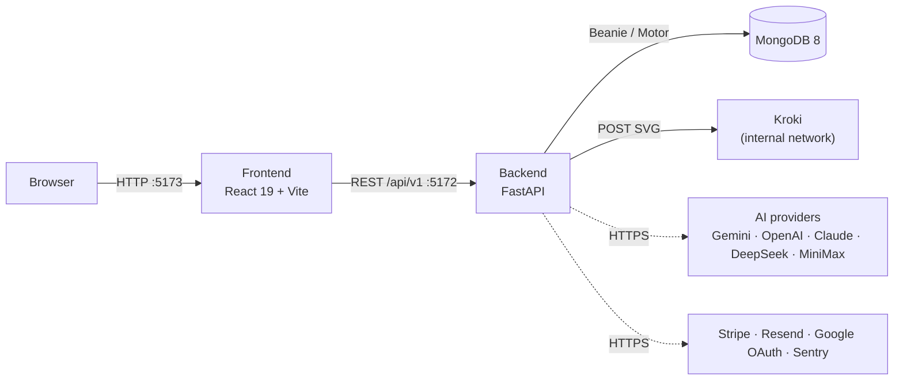
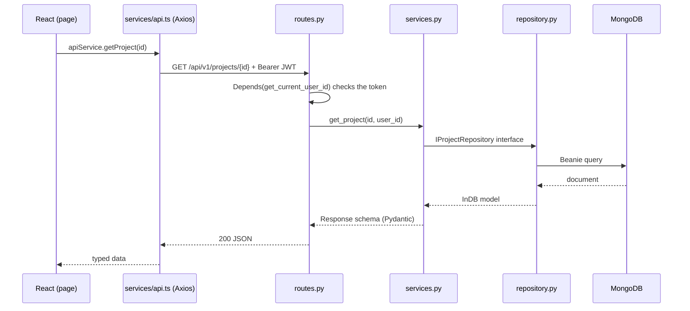
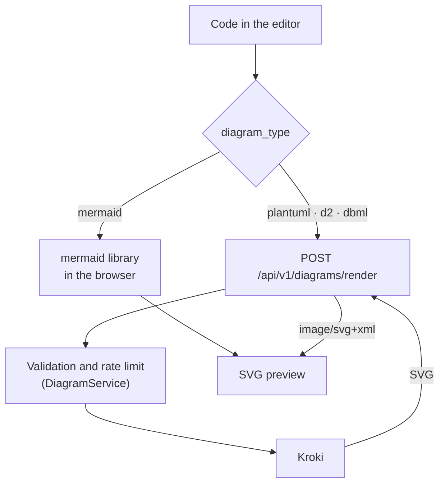
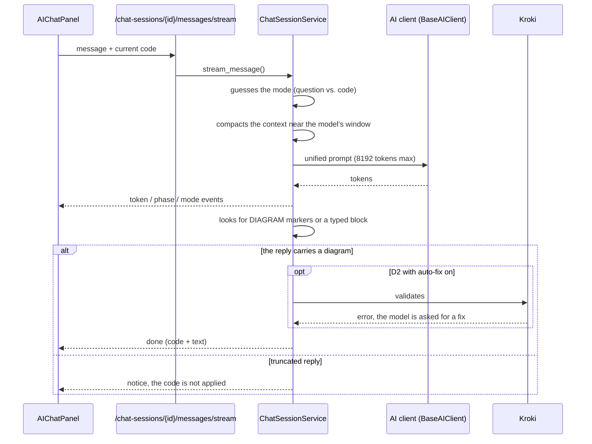

# Architecture

DiagramaHub is a modular monorepo with a **React 19 + Vite 7** frontend, a **FastAPI + MongoDB** API and **[Kroki](https://kroki.io/)** to render on the server the languages that aren't drawn in the browser. Everything is orchestrated with Docker Compose.

## Services



| Service | Technology | Purpose |
|---|---|---|
| Frontend | React 19 + TypeScript + Vite 7 + TailwindCSS v3 | UI, Monaco editor, client-side Mermaid rendering, whiteboard |
| Backend | FastAPI (`python:3.13-alpine` image) | API, business logic, Kroki proxy, AI calls |
| Kroki | `yuzutech/kroki` image | Server-side rendering of PlantUML, D2 and DBML |
| MongoDB | MongoDB 8 (or external in `external-mongodb` mode) | Persistence |

Third-party services (AI, Stripe, Resend, Google, Sentry) are optional: they are enabled by the operator's configuration or by each user's own API key (BYOL).

## Request flow

The backend follows a layered architecture with dependency inversion: routes only translate HTTP, services depend on **interfaces**, and repositories are the only layer that touches MongoDB.



If the API answers `401`, the Axios interceptor removes the token from `localStorage` and the app goes back to the login page.

## Diagram rendering

Mermaid is drawn in the browser; PlantUML, D2 and DBML are sent to the backend, which forwards them to Kroki and returns an SVG. Content never leaves your installation: Kroki runs inside the Docker network.



`/diagrams/render` is public (shared-link pages use it too), so it has its own per-IP rate limit (`diagrams/rate_limiter.py`).

## AI chat flow

The chat is the only UI entry point for generating or modifying diagrams with AI. The reply is streamed (Server-Sent Events, `chat_sessions/sse_events.py`).



Key points:

- **Markers**: the model wraps the code in `<<<DIAGRAM>>>` / `<<<END_DIAGRAM>>>` (or `<<<DIAGRAMA>>>` / `<<<END_DIAGRAMA>>>`). A reply with markers is always handled as code, even if the guessed mode was "question"; a block tagged with the diagram type holding a whole diagram counts too (except in Explain mode).
- **Truncation**: a reply cut at the token limit is never applied as code; the generation API answers `422 response_truncated` and an empty one `502 empty_response`.
- **Validation**: D2 is validated with Kroki on the server; Mermaid with the real parser in the browser, which asks the model once for a fix. PlantUML and DBML are not retried (they produced false positives). Everything obeys the user's `auto_fix_generated` setting.
- `<think>` tags from reasoning models are stripped.

## Repository layout

```text
diagramahub/
├── backend/            # FastAPI + Beanie (Poetry)
│   ├── app/
│   │   ├── main.py     # app, lifespan, middlewares, router registration
│   │   ├── core/       # config, security, rate limit, request limits
│   │   └── api/        # deps.py + v1/<module>/
│   └── tests/
├── frontend/           # React 19 + Vite 7 (pnpm)
│   └── src/
├── deploy/
│   ├── local-full/         # MongoDB 8 + Kroki + Backend + Frontend
│   └── external-mongodb/   # Kroki + Backend + Frontend (external MongoDB)
├── docs/               # this site (MkDocs Material)
├── scripts/            # check-version.sh, ai-benchmark/, test-helpers.sh
└── docker-compose.yml  # symlink to the deployment mode
```

More detail in [Backend](backend.md) and [Frontend](frontend.md).
