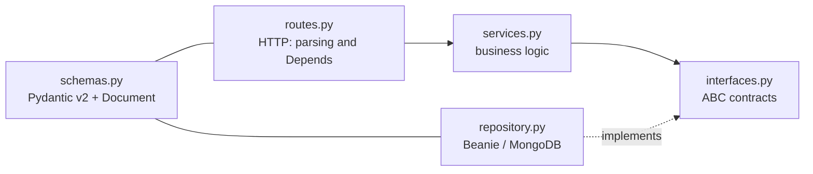

# Backend

REST API built with **FastAPI** on **MongoDB 8** through the **Beanie** ODM (async Motor driver). Dependencies are managed with **Poetry** (`backend/pyproject.toml`, Python `>=3.12,<3.14`; the Docker image uses Python 3.13).

## Layout

```text
backend/app/
├── main.py          # FastAPI, lifespan (init_beanie), middlewares, routers, Sentry
├── core/
│   ├── config.py         # Settings (pydantic-settings, reads backend/.env)
│   ├── security.py       # JWT + BCrypt
│   ├── rate_limit.py     # shared in-memory sliding-window limiter
│   ├── request_limits.py # ASGI middleware for the max body size (413)
│   └── clock.py          # naive UTC utcnow() (as Motor returns dates)
└── api/
    ├── deps.py      # get_current_user_email / get_current_user / get_current_user_id
    └── v1/<module>/ # one module per entity
```

## Module pattern

Each entity lives in its own folder under `backend/app/api/v1/` with the same layers:



| File | Responsibility |
|---|---|
| `interfaces.py` | Abstract base classes (ABC) with the repository contract |
| `repository.py` | Concrete Beanie implementation |
| `services.py` | Business logic; depends on the **interface**, never on the concrete repository |
| `schemas.py` | Pydantic v2 models: `Base`, `Create`, `Update`, `InDB` (Beanie `Document`) and `Response` |
| `routes.py` | `APIRouter`: HTTP only, delegates to the service |

!!! warning "Rule"
    Routes hold no business logic and services never import concrete repositories: they receive them already built (dependency injection with `Depends`).

## The 12 modules

| Module | Purpose | Files beyond the base pattern |
|---|---|---|
| `users/` | Registration, login, profile, password change and reset, account deletion, installation status | `audit_log.py`, `deletion_service.py`, `email_templates.py`, `rate_limiter.py` |
| `projects/` | Project CRUD; export (ZIP / AI-ready Markdown) and import (files, ZIP, Excalidraw) | `export_service.py`, `export_builders.py`, `import_service.py`, `import_parsers.py` |
| `diagrams/` | CRUD, move, duplicate, AI fix, conversion between types, syntax validation and the Kroki render proxy | `fix_service.py`, `fix_prompts.py`, `conversion_service.py`, `syntax_validator.py`, `config_utils.py`, `kroki_client.py`, `rate_limiter.py` |
| `folders/` | Folder CRUD inside a project | — |
| `ai_providers/` | The user's AI providers (encrypted keys), diagram and description generation/improvement | `clients/` (`base.py`, `factory.py` and one client per provider), `prompts.py`, `model_catalog.json`, `model_catalog.py` |
| `chat_sessions/` | AI chat sessions and messages, SSE streaming, context compaction | `sse_events.py` |
| `subscriptions/` | Plans, subscriptions, usage limits, Stripe (checkout, portal, webhooks) | `plan_repository.py`, `plan_service.py`, `subscription_repository.py`, `subscription_service.py`, `billing_service.py`, `usage_limiter.py`, `webhook_handler.py`, `webhook_routes.py`, `stripe_catalog_service.py`, `migration_service.py`, `payment_providers/`, `constants.py`, `exceptions.py`, `logger.py` |
| `shared_links/` | Diagram sharing links (public or code-protected), expiration, access log | `public_routes.py`, `rate_limiter.py` |
| `prompt_history/` | The user's AI prompt history | — |
| `integrations/` | Admin configuration of email, payment and OAuth vendors | `email_service.py`, `email_vendors/` (Resend), `vendor_factory.py` |
| `mfa/` | TOTP and email-code MFA, recovery codes, admin MFA management | `totp_service.py`, `admin_service.py`, `rate_limiter.py` |
| `oauth/` | OAuth 2.0 / OpenID Connect login (Google; extensible through `IOAuthProvider`) | `providers/` (`google.py`, `factory.py`) |

!!! info "Where data lives"
    MFA data is stored on the user document itself (`UserInDB`), which is why `mfa/` doesn't register a `Document` of its own.

## Registration in `main.py`

A new module doesn't exist for the app until it is registered in [`backend/app/main.py`](https://github.com/diagramahub/diagramahub/blob/main/backend/app/main.py):

1. Its `Document` in `init_beanie(document_models=[...])` inside the `lifespan`. Registered today: `UserInDB`, `ProjectInDB`, `DiagramInDB`, `FolderInDB`, `UserAISettingsInDB`, `PlanInDB`, `SubscriptionInDB`, `StripeConfigInDB`, `WebhookEventInDB`, `PromptHistoryInDB`, `ChatSessionInDB`, `ChatMessageInDB`, `SharedLinkInDB`, `AccessLogInDB`, `VendorConfigInDB`, `AuditLogEntry` and `OAuthStateToken`.
2. Its router with `app.include_router(router, prefix=settings.API_V1_PREFIX)`. AI providers are mounted under `/api/v1/ai`.
3. Public or webhook routes kept in separate files (`public_routes.py`, `webhook_routes.py`) are registered too.

`main.py` also sets up:

- **Middlewares**: body size limit (`MAX_REQUEST_BODY_BYTES`, with a larger budget for `POST /projects/{id}/import`), security headers and CORS with an explicit header list.
- **Production** (`APP_ENV=production`): Swagger, ReDoc and `openapi.json` disabled, HSTS and CSP on responses, and a handler that hides stack traces (`500 Internal server error`).
- **Sentry**: only when `SENTRY_DSN` is set, with sensitive-data sanitization in `before_send`.

## Configuration

[`backend/app/core/config.py`](https://github.com/diagramahub/diagramahub/blob/main/backend/app/core/config.py) defines `Settings` with `pydantic-settings`; values come from environment variables or `backend/.env`. The most relevant ones for development:

| Variable | Default | Use |
|---|---|---|
| `JWT_SECRET` | — (required) | Signs the JWTs |
| `MONGO_URI` / `DATABASE_NAME` | `mongodb://mongodb:27017` / `diagramahub` | MongoDB connection |
| `APP_ENV` | `production` | Use `development` locally to get Swagger |
| `KROKI_URL` | `http://kroki:8000` | Rendering service |
| `FRONTEND_URL` / `BACKEND_CORS_ORIGINS` | `http://localhost:5173` / empty | CORS (when empty, `FRONTEND_URL` is used) |
| `AI_ENCRYPTION_KEY` | — | Fernet key that encrypts AI API keys |

The full operator reference is in [Configuration](../self-host/configuration.md).

## Code quality

```bash
docker exec diagramahub-backend poetry run black app/
docker exec diagramahub-backend poetry run ruff check app/
docker exec diagramahub-backend poetry run mypy app/
```

Ruff and Black use `line-length = 100`. Every function has type hints and a docstring; API errors are raised with `HTTPException`.
