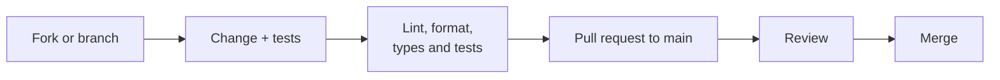

# Contributing

DiagramaHub is open source under the **Apache 2.0** license. Every contribution is published under that same license.

## Reporting a problem

- **Bugs and proposals**: open an issue on [GitHub](https://github.com/diagramahub/diagramahub/issues) with the steps to reproduce, what you expected, what happened, the version (shown in **About** or by `GET /`) and the diagram type if relevant.
- **Vulnerabilities**: do **not** open a public issue. Report them privately as explained in [Security](../security/index.md).

## How a change flows



1. Branch off `main` (or off the current `release/<V>` branch, if the change goes into that version).
2. Make the change following the architecture: [Backend](backend.md) and [Frontend](frontend.md).
3. Add tests: every new endpoint gets its test.
4. Run the checks (below).
5. Open a pull request against `main` explaining what changes and why.

## Before opening the PR

=== "Backend"

    ```bash
    docker exec diagramahub-backend poetry run black app/
    docker exec diagramahub-backend poetry run ruff check app/
    docker exec diagramahub-backend poetry run mypy app/
    docker exec diagramahub-backend poetry run pytest --cov-fail-under=60
    ```

=== "Frontend"

    ```bash
    cd frontend
    pnpm lint
    pnpm test
    pnpm build
    ```

=== "Documentation"

    ```bash
    mkdocs build --strict
    ```

## Style

| Area | Rule |
|---|---|
| Python | Ruff + Black (`line-length = 100`), mypy; type hints and a docstring on every function; `snake_case` |
| TypeScript | ESLint (`typescript-eslint`); `camelCase`; strict TypeScript |
| Validation | Pydantic models for every API input and output |
| Async | `async`/`await` throughout the backend |
| UI text | Never hardcoded visible strings: `t('key')` in `es.json` **and** `en.json` |
| UI | Per [`DESIGN.md`](https://github.com/diagramahub/diagramahub/blob/main/DESIGN.md) |
| Test credentials | Generated, never literal (see [Testing](testing.md#test-credentials)) |

## Commits and PRs

- Messages in English, imperative and descriptive; with a `fix:`, `feat:`, `docs:`, `chore:` style prefix when it helps.
- One topic per PR. Releases are merged as `Release <V>: <summary>`.
- If the change is user-visible, add the entry to `CHANGELOG.md` and to the current version's release notes (see [Versioning](versioning.md)).
