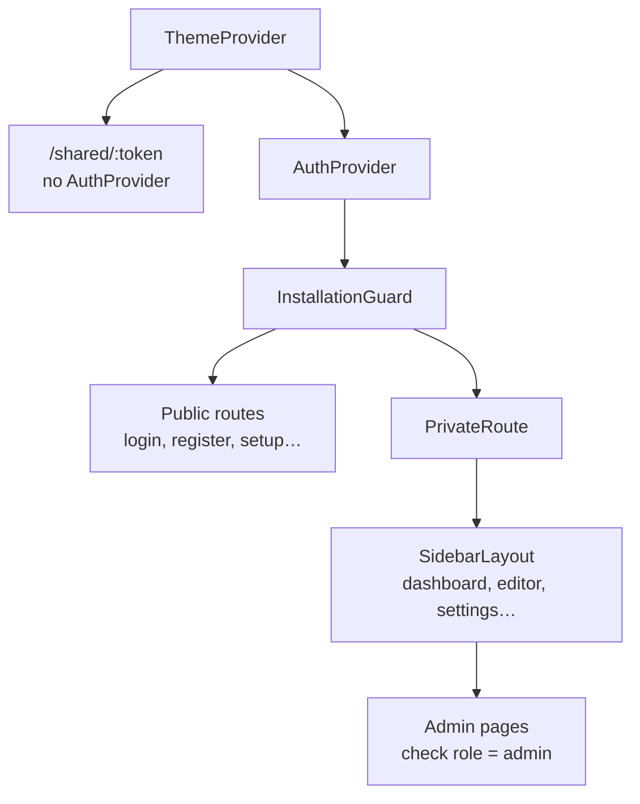

# Frontend

SPA in **React 19 + TypeScript** built with **Vite 7**, styled with **TailwindCSS v3** and routed with **React Router v7**. Packages with **pnpm**.

```bash
cd frontend
pnpm install
pnpm dev       # Vite with HMR on :5173
pnpm build     # tsc -b && vite build
pnpm lint      # ESLint
pnpm test      # Vitest
```

## `src/` layout

```text
frontend/src/
├── App.tsx          # providers + routes
├── main.tsx         # entry point + Sentry
├── index.css        # Tailwind directives + @layer components
├── pages/           # one page per route
├── components/      # reusable UI (+ admin/, annotations/, mfa/, subscription/)
├── contexts/        # AuthContext, ThemeContext, PresentationContext
├── services/        # api.ts (Axios + ApiService), streamConsumer.ts (chat SSE)
├── hooks/           # useIsMobile, useTouchZoomPan, useDialogA11y, …
├── types/           # types per domain (ai, auth, chat, project, sharing, …)
├── utils/           # rendering, export, whiteboard, sketch → Mermaid, … (+ __tests__/)
└── i18n/            # config.ts + locales/es.json, en.json
```

## Routes

Defined in [`frontend/src/App.tsx`](https://github.com/diagramahub/diagramahub/blob/main/frontend/src/App.tsx).



| Route | Page | Access |
|---|---|---|
| `/shared/:token` | `SharedDiagramPage` | Public, outside `AuthProvider` |
| `/setup` | `InstallationWizardPage` | Public (setup wizard) |
| `/login`, `/register` | `LoginPage`, `RegisterPage` | Public |
| `/forgot-password`, `/reset-password` | `ForgotPasswordPage`, `ResetPasswordPage` | Public |
| `/mfa-verify` | `MfaVerifyPage` | Public (second login step) |
| `/oauth/callback` | `OAuthCallbackPage` | Public (return from Google) |
| `/onboarding` | `OnboardingWizardPage` | Signed in |
| `/dashboard` | `DashboardPage` | Signed in |
| `/projects-list` | `ProjectsPage` | Signed in |
| `/projects/:projectId` | `DiagramEditorPage` | Signed in |
| `/projects/:projectId/diagrams/:diagramId` | `DiagramEditorPage` | Signed in |
| `/profile`, `/settings` | `ProfilePage`, `SettingsPage` | Signed in |
| `/subscription` | `SubscriptionPage` | Signed in |
| `/about` | `AboutPage` | Signed in |
| `/admin`, `/admin/users`, `/admin/plans`, `/integrations` | `AdminPage`, `UserManagementPage`, `PlansPage`, `IntegrationsPage` | Administrator |
| `/` | redirects to `/dashboard` | — |
| `*` | `NotFoundPage` | — |

- `InstallationGuard` sends you to `/setup` while there is no administrator.
- `PrivateRoute` redirects to `/login` without a session.
- Admin pages redirect to `/dashboard` when `user.role !== 'admin'`. That is navigation only: **the backend enforces the real authorization**.
- Editor routes are additionally wrapped in `PresentationProvider` (presentation mode).

## Global state

| Context | What it holds |
|---|---|
| `AuthContext` | User and JWT (in `localStorage`, key `token`); automatic logout on `401` |
| `ThemeContext` | Light/dark theme, persisted in `localStorage` under `theme` |
| `PresentationContext` | Whether the editor is in presentation mode |

## API layer

[`services/api.ts`](https://github.com/diagramahub/diagramahub/blob/main/frontend/src/services/api.ts) centralizes every call in the `ApiService` class (exported as `apiService`):

- Axios instance with `baseURL = API_URL`.
- Request interceptor: adds `Authorization: Bearer <token>` and `Accept-Language` with the UI language (errors and AI answer in that language).
- Response interceptor: on `401` it removes `token` and `user` and goes back to the login page.
- The chat stream is consumed with `fetch` + SSE in `services/streamConsumer.ts`.

`API_URL`, `SENTRY_DSN` and `APP_ENV` come from [`utils/runtimeConfig.ts`](https://github.com/diagramahub/diagramahub/blob/main/frontend/src/utils/runtimeConfig.ts) with this precedence: `window.__DH_CONFIG__` (injected into `/config.js` when the production image starts), then the build-time `VITE_*` variables, and finally localhost defaults. That way the same image works for any domain.

## Internationalization

- i18next + react-i18next, configured in `src/i18n/config.ts`. Spanish by default (`fallbackLng: 'es'`), English available; the language is stored in `localStorage` under `language`.
- **Every** visible string is written with `t('key')` and the key exists in `es.json` **and** `en.json`. The `i18nParity.test.ts` test fails if the files don't have exactly the same keys.

## Design system (summary)

The mandatory reference is [`DESIGN.md`](https://github.com/diagramahub/diagramahub/blob/main/DESIGN.md). The essentials:

- **No UI or icon libraries**: TailwindCSS and in-house components only; inline Heroicons-style SVG icons.
- **Purple identity**: `bg-purple-600` / `hover:bg-purple-700`; primary button `.btn-glass`. Danger in `red-600`, success in `green-600`.
- **Dark mode everywhere**: `darkMode: 'class'` and `dark:` variants on every color.
- **No colors in `style`**: Tailwind classes only; custom CSS only in `index.css` under `@layer components`.
- **Minimum accessibility**: semantic `<button>`/`<a>` elements, `aria-label` on text-less controls, visible focus `focus:ring-2 focus:ring-purple-500`, AA contrast.
- New pages in `pages/` + route in `App.tsx`; reusable UI in `components/`.
