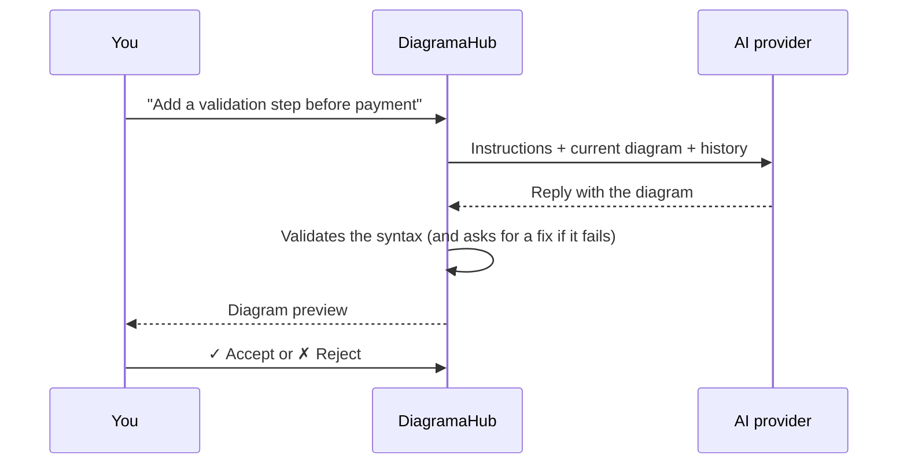

# AI assistant

DiagramaHub follows a **BYOL** model (*Bring Your Own LLM*): you connect **your own API key** from an AI provider, and DiagramaHub uses it to generate, improve, fix and explain diagrams. Model usage is billed to **your provider account**, not by DiagramaHub.

## Supported providers

| Provider | Where to get the API key |
|---|---|
| **Google Gemini** | [Google AI Studio](https://aistudio.google.com/app/apikey) |
| **OpenAI GPT** | [OpenAI Platform](https://platform.openai.com/api-keys) |
| **Anthropic Claude** | [Anthropic Console](https://console.anthropic.com/settings/keys) |
| **DeepSeek** | [DeepSeek Platform](https://platform.deepseek.com/api_keys) |
| **Minimax** | [Minimax Platform](https://platform.minimax.io/user-center/basic-information) |

## Configure a provider

1. Go to **Settings → AI Integrations**.
2. Click **Add Provider** and choose the provider.
3. Paste your **API Key** and choose the **Model**. The suggested model is marked **Recommended**.
4. Optionally give it a **Custom name** (for example "My Gemini account").
5. Use **Test Connection** to check the key before saving it.

If the test fails, the message tells you why: invalid key or missing permissions, an account with no credits, the provider's rate limit, or a model that is not available for that key.

You can connect several providers. Mark one with **Use as default** and temporarily turn off the ones you don't want to use with **Active**. A connection's provider cannot be changed: if you want another one, create a new connection.

??? note "Available models (0.8.x)"
    The list comes from the server's model catalog. It may change between versions.

    | Provider | Models | Recommended |
    |---|---|---|
    | Google Gemini | `gemini-3.8-flash`, `gemini-3.7-flash`, `gemini-3.5-flash`, `gemini-3.5-flash-lite`, `gemini-3.1-pro-preview` | `gemini-3.8-flash` |
    | OpenAI GPT | `gpt-6-luna`, `gpt-6.1-sol`, `gpt-6-astra`, `gpt-5.5`, `gpt-5.4-mini`, `gpt-5.4-nano`, `gpt-4.1-mini` | `gpt-6-luna` |
    | Anthropic Claude | `claude-sonnet-5-5`, `claude-opus-5-5`, `claude-fable-5-1`, `claude-haiku-4-5-20251001` | `claude-sonnet-5-5` |
    | DeepSeek | `deepseek-flash`, `deepseek-v4-pro` | `deepseek-flash` |
    | Minimax | `MiniMax-M2.7`, `MiniMax-M3`, `MiniMax-M2.7-highspeed` | `MiniMax-M2.7` |

    If a model you already had configured leaves the list, it is shown as **retired**. It keeps working as long as the provider offers it, and you can change it when editing the connection.

!!! info "Your key is protected"
    - The key is stored **encrypted** in the database.
    - It is never returned in full: the UI only shows a masked version (for example `AIza...xyz`).
    - When editing a connection, leave the field empty to keep the current key.
    - The DiagramaHub server is what calls the provider. Your diagram's code and your messages are sent to the provider you chose, under its own privacy policies.

## The AI chat

In the editor, open **AI Chat**. The chat is the main way to create and modify diagrams with AI: describe what you want in plain language and the assistant replies with the complete diagram.

### Quick actions

Below the message box there are four shortcuts:

| Action | What it asks the model |
|---|---|
| 🧠 **Explain** | To explain the diagram clearly and briefly. It does not change the diagram. |
| 🎨 **Improve UI** | To make it clearer, cleaner and easier to read. |
| ⚙️ **Improve Process** | To improve the process it represents so it is more efficient. |
| 🛠️ **Fix** | To fix syntax, structure or rendering errors and return the complete diagram. |

### Review the changes

When the assistant proposes a diagram, the chat shows a **Diagram preview** (with **View larger**):

- **✓ Accept** applies the change to the editor.
- **✗ Reject** discards it.
- On earlier proposals you can use **↩ Restore** or **↩ Use** to go back to that version.

### Chat sessions

Each diagram has its own chat **sessions**. You can start a **New session**, switch between sessions, rename or delete them, and pick each session's **Model**.

When a conversation gets close to the model's context limit, DiagramaHub **summarizes it automatically** and continues in a new session that starts from that summary. The previous session is marked **Session finished (read-only)**: you can read it, but you can no longer send messages to it.

### Language

The assistant replies in the UI language (Spanish or English), including the labels of the diagrams it generates.

## Automatic fixing

With **Fix generated diagrams automatically** (in **Settings → AI Integrations**, on by default), if the Mermaid or D2 code the AI generates cannot be rendered, DiagramaHub asks the model for **one fix** before showing it to you:

- **Mermaid** is validated in your browser with the same engine that draws the diagram.
- **D2** is validated on the server.
- **PlantUML and DBML** are not fixed automatically: their validation produced false positives.

!!! tip "Each automatic fix uses one extra call on your key"
    If you prefer to control usage, turn this option off and use **Fix** only when you need it.

## Fix with AI from the editor

If the diagram has an error, the code panel shows a **Fix with AI** button. The proposal is shown next to the original code so you can review the changes before applying them.

## Replies that are too long

If the diagram the model generates is so large that the reply is cut off at the output limit, DiagramaHub does **not** apply that incomplete code. Instead, the chat tells you the reply was cut off. Ask for a smaller diagram or build it in parts.

## Other AI features

- **AI description**: in the diagram description, **Generate with AI** proposes a text. You can **Refine** it with instructions ("make it shorter", "more technical detail") before you **Accept** it.
- **Convert diagram type**: converts the diagram to another format (for example from PlantUML to Mermaid). The conversion is shown in a preview with warnings about possible incompatibilities and is applied only when you click **Apply conversion**. More in [The editor](editor.md).

## No provider configured

If you try to use an AI feature without an active provider, you will see **AI Configuration Required** with a **Go to Configuration** shortcut.
