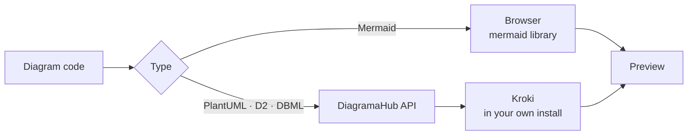

# Diagram types

DiagramaHub supports four text-based diagram languages plus a freehand whiteboard. You pick the type when creating the diagram and can change it later with **Convert diagram type** (see [The editor](editor.md#convert-to-another-type)).

| Type | Best for | Where it renders | Download extension |
|---|---|---|---|
| [Mermaid](#mermaid) | Flowchart, sequence, class, state, ER, Gantt | In your browser | `.mmd` |
| [PlantUML](#plantuml) | UML, class, component, sequence, activity | On the server (Kroki) | `.puml` |
| [D2](#d2) | Declarative architecture and system diagrams | On the server (Kroki) | `.d2` |
| [DBML](#dbml) | Database tables, columns and relationships | On the server (Kroki) | `.dbml` |
| [Freehand](whiteboard.md) | Free sketches with shapes and arrows | In your browser | `.freehand.json` |



!!! info "Your content stays in your installation"
    PlantUML, D2 and DBML are rendered with [Kroki](https://kroki.io/). In Docker Compose installs, Kroki runs as one more service next to DiagramaHub (`KROKI_URL`, see [Configuration](../self-host/configuration.md)), so your diagrams are not sent to a public service.

## Mermaid

[Mermaid](https://mermaid.js.org/) is the most versatile type: flowcharts, sequence, class, state, entity-relationship and Gantt diagrams, among others. It renders in your browser, so the preview is instant.

=== "Code"

    ```text
    graph TD
      A[Start] --> B[End]
    ```

=== "Result"

    ```mermaid
    graph TD
      A[Start] --> B[End]
    ```

### Appearance options

Under **Appearance** you can set:

| Option | Values |
|---|---|
| **Theme** | Default, Base (customizable), Dark, Forest, Neutral |
| **Layout** | Dagre, ELK |
| **Style** | Classic, Neo, Hand Drawn (sketch look) |
| Line type | Basis (smooth), Linear (straight), Step, Step Before, Step After |
| Font | Default, Arial, Helvetica, Verdana, Trebuchet MS, Georgia, Courier New, Times New Roman |
| Font size | 12, 14, 16, 18 or 20 px |

These options are stored inside the diagram code itself as a Mermaid init block (`%%{init: ...}%%`), so they travel with the code when you copy or export it.

!!! tip
    New Mermaid diagrams use a **Grid** background by default; the other types use **Plain**. Change it under **Appearance**.

## PlantUML

[PlantUML](https://plantuml.com/) is the standard for UML: class, component, sequence, activity, use case and more. The code goes between `@startuml` and `@enduml`.

```text
@startuml
Alice -> Bob: Hello
Bob -> Alice: Hi!
@enduml
```

### Themes

Under **Appearance** you choose a PlantUML **Theme**. DiagramaHub inserts the `!theme <name>` directive right after `@startuml`:

| Group | Themes |
|---|---|
| Modern styles | sketchy, sketchy-outline, blueprint, minty, spacelab |
| Color | bluegray, cerulean, cerulean-outline, materia, materia-outline, lightgray, plain |
| Dark | cyborg, cyborg-outline, superhero, superhero-outline, black-knight, hacker |
| Retro | amiga, crt-amber, crt-green, metal |
| Other | resume-light, unitide |

You can also write `skinparam` directives directly in the code.

## D2

[D2](https://d2lang.com/) is a declarative language built for architecture and system diagrams: you describe the connections and D2 handles the layout. The editor ships its own D2 syntax highlighting.

```text
x -> y: hello world
```

### Themes

The D2 **Theme** is stored in the code as a `vars` block:

```text
vars: {
  d2-config: {
    theme-id: 200
  }
}
x -> y: hello world
```

| Group | Themes (id) |
|---|---|
| Light | Default (0), Neutral Grey (1), Flagship Terrastruct (3), Cool Classics (4), Mixed Berry Blue (5), Grape Soda (6), Aubergine (7), Colorblind Clear (8), Vanilla Nitro Cola (100), Orange Creamsicle (101), Shirley Temple (102), Earth Tones (103), Everglade Green (104), Buttered Toast (105) |
| Dark | Dark Mauve (200), Dark Flagship Terrastruct (201) |
| Special | Terminal (300), Terminal Grayscale (301), Origami (302) |

## DBML

[DBML](https://dbml.dbdiagram.io/) (*Database Markup Language*) defines a database's tables, columns and relationships. It is ideal for documenting schemas.

```text
Table users {
  id integer [primary key]
  username varchar
  email varchar
  created_at timestamp
}

Table posts {
  id integer [primary key]
  title varchar
  body text
  user_id integer
  created_at timestamp
}

Ref: posts.user_id > users.id
```

DBML has no themes: under **Appearance** you only set the background color and pattern.

## Syntax validation

As you type, the editor checks the syntax and shows **No errors** or **Syntax error** in the code panel. With an AI provider configured you can use **Fix with AI** (see [AI assistant](ai.md)).

## Which one should I pick?

| If you want… | Use |
|---|---|
| A quick flowchart, sequence or Gantt with an instant preview | Mermaid |
| Formal, detailed UML | PlantUML |
| System architecture with automatic layout and polished themes | D2 |
| To document a database schema | DBML |
| To think out loud, no syntax | [Freehand](whiteboard.md) |
