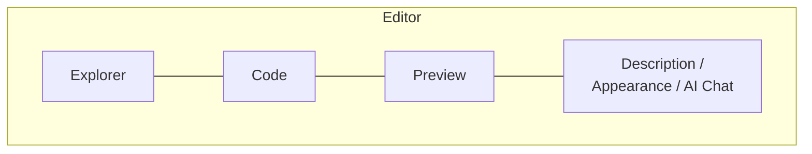

# The editor

The editor is where you write, view and adjust each diagram. It is split into panels you can show or hide from the top bar.

## Code and preview

Click **Code** to open the code panel, built on the Monaco editor (the engine behind VS Code): line numbers, syntax highlighting (D2 has its own highlighter), undo/redo, and colors that follow the app's light or dark theme.

- The **preview** updates as you type (with a short pause so it doesn't re-render on every keystroke).
- The panel footer shows the line count and the syntax status: **No errors** or **Syntax error**.
- **Copy code** copies the code to the clipboard.
- Resize the panel by dragging its edge.

!!! tip "Syntax errors"
    When the diagram has an error, the preview shows the message and a checklist of usual suspects (valid diagram type, arrows, unescaped characters, balanced quotes). The code panel shows a **Fix with AI** button (requires a configured AI provider): it proposes a fix with an explanation of the changes and shows the **Original code** next to the **Fixed code** before you click **Apply fix**. See [AI assistant](ai.md).

## Autosave

There is no save button: **changes save themselves**.

- Code, title, description and appearance are saved about 1.5 seconds after you stop typing.
- The bar shows the status (**Saving...**, **Saved** and how long ago: "Saved 2m ago").
- Saves never overwrite each other: if one is slow, the next one waits for it to finish.

## Zoom and view position

| Action | How |
|---|---|
| Zoom in / out | Zoom buttons in the bar, or the mouse wheel over the preview |
| Fit to screen | **Fit to screen** button |
| Back to 100% | **Reset view (100%)** button |
| Move the view | Drag the preview (on mobile, pinch and drag) |

!!! info "The view is remembered per diagram"
    Zoom level and position are saved with each diagram (about a second after you stop moving), so when you reopen it you find it exactly where you left it. Moving the view does not count as editing the diagram.

## Explorer

**Explorer** opens the project tree with its folders and diagrams. Shortcut: ++ctrl+b++ (++cmd+b++ on macOS).

- **Search diagram...** filters the tree by name and shows how many match.
- Drag a diagram onto a folder to move it, or onto the root to take it out of the folder.
- Each diagram's menu offers **Rename**, **Duplicate**, **Move to folder**, **Move to another project** and **Delete**.
- Folders have a **Color**, **New diagram here**, editing and deletion.
- Resize the explorer; double-click its edge to reset it.

More on organizing in [Projects and folders](organization.md).

## Description

**Description** opens a panel to document the diagram in **Markdown** (with a visual editor). Use it to explain decisions, context or pending work.

- **Pin panel** keeps it open next to the preview.
- You can change the text size and the panel width; those preferences are remembered per diagram.
- The description can be included when exporting to PDF or Markdown (see [Export and import](export-import.md)).

## Appearance

**Appearance** opens the visual options of the diagram. What you see depends on the type:

| Type | Options |
|---|---|
| Mermaid | Theme, layout, style, line type, font and font size |
| PlantUML | Theme |
| D2 | Theme |
| DBML | Background only |
| All | **Background color** and **Background pattern** (**Plain**, **Dots**, **Grid**) |

Themes and styles per language are detailed in [Diagram types](diagram-types.md). Background color and pattern belong to the viewer: they don't change the diagram's code.

## Title, move and duplicate

- Click the diagram title to edit it (++enter++ saves, ++esc++ cancels).
- **Move diagram** sends it to another project (it lands at the root of the target project).
- **Duplicate diagram** creates a copy in the same project with the "-copy" suffix.

## Convert to another type

**Convert diagram type** rewrites the diagram in another language (for example, from PlantUML to Mermaid) using your AI provider:

1. Pick the format under **Convert to**.
2. Review the **Conversion preview**: the original next to the converted version, as preview or code, with warnings about possible incompatibilities.
3. Click **Apply conversion**: the diagram's content and type are updated to the target format.

!!! warning "Conversion may not be exact"
    Each language has its own elements and styles; check the preview before applying. Requires a configured AI provider.

For freehand whiteboards the menu offers **Sketch → Mermaid**, an AI-free conversion described in [Freehand whiteboard](whiteboard.md#sketch-mermaid).

## Editor shortcuts

| Shortcut | Action |
|---|---|
| ++ctrl+b++ / ++cmd+b++ | Show or hide the explorer |
| ++esc++ | Leave presentation mode |
| ++enter++ / ++esc++ | Save / cancel title editing |

Whiteboard shortcuts are listed in [Freehand whiteboard](whiteboard.md#keyboard-shortcuts).
