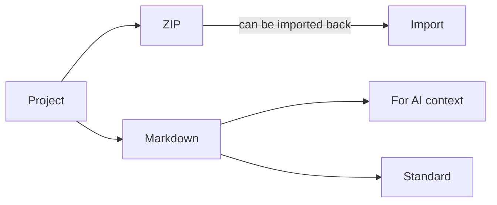

# Export and import

You can take your diagrams out of DiagramaHub in two ways: **one at a time**, as an image or document, or **per project or folder**, as a ZIP or Markdown file. You can also import diagram files, ZIP archives and Excalidraw drawings.

## Export a diagram

In the editor, open **Export Diagram** and pick a format:

| Format | Use it for | Options |
|---|---|---|
| **PNG** | Raster image for slides, chats or documents. | **PNG resolution**: Screen (1x), Standard (2x) or High (3x). |
| **SVG** | Scalable vector, no quality loss. | Exported as a clean vector, without a header. |
| **PDF** | A document to print or attach. | Description and project information. |
| **Markdown** | An `.md` file with the diagram's code in a code block. | Description and project information. |

For PNG, PDF and Markdown you can turn on:

- **Include diagram description**
- **Include project information** (project, folder, author)

!!! info "Freehand sketches"
    A [sketch](whiteboard.md) can only be exported as **PNG**. It also has a **Transparent background** option that removes the canvas background.

### Download the source code

In the same dialog, **Download source code** saves the diagram as text, with the extension of its type:

| Type | Extension |
|---|---|
| Mermaid | `.mmd` |
| PlantUML | `.puml` |
| D2 | `.d2` |
| DBML | `.dbml` |
| Sketch | `.freehand.json` |

These files can be [imported](#import-diagrams) back.

## Export a project or a folder

Use **Export project** or **Export folder** and choose:

1. **Scope**: **Whole project** (the root and every folder) or **One folder**.
2. **Format**:

    === "ZIP — folders and individual files"

        One file per diagram with its extension (`.mmd`, `.puml`, `.d2`, `.dbml`, `.freehand.json`), inside one folder per project folder. If you turn on **Include descriptions**, each diagram comes with an `.md` next to it holding its description.

        The ZIP includes a `README.md` with an index and a `manifest.json` with what is needed to **import it back**: titles, folders and their colors.

    === "Markdown — a single file"

        Every diagram in a single `.md`, with one code block per diagram. It has two variants:

        - **For AI context**: adds a preamble that explains the file to the model, an index with paths and each diagram's metadata. It is meant to be pasted into an AI assistant as context about your project.
        - **Standard**: a clean document with title, sections, descriptions and code.

        Sketches have no text source. In the Markdown they appear as a note listing the texts they contain.

Before downloading, the dialog shows a summary of what you will get: number of diagrams, folders and size. In the AI variant it also shows a **token** estimate.

!!! note "What does not travel with an export"
    Each diagram's **title, type, code and description** is exported, plus folders with their colors. The visual settings stored separately (theme, background, view position and zoom) and shared links are **not** exported.

## Import diagrams

Use **Import files** in the project or **Import here** on a folder. You can also drag the files onto the file browser.

### Accepted files

| File | Result |
|---|---|
| `.mmd`, `.mermaid` | Mermaid diagram |
| `.puml`, `.plantuml`, `.pu`, `.iuml` | PlantUML diagram |
| `.d2` | D2 diagram |
| `.dbml` | DBML diagram |
| `.freehand.json` | DiagramaHub sketch |
| `.excalidraw`, `.excalidraw.json` | Excalidraw drawing, converted to a sketch |
| `.md`, `.markdown`, `.txt` | One diagram, if the file contains a diagram code block |
| `.zip` | Several diagrams, with their folders |

In a Markdown file, the code block becomes the diagram. A leading `# …` heading is used as the diagram title and the rest of the text as its description.

### Preview before importing

Before anything is created, DiagramaHub shows you a **Preview**:

- which diagrams and folders will be created;
- which files will be skipped and why (for example "unrecognised type" or "ZIP inside another ZIP");
- where your diagram quota will end up ("You will be at 12 of 30 diagrams of your plan").

### How a ZIP is imported

- Folders come from the **first level** of paths in the ZIP. If everything sits inside a single top-level folder, the next level is used. Deeper levels are merged into their first-level folder.
- An `.md` with the same name as a diagram (`flow.md` next to `flow.mmd`) becomes its description.
- If a folder with the same name already exists (case-insensitive), it is reused.
- If the ZIP is a DiagramaHub export, the original titles and folder colors are restored as well.

### Import from Excalidraw

`.excalidraw` drawings are converted into a [sketch](whiteboard.md). Rectangles, diamonds, ellipses, arrows, lines, texts and freedraw strokes are kept. A text bound to a shape becomes its label. Images, frames, embeds and any other element are skipped; the preview tells you how many and marks the import as **partial**.

### Guarantees and limits

!!! success "All or nothing"
    - Your plan quota is checked **before** anything is created. If the import would exceed it, nothing is imported.
    - If something fails midway, whatever was already created is undone.

| Limit | Default value |
|---|---|
| Total upload size | 20 MB |
| Files per import | 500 |
| Uncompressed ZIP size | 50 MB |
| Single file size | 5 MB |

The instance operator can adjust these values. There is also a per-minute cap on imports and exports. If you hit it, the message tells you how many seconds to wait.
