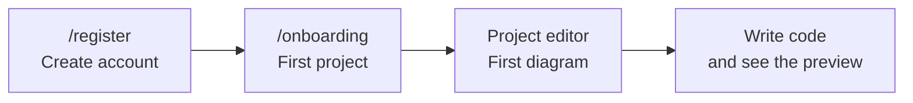

# Getting started

In a few minutes you will have an account, a project and your first diagram.



## 1. Create your account

Open your DiagramaHub instance (for example `http://localhost:5173` on a local install) and go to **Register**.

- Enter your email, your name (optional) and a password.
- If the administrator enabled Google sign-in, you can also sign up with that button.

!!! info "Password requirements"
    The password must be **at least 12 characters** long and include an uppercase letter, a lowercase letter, a digit and a special character. It cannot be the same as your email. A meter shows its strength as you type.

Every new account automatically gets the instance's free plan. The project and diagram limits of each plan are set by whoever runs the installation.

??? note "Opening the instance for the first time?"
    If nobody has set up the installation yet, DiagramaHub first takes you to the setup wizard (`/setup`) to create the administrator account. See [Installation](../installation.md).

## 2. Create your first project

After signing up you land on the welcome wizard, which asks you to create your first project:

1. Pick an icon.
2. Type the project name (required) and, optionally, a description.
3. Click **Create project and continue →**.

If you close the wizard you go back to **Home** (the dashboard), where you can create projects at any time with **Create project**.

## 3. Create your first diagram

When the project opens, the **Create your first diagram!** dialog appears:

1. Give it a descriptive name.
2. Choose the **Diagram type**:

    | Type | Use it for |
    |---|---|
    | **Mermaid** | Flowchart, sequence, class, state, ER, Gantt |
    | **PlantUML** | UML, class, component, sequence, activity |
    | **D2** | Declarative diagramming language |
    | **DBML** | Database tables, columns and relationships |
    | **Freehand** | Free whiteboard to draw with basic shapes |

3. Optionally pick a **Folder (optional)** (or leave it at the project root).
4. Click **Create diagram and start →**.

The diagram is created with a minimal example of the chosen type so you immediately see how it renders. For example, a new Mermaid diagram starts like this:

```text
graph TD
  A[Start] --> B[End]
```

More about each language in [Diagram types](diagram-types.md).

## 4. A tour of the interface

### Sidebar

The sidebar takes you around the app:

| Item | What you'll find |
|---|---|
| **Home** | A summary of your workspace: projects, diagrams, last activity, current plan, recently updated diagrams and AI engine usage |
| **Projects** | The list of all your projects |
| **Profile** | Your details, password and two-step verification (MFA) |
| **Settings** | Your AI providers (BYOL) and account deletion |
| **Subscription** | Your plan and its usage |
| **Language** / **Toggle theme** | Spanish or English; light or dark mode |

Administrators also see an **Administration** section (users, plans and integrations).

### The editor

Opening a diagram takes you to the editor. The top bar groups its tools:

| Button | What it does |
|---|---|
| **Explorer** | Tree of the project's folders and diagrams (++ctrl+b++ / ++cmd+b++) |
| **Code** | Panel with the diagram's code |
| **Description** | Markdown notes for the diagram |
| **Appearance** | Theme, style and background of the diagram |
| **AI Chat** | Assistant to generate or modify the diagram |
| **New Diagram** | Creates another diagram in the project |
| **Export Diagram** / **Share diagram** | Downloads and public links |
| **Convert diagram type** | Rewrites the diagram in another language |
| Zoom | Zoom out, zoom in and fit to screen |
| **Present** | Full-window presentation mode |

Everything is covered in detail in [The editor](editor.md).

!!! tip "Next step"
    Set up an AI provider under **Settings** to generate diagrams from a plain-language description. See [AI assistant](ai.md).
