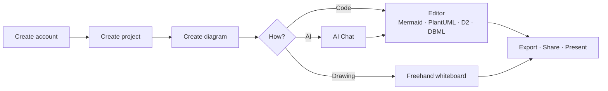

# User guide

This guide covers everyday use of DiagramaHub: creating diagrams as code or freehand, organizing them into projects and folders, exporting and sharing them, and using AI with your own key (BYOL).

If you are installing or running your own instance, see the [Self-host](../self-host/index.md) section.

-   :material-rocket-launch: **Getting started**

    ---

    Create your account, your first project and your first diagram, and learn the interface.

    [:octicons-arrow-right-24: Get started](getting-started.md)

-   :material-code-braces: **The editor**

    ---

    Code, live preview, autosave, explorer, description and appearance.

    [:octicons-arrow-right-24: Learn the editor](editor.md)

-   :material-shape: **Diagram types**

    ---

    Mermaid, PlantUML, D2 and DBML: examples, themes and options for each.

    [:octicons-arrow-right-24: See the types](diagram-types.md)

-   :material-draw: **Freehand whiteboard**

    ---

    Draw hand-drawn shapes and arrows and turn them into Mermaid.

    [:octicons-arrow-right-24: Use the whiteboard](whiteboard.md)

-   :material-folder-multiple: **Projects and folders**

    ---

    Organize, move, duplicate and search your diagrams.

    [:octicons-arrow-right-24: Organize](organization.md)

-   :material-swap-horizontal: **Export and import**

    ---

    PNG, SVG, PDF, Markdown, project ZIPs and Excalidraw files.

    [:octicons-arrow-right-24: Export and import](export-import.md)

-   :material-share-variant: **Sharing diagrams**

    ---

    Public or access-code protected links with expiration.

    [:octicons-arrow-right-24: Share](sharing.md)

-   :material-presentation: **Presentation mode**

    ---

    Show your diagram full-window, without distractions.

    [:octicons-arrow-right-24: Present](presentation.md)

-   :material-robot: **AI assistant**

    ---

    Generate, improve, fix and convert diagrams with your own AI provider.

    [:octicons-arrow-right-24: Use AI](ai.md)

-   :material-account-lock: **Your account and security**

    ---

    Profile, password, two-step verification (MFA) and account deletion.

    [:octicons-arrow-right-24: Your account](account.md)

## A typical journey

!!! tip "Language and theme"
    The interface is available in Spanish and English. Change the language and switch between light and dark mode from the sidebar; both preferences are remembered in your browser.
