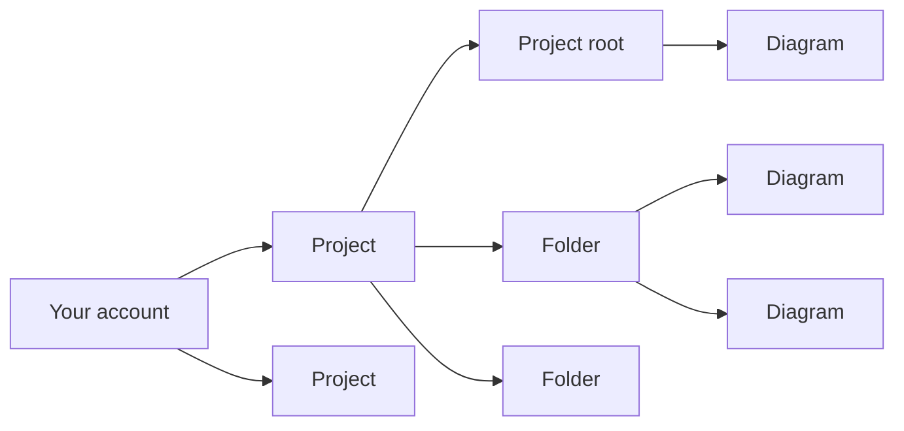

# Projects and folders

DiagramaHub organizes your work in three levels: **projects**, **folders** and **diagrams**.

- A **project** groups related diagrams (a system, a client, a course…).
- A **folder** lives inside a project and groups diagrams. Folders have a single level: there are no folders inside folders.
- A **diagram** always belongs to a project and, optionally, to a folder. If it is in no folder, it appears in the **Project root**.

## Projects

### Create a project

From the **Dashboard** or the **Projects** section, use **Create project**. Each project has:

| Field | Detail |
|---|---|
| Project name | Required. |
| Description | Optional. |
| Project icon | An icon to recognize it in lists. |

To change these details, use **Edit project**.

### Delete a project

**Delete project** removes the project **together with all its diagrams and folders**. It cannot be undone.

!!! tip "Back it up first"
    If in doubt, first [export the project as a ZIP](export-import.md#export-a-project-or-a-folder). That file can be imported back.

## The file browser

Inside the editor, the side browser shows the project tree: folders first, then the diagrams in the root. From there you can:

- **Search** diagrams by name. The counter shows how many match ("3 of 12 diagrams").
- Create a diagram with **New diagram here**, right in the root or in a folder.
- **Create folder**, rename it and pick its **Color**.
- Drag files from your computer to [import them](export-import.md#import-diagrams) into the root or a folder.
- Resize the panel by dragging its edge. Double-click it to restore the original width.

## Move, duplicate and delete diagrams

Each diagram's actions menu offers:

| Action | What it does |
|---|---|
| **Rename** | Changes the diagram title. |
| **Duplicate** | Opens **Duplicate diagram**: creates a copy in the same project. The suggested name ends in `-copy` and you can change it. |
| **Move to folder** | Moves it to another folder in the same project, or to the root. |
| **Move to another project** | Moves it to another of your projects. It lands in the destination project's **root**. |
| **Delete** | Removes the diagram. If it had an active shared link, the link is revoked. |

You can also **drag** a diagram in the browser and drop it on a folder. If you drop it on the "Drop here to move it out of the folder" area, it goes back to the root.

!!! note "A copy counts as a new diagram"
    Duplicating creates one more diagram, so it counts against your plan's limit, just like creating one from scratch.

## Delete a folder

When you delete a folder that contains diagrams, DiagramaHub lets you choose what happens to them:

=== "Keep the diagrams"

    The folder goes away and its diagrams move to the **project root**. Nothing is lost.

=== "Delete the diagrams too"

    The folder is deleted together with all its diagrams. It cannot be undone.

## Your plan's limits

Whoever operates the DiagramaHub instance defines the plans: how many **projects** and how many **diagrams** each one allows. If you are the operator, see [Plans and limits](../self-host/plans.md).

- The diagram limit is for your **whole account**: diagrams from all your projects add up.
- A plan can have no limit. In that case the UI shows **Unlimited**.
- Limits are enforced on the server. If you hit the limit when creating, duplicating or importing, you will see **Plan limit reached** with a link to **See available plans**.
- Administrator accounts have no limits.

Your current usage is shown in **Subscription → Resource Usage**. More in [Your account and security](account.md#subscription).
