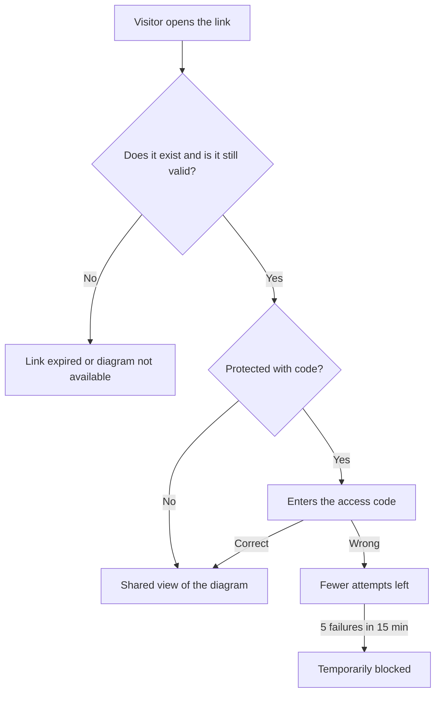

# Sharing diagrams

You can share a diagram with anyone through a **link**. Whoever opens it does not need a DiagramaHub account: they see the diagram in read-only mode.

## Create a link

1. Open the diagram in the editor. If it is new, save it first: an unsaved diagram cannot be shared.
2. Use **Share diagram**.
3. Configure the link:

| Option | Values |
|---|---|
| **Access type** | **Public**: anyone with the link can see it. **Protected with code**: the visitor must enter an access code. |
| **Access code** | Protected links only. 4 to 20 characters. Type one or use **Generate**. If you leave it empty, one is generated automatically. |
| **Link expiration** | 5, 10 or 30 days, or **Unlimited**. The default is 30 days. |
| **Allow copying diagram code** | When on, visitors can see and copy the source code. |

4. Click **Generate link** and use **Copy link**.

!!! warning "Save the access code when you create it"
    The code is shown **only when you create the link**. DiagramaHub stores only a hashed version of the code, so it cannot show it again later. If you lose it, create a new link.

## One active link per diagram

Each diagram has at most **one active link**. If you generate a new one, the previous link stops working. While a link is active, the editor says "This diagram has an active shared link".

The link always shows the **current version** of the diagram: if you edit it, visitors see the changes the next time they open the link.

## Revoke a link

In **Share diagram**, use **Revoke link**. The link stops working immediately. If you delete the diagram, its link is revoked too.

## What the visitor sees

In the **Shared view**, the visitor can:

- see the title, the diagram description and the name of whoever shared it;
- zoom in, zoom out and **fit to screen**;
- see and copy the code, only if you turned on **Allow copying diagram code**.

The visitor cannot edit the diagram or see the rest of your project.

!!! note "Copying code is not a confidentiality control"
    Turning **Allow copying diagram code** off hides the code view on the shared page. Even so, the visitor's browser receives the diagram in order to draw it. Do not share by link anything that people with access to the link should not see.

## Abuse protection

- **Code attempts**: after 5 wrong codes in 15 minutes from the same connection, the link is temporarily blocked for that connection.
- **Request limit**: public pages accept a limited number of requests per minute per IP.
- **Access log**: every access is logged with an **anonymized** IP (a hash is stored, not the address).
- **Unguessable tokens**: each link URL uses a cryptographically secure random token, so it cannot be guessed.

More details in [Protections](../security/protections.md).
