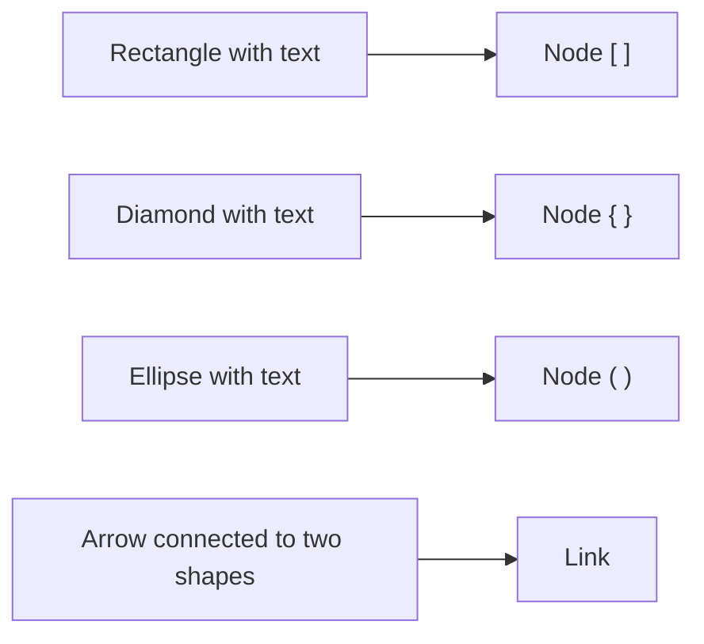

# Freehand whiteboard

The **Freehand** type is a free whiteboard for thinking without syntax: draw shapes, arrows, text and strokes with a hand-drawn look. When the idea is ready, turn it into a Mermaid diagram with one click.

To create one, choose **Freehand** as the **Diagram type** when creating a diagram. The whiteboard autosaves like any other diagram.

## Tools

| Tool | Shortcut | Use |
|---|---|---|
| **Select** | ++v++ | Select, move, resize and rotate elements |
| **Hand** | ++h++ | Pan the canvas |
| **Rectangle** | ++r++ | Box |
| **Diamond** | ++d++ | Decision |
| **Ellipse** | ++o++ | Circle or oval |
| **Arrow** | ++a++ | Arrow; drop it on a shape and it stays connected to it |
| **Line** | ++l++ | Line without arrowheads |
| **Text** | ++t++ | Free text |
| **Freehand** | ++p++ | Free stroke, pen-pressure aware |
| **Eraser** | ++e++ | Erase elements |

!!! tip "Quick text"
    Double-click a shape to type inside it, or double-click empty space (with **Select**) to create a text element. ++enter++ confirms and ++esc++ cancels; ++shift+enter++ adds a line break.

Connected arrows follow their shapes when you move or rotate them.

## Element style

With one or more elements selected, the **Element style** panel lets you set:

| Option | Values |
|---|---|
| **Stroke** and **Fill** | Border and interior color (or **No fill**) |
| **Width** | Stroke width |
| **Stroke style** | **Clean**, **Architect**, **Artist**, **Cartoonist** |
| **Fill style** | **Solid**, **Hachure**, **Cross-hatch** |
| **Font** | **Handwritten**, **Regular**, **Code**; plus **Font size** |
| Lines and arrows | **Dashed line**, **Start arrowhead**, **End arrowhead** |
| Shapes | **Rounded corners** |

The hand-drawn look is rendered with [Rough.js](https://roughjs.com/) and is stable: an element doesn't change shape every time it is redrawn.

## Arranging elements

- **Duplicate**, **Group** / **Ungroup**.
- Order: **Bring to front**, **Bring forward**, **Send backward**, **Send to back**.
- Alignment (left, center, right, top, middle, bottom) and **Distribute horizontally** / **vertically**.
- Alignment guides while moving elements.
- Context menu on right-click.
- **Clear all** empties the whiteboard (it can be undone).

## Locking elements

**Lock** pins the selected elements so you don't move them by accident (also with ++ctrl+shift+l++ / ++cmd+shift+l++ or from the context menu). A locked element cannot be dragged, resized, rotated, nudged with the arrow keys, aligned, restyled, cut or deleted until you click **Unlock**.

## Moving around the canvas

| Action | How |
|---|---|
| Pan | Mouse wheel, the **Hand** tool, hold ++space++ and drag, or middle-click |
| Zoom | ++ctrl++ / ++cmd++ + wheel (anchored at the cursor) or the zoom buttons |
| Fit to content | ++f++ |

The whiteboard's position and zoom are saved with the diagram.

## Keyboard shortcuts

| Shortcut | Action |
|---|---|
| ++ctrl+z++ / ++cmd+z++ | Undo |
| ++ctrl+shift+z++ or ++ctrl+y++ | Redo |
| ++ctrl+a++ | Select all |
| ++ctrl+c++ / ++ctrl+x++ / ++ctrl+v++ | Copy / cut / paste (pastes at the cursor position) |
| ++ctrl+d++ | Duplicate |
| ++ctrl+g++ / ++ctrl+shift+g++ | Group / ungroup |
| ++ctrl+shift+l++ | Lock / unlock |
| ++delete++ or ++backspace++ | Delete the selection |
| Arrow keys (++shift++ = 10 px) | Nudge the selection |
| ++esc++ | Clear the selection and go back to **Select** |
| ++f++ | Fit to content |

On macOS use ++cmd++ instead of ++ctrl++.

## Exporting the whiteboard

From **Export Diagram**, whiteboards export as **PNG** at **Screen (1x)**, **Standard (2x)** or **High (3x)** resolution, with a **Transparent background** option. The image covers everything drawn (rotated elements included); on very large canvases the scale is reduced automatically to stay within browser limits, without cropping anything.

You can also **Download source code** as a `.freehand.json` file, which can be imported again. Excalidraw files (`.excalidraw`) are imported as whiteboards. See [Export and import](export-import.md).

## Sketch → Mermaid

On a whiteboard, the **Convert diagram type** menu offers **Sketch → Mermaid**, which creates a **new Mermaid diagram** (the whiteboard is left untouched). The conversion is deterministic and **uses no AI**:

| On the whiteboard | In Mermaid |
|---|---|
| Rectangle / diamond / ellipse with text | Node `[ ]` / `{ }` / `( )` |
| Arrow connected to two shapes | Link `-->` (the arrow's text becomes the label) |
| Dashed arrow | `-.->` |
| Double-headed arrow | `<-->` |
| Line without arrowheads | `---` |
| Arrow leaving and entering the same shape | Self-loop |

!!! note "What is left out"
    Freehand strokes, loose text, unconnected arrows and shapes without text have no structural equivalent: they are skipped, and DiagramaHub tells you how many of each were left out.
