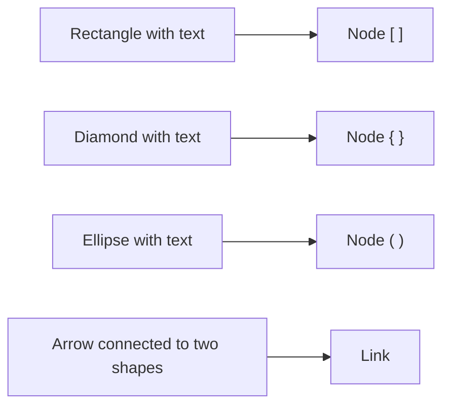

# Freehand whiteboard

The **Freehand** type is a free whiteboard for thinking without syntax: draw shapes, arrows, text, strokes, sticky notes and images with a hand-drawn look. When the idea is ready, turn it into a Mermaid diagram with one click.

To create one, choose **Freehand** as the **Diagram type** when creating a diagram. The whiteboard autosaves like any other diagram.

## Tools

| Tool | Shortcut | Use |
|---|---|---|
| **Select** | ++v++ | Select, move, resize and rotate elements |
| **Hand** | ++h++ | Pan the canvas |
| **Rectangle** | ++r++ | Box |
| **Diamond** | ++d++ | Decision |
| **Ellipse** | ++o++ | Circle or oval |
| **Arrow** | ++a++ | Arrow; drop it on a shape and it stays connected to it |
| **Line** | ++l++ | Line without arrowheads |
| **Text** | ++t++ | Free text |
| **Sticky note** | ++n++ | Coloured post-it; a click places it, a drag sizes it |
| **Freehand** | ++p++ | Free stroke, pen-pressure aware |
| **Eraser** | ++e++ | Erase elements |
| **Image** | — | Insert images from your computer (see [Images](#images)) |

!!! tip "Quick text"
    Double-click a shape (or select it and press ++enter++) to type inside it, or double-click empty space (with **Select**) to create a text element. ++enter++ confirms and ++esc++ cancels; ++shift+enter++ adds a line break. Text inside shapes wraps over several lines to fit them.

Connected arrows follow their shapes, notes and images when you move or rotate them.

### Connectors

When you select a shape, note or image, a dot appears next to each of its four sides, as in Miro. Drag from one of those dots to pull out an arrow: drop it on another element and it stays connected to both. A click on a dot without dragging creates nothing.

## Sticky notes

The **Sticky note** tool (++n++) creates Miro-style post-its: a click places a 200 × 200 note and a drag draws it at the size you want. A new note is ready for typing. The text fits the note by itself, shrinking as you write more. **Note color** offers six colours, and arrows connect to notes like to any shape.

## Images

Insert PNG, JPEG, WebP or GIF images in three ways:

- **Paste** a copied image (++ctrl+v++ / ++cmd+v++): it appears under the cursor.
- **Drag and drop** files onto the canvas.
- The **Image** button in the toolbar.

Before uploading, the browser shrinks the image to at most 2048 px and compresses it again, which also removes its metadata (such as a photo's GPS location). Images are stored apart from the drawing, keep their proportions when resized, accept connected arrows, and show in the PNG export, the shared view, embeds and presentations. SVG is not supported.

!!! note "Limits"
    Each image can weigh up to 3 MB after compression, and a whiteboard holds up to 100 images (a self-hosted operator can change both values). Images no longer in use are freed automatically when room is needed.

## Element style

With one or more elements selected, the **Element style** panel lets you set:

| Option | Values |
|---|---|
| **Stroke** and **Fill** | Border and interior color (or **No fill**) |
| **Width** | Stroke width |
| **Stroke style** | **Clean**, **Architect**, **Artist**, **Cartoonist** |
| **Fill style** | **Solid**, **Hachure**, **Cross-hatch** |
| **Font** | **Handwritten**, **Regular**, **Code**; plus **Font size** |
| Lines and arrows | **Dashed line**, **Start arrowhead**, **End arrowhead** |
| Shapes | **Rounded corners** |

The hand-drawn look is rendered with [Rough.js](https://roughjs.com/) and is stable: an element doesn't change shape every time it is redrawn.

## Arranging elements

- **Duplicate**, **Group** / **Ungroup**.
- Order: **Bring to front**, **Bring forward**, **Send backward**, **Send to back**.
- Alignment (left, center, right, top, middle, bottom) and **Distribute horizontally** / **vertically**.
- Alignment guides while moving elements.
- Context menu on right-click.
- **Clear all** empties the whiteboard (it can be undone).

## Locking elements

**Lock** pins the selected elements so you don't move them by accident (also with ++ctrl+shift+l++ / ++cmd+shift+l++ or from the context menu). A locked element cannot be dragged, resized, rotated, nudged with the arrow keys, aligned, restyled, cut or deleted until you click **Unlock**.

## Moving around the canvas

| Action | How |
|---|---|
| Pan | Mouse wheel (++shift++ + wheel to pan sideways), the **Hand** tool, hold ++space++ and drag, or middle-click |
| Zoom | ++ctrl++ / ++cmd++ + wheel or a trackpad pinch (anchored at the cursor), or the zoom buttons |
| Fit to content | ++f++ |

The whiteboard's position and zoom are saved with the diagram, without counting as an edit.

### Touch screens and pens

On tablets and touch screens, one finger draws with the active tool (with **Select**, dragging empty space pans the canvas), two fingers pan and pinch to zoom, and a double tap works as a double-click. Pens are pressure aware. A stroke or drag that leaves the canvas is not lost.

## Keyboard shortcuts

| Shortcut | Action |
|---|---|
| ++ctrl+z++ / ++cmd+z++ | Undo |
| ++ctrl+shift+z++ or ++ctrl+y++ | Redo |
| ++ctrl+a++ | Select all |
| ++ctrl+c++ / ++ctrl+x++ / ++ctrl+v++ | Copy / cut / paste through the system clipboard: pastes at the cursor position and works across diagrams and tabs. Text copied from another app is pasted as text |
| ++enter++ | Type into the selected shape, note or text |
| ++ctrl+d++ | Duplicate |
| ++ctrl+g++ / ++ctrl+shift+g++ | Group / ungroup |
| ++ctrl+shift+l++ | Lock / unlock |
| ++delete++ or ++backspace++ | Delete the selection |
| Arrow keys (++shift++ = 10 px) | Nudge the selection |
| ++esc++ | Clear the selection and go back to **Select** |
| ++f++ | Fit to content |

On macOS use ++cmd++ instead of ++ctrl++.

## Exporting the whiteboard

From **Export Diagram**, whiteboards export as **PNG** at **Screen (1x)**, **Standard (2x)** or **High (3x)** resolution, with a **Transparent background** option. The image covers everything drawn (rotated elements included); on very large canvases the scale is reduced automatically to stay within browser limits, without cropping anything.

You can also **Download source code** as a `.freehand.json` file, which can be imported again (without the images, which are stored apart from the drawing; the ZIP export of a project or folder does include them). Excalidraw files (`.excalidraw`) are imported as whiteboards. See [Export and import](export-import.md).

## Sketch → Mermaid

On a whiteboard, the **Convert diagram type** menu offers **Sketch → Mermaid**, which creates a **new Mermaid diagram** (the whiteboard is left untouched). The conversion is deterministic and **uses no AI**:

| On the whiteboard | In Mermaid |
|---|---|
| Rectangle / diamond / ellipse with text | Node `[ ]` / `{ }` / `( )` |
| Sticky note with text | Flag-shaped node `> ]` |
| Arrow connected to two shapes | Link `-->` (the arrow's text becomes the label) |
| Dashed arrow | `-.->` |
| Double-headed arrow | `<-->` |
| Line without arrowheads | `---` |
| Arrow leaving and entering the same shape | Self-loop |

!!! note "What is left out"
    Freehand strokes, loose text, images, unconnected arrows and shapes without text have no structural equivalent: they are skipped, and DiagramaHub tells you how many of each were left out.
