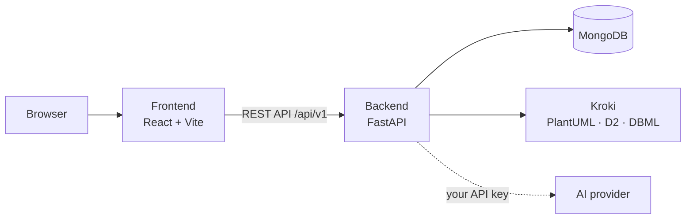

# Welcome to DiagramaHub

**DiagramaHub** is an open-source platform (Apache 2.0) to create, organize and export
diagrams written as text: **Mermaid**, **PlantUML**, **D2** and **DBML**, plus a
**freehand whiteboard** for sketching. It includes an AI assistant built on **BYOL**
(*Bring Your Own LLM*): you supply your provider's API key and DiagramaHub uses it to
generate, improve, fix and explain diagrams through a chat.

It runs on your own infrastructure with Docker Compose.

!!! warning "Beta software (v0.x)"
    APIs and data structures may change between versions. Check the
    [release notes](release-notes/index.md) before upgrading.

## Where do I start?

<div class="grid cards" markdown>

-   :material-pencil-ruler: **I want to use DiagramaHub**

    ---

    Create your first project and learn the editor and the four diagram languages.

    [:octicons-arrow-right-24: User guide](guide/index.md)

-   :material-server: **I want to run it on my server**

    ---

    Installation, environment variables, production, integrations and backups.

    [:octicons-arrow-right-24: Self-host](self-host/index.md)

-   :material-code-braces: **I want to develop or contribute**

    ---

    Architecture, backend modules, frontend, API, testing and how to extend it.

    [:octicons-arrow-right-24: Development](development/index.md)

-   :material-shield-lock: **I want to review security**

    ---

    Authentication, MFA, protections, audit log and how to report issues.

    [:octicons-arrow-right-24: Security](security/index.md)

</div>

## Features

### Diagrams as code

- **Four languages**: Mermaid (rendered in the browser), PlantUML, D2 and DBML (rendered on the
  server with [Kroki](https://kroki.io/), inside your own installation).
- **Monaco editor** with syntax highlighting and a live preview.
- **Per-diagram styling**: themes, layout engines, classic or hand-drawn look and curve types in
  Mermaid; themes and `skinparam` in PlantUML; themes in D2; background color and pattern for all.
- **Conversion between languages** with AI, with a side-by-side preview.
- **Presentation mode** in full screen.

### Freehand whiteboard

- Whiteboard canvas with shapes, arrows, text and freehand strokes, drawn with a hand-drawn look.
- Element locking, undo/redo and PNG export.
- **Sketch → Mermaid**: turn a sketch into an editable Mermaid diagram.

### Organization

- **Projects and folders** with a file explorer: rename, duplicate, move between folders and
  between projects.
- **Export** a diagram to PNG, SVG, PDF or Markdown.
- **Export a project or a folder** as a ZIP or as Markdown meant as context for AI.
- **Import** diagram files, ZIP archives and Excalidraw drawings.

### AI assistant (BYOL)

- Five providers: **Google Gemini**, **OpenAI**, **Anthropic Claude**, **DeepSeek** and
  **MiniMax**. Your API key is stored encrypted and is never returned in full.
- Per-diagram chat to generate, improve, repair or explain, with validation of the generated
  code and optional automatic fixing.

### Sharing

- **Public** or **protected** links with an access code, expiring after 5, 10 or 30 days or
  never, with the option to show or hide the source code.

### Accounts, security and administration

- Sign-up with a strong password, **MFA** (TOTP app and email codes, with recovery codes) and
  **Google** sign-in.
- **Plans and limits** defined by the operator, with optional payments through **Stripe**.
- **Admin panel**: users, plans and integrations (email, payments, OAuth).
- **Audit log** of security events.
- **Spanish and English** UI, with light and dark mode.

## How it is built



Four Docker Compose services: frontend, backend, Kroki and MongoDB (which can be external).
See [Architecture](development/architecture.md) for the details.

## Links

- [GitHub repository](https://github.com/diagramahub/diagramahub)
- [Release notes](release-notes/index.md) ·
  [CHANGELOG](https://github.com/diagramahub/diagramahub/blob/main/CHANGELOG.md)
- [FAQ](faq.md)
- [Apache 2.0](https://github.com/diagramahub/diagramahub/blob/main/LICENSE) license

---

*To serve this documentation locally:*

```bash
pip install -r docs/requirements.txt
mkdocs serve
```
