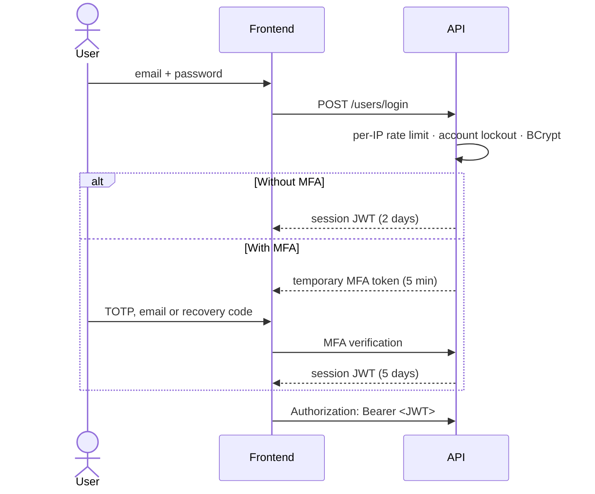

# Authentication

DiagramaHub authenticates with **JWT tokens** signed by the backend. Users can sign in with email and password (with or without a second factor) or with **Google OAuth**.

## Sign-in flow

## Sessions (JWT)

| Aspect | Value |
|---|---|
| Algorithm | HS256, signed with `JWT_SECRET` |
| Session without MFA | 2 days |
| Session with MFA | 5 days |
| Session through OAuth | 5 days |
| Temporary MFA verification token | 5 minutes, only usable to complete the second factor, and single use: it stops being accepted after a successful sign-in |
| Browser storage | `localStorage`; the frontend signs out automatically on a `401` |

### Invalidation on password change

Every token carries the `pca` claim (*password changed at*). When users change or reset their password, the backend stores the new timestamp and **rejects any token issued before it** with `401 Session invalidated`. Changing the password therefore closes every session open on other devices.

!!! tip "Rotating `JWT_SECRET`"
    Changing `JWT_SECRET` invalidates every session of the instance at once. Use it if you suspect the secret leaked.

## Password policy

Validated on the server at registration, password change and password reset:

- Between **12 and 128** characters.
- At least one **uppercase** letter, one **lowercase** letter, one **digit** and one **special character** (`!@#$%^&*()_+-=[]{}|;:',.<>?/~`).
- It can't be the same as the user's email.

Passwords are stored with **BCrypt** (random salt per password), never in plain text.

## Brute-force protection

| Control | Limit |
|---|---|
| Login attempts | 10 per IP per minute (`429` response with `Retry-After`) |
| Account lockout | After **5 consecutive failures** the account is locked for **15 minutes** |
| Registration | 20 accounts per IP per hour |
| Password reset requests | 10 per IP per hour |
| MFA verification | 10 attempts per IP every 5 minutes |
| MFA codes per sign-in | **5 attempts** (TOTP, email or recovery) per temporary token, concurrent requests included; after that the user must sign in again |
| OAuth callback | 10 per IP per minute |

A successful sign-in resets the failure counter. Failures and lockouts are written to the [audit log](audit-log.md).

!!! note "In-memory counters"
    Counters live in the backend process memory and reset when it restarts. With several processes or replicas, each one keeps its own counters.

## Multi-factor authentication (MFA)

Each user can enable one or both methods from their profile (see [Your account and security](../guide/account.md)):

| Method | How it works |
|---|---|
| **TOTP** | Authenticator app (Google Authenticator, Authy, 1Password…). The secret is stored encrypted with Fernet. |
| **Email code** | One-time numeric code sent by email; it expires after **10 minutes**. Up to 3 resends, 60 seconds apart. Requires an email provider configured by the administrator. |

- With both methods active, the user picks the **default** one and can use the other one at sign-in.
- Enabling MFA generates **8 single-use recovery codes** (10 characters). They are shown only once and stored hashed. When the last one is used, the app reminds the user to generate new ones.
- Disabling a method requires confirming the password.
- An administrator can **reset the MFA** of a user who lost access to their factors; the action is audited as `admin_mfa_reset`.

## Sign in with Google (OAuth 2.0 / OpenID Connect)

The administrator enables Google as a provider under **Integrations** (see [Integrations](../self-host/integrations.md)). The flow applies these controls:

- **CSRF protection**: each attempt creates a random `state` stored on the server, valid for **10 minutes** and single-use.
- **ID token validation**: signature, issuer, audience (`client_id`) and expiration.
- **Verified emails only**: if Google doesn't mark the email as verified, access is denied and audited.
- **Automatic linking by email**: if an account with that email already exists, it is linked to Google (`oauth_account_linked` event); otherwise a new account is created on the free plan.
- The OAuth session lasts 5 days and **doesn't ask for DiagramaHub's second factor**: verification is left to Google.

## Roles

| Role | Permissions |
|---|---|
| `user` | Default role. Manages their own projects, diagrams, AI providers and links. |
| `admin` | Additionally manages users, plans and integrations (email, payments, OAuth). |

The **first account** registered on a new installation is created as `admin` (setup wizard). Permissions are checked on the server on every administration endpoint.
