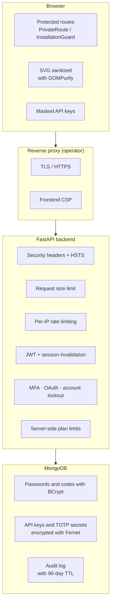

# Security

DiagramaHub treats security as a design requirement: every layer of the stack, from the database to the browser, has its own overlapping controls. This section describes what the software protects, how it does it, and which part is up to whoever operates it.

!!! warning "Beta software"
    DiagramaHub is in beta (v0.x). APIs and data structures may change between versions. Use it in production at your own discretion and keep your instance up to date.

## Layered security model

| Layer | What protects it | More detail |
|---|---|---|
| Identity | JWT, password policy, account lockout, MFA (TOTP + email), Google OAuth | [Authentication](authentication.md) |
| API and data | Security headers, secret encryption, rate limiting, plan limits, per-project isolation, error sanitization | [Protections](protections.md) |
| Traceability | Immutable log of security events with 90-day retention | [Audit log](audit-log.md) |

## Shared responsibility

The software ships the application controls. Whoever operates a self-hosted instance is responsible for the rest:

- [x] Serve the frontend and the API **over HTTPS only**, behind a reverse proxy.
- [x] Set `APP_ENV=production` (disables Swagger, hides stack traces and enables HSTS and CSP on the API).
- [x] Generate a long, random `JWT_SECRET` and a valid Fernet `AI_ENCRYPTION_KEY`; keep both out of the repository.
- [x] Restrict `BACKEND_CORS_ORIGINS` to the real frontend domain.
- [x] Never expose MongoDB to the Internet, and back it up regularly.
- [x] Keep DiagramaHub and its Docker images up to date.

The concrete steps are in [Production](../self-host/production.md) and [Configuration](../self-host/configuration.md).

## Continuous dependency scanning

The project is part of [Snyk](https://snyk.io/)'s **Secure Developer Program for Open Source**, which continuously scans the npm and Python dependencies, the code (SAST) and the container images.

## Reporting a vulnerability

!!! danger "Don't open a public issue"
    If you find a vulnerability, report it **privately** through [GitHub Security Advisories](https://github.com/diagramahub/diagramahub/security/advisories/new). A public issue exposes every installation before a fix exists.

Include in the report:

1. The affected DiagramaHub version (shown in **About** or by `GET /` on the API).
2. The steps to reproduce the problem and the impact you observed.
3. If you know it, the affected component (frontend, backend, deployment).

The team reviews every report and answers as soon as possible. Security fixes are published in the [release notes](../release-notes/index.md).
