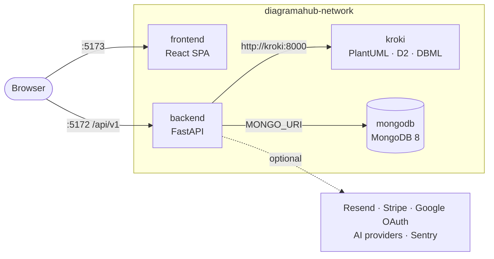

# Self-host

DiagramaHub is open source (Apache 2.0) and installs on your own infrastructure with
Docker Compose. This section is for whoever **operates** an instance: installing it,
configuring it, exposing it to the internet, connecting external services and keeping it
up to date.

!!! warning "Beta software"
    DiagramaHub is at version `0.x`. APIs and data structures may change between versions:
    read the [release notes](../release-notes/index.md) before upgrading and back up the
    database.

## Requirements

| Requirement | Detail |
|---|---|
| Docker + Docker Compose | Everything runs in containers; you don't need Python or Node on the host. |
| Git | To clone the repository and upgrade. |
| MongoDB 8 | Included as a container in `local-full` mode, or external (Atlas, your own server) in `external-mongodb` mode. |
| Free ports | `5173` (frontend), `5172` (API) and `27017` (MongoDB, `local-full` only). |
| Operating system | The `install.sh` installer detects macOS, Ubuntu/Debian, CentOS/RHEL and Fedora. |

## Services

An installation has four services on the `diagramahub-network` Docker network. Kroki
publishes no port: only the backend talks to it.

| Service | Container | Port | Role |
|---|---|---|---|
| Frontend | `diagramahub-frontend` | 5173 | Web UI. Mermaid renders in the browser. |
| Backend | `diagramahub-backend` | 5172 | REST API, business logic, proxy to Kroki. |
| Kroki | `diagramahub-kroki` | internal | Server-side rendering for PlantUML, D2 and DBML. Your content never leaves your network. |
| MongoDB | `diagramahub-mongodb` | 27017 | Database (`local-full` mode only). |

## In this section

-   :material-download: **[Installation](../installation.md)**

    ---

    One-line installer (`install.sh`) or step-by-step manual install.

-   :material-cog: **[Configuration](configuration.md)**

    ---

    Full reference of backend and frontend environment variables.

-   :material-server-network: **[Production](production.md)**

    ---

    Deployment modes, reverse proxy, HTTPS, CORS and a hardening checklist.

-   :material-puzzle: **[Integrations](integrations.md)**

    ---

    Email (Resend), payments (Stripe) and Google sign-in from the admin panel.

-   :material-card-account-details: **[Plans and limits](plans.md)**

    ---

    Define your own plans, project/diagram limits and prices.

-   :material-backup-restore: **[Maintenance](maintenance.md)**

    ---

    Upgrading, MongoDB backups, repair scripts, logs and Sentry.

-   :material-lifebuoy: **[Troubleshooting](troubleshooting.md)**

    ---

    Common errors and how to diagnose them.

## Quick path

1. [Install](../installation.md) with `install.sh` or manually.
2. Generate and set `AI_ENCRYPTION_KEY` (see [Configuration](configuration.md#security)):
   without it, AI providers, integrations and authenticator-app MFA cannot be saved.
3. Open `http://localhost:5173`: the `/setup` wizard creates the **administrator** account
   (the first registered user is always an admin).
4. Connect an email engine in **Integrations** to enable password recovery and email MFA
   codes.
5. Before exposing it to the internet, follow the [Production](production.md) guide.
