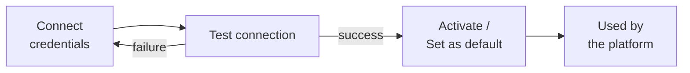

# Integrations

External services are connected from the UI, without touching files: sign in as an
administrator and open **Integrations** in the sidebar (route `/integrations`). There are
three categories:

| Category | Available provider | Used for |
|---|---|---|
| Email | Resend | Password recovery, email MFA codes and notifications. |
| Payment gateway | Stripe | Charging paid plans with a monthly subscription. |
| OAuth / Social login | Google | The "Continue with Google" button on the sign-in page. |

## How it works



- Credentials are stored **encrypted** with `AI_ENCRYPTION_KEY`
  (see [Configuration](configuration.md#security)). When editing, the UI shows secrets
  masked; leave a field empty to keep its current value.
- An integration can only be activated after passing the **connection test**. If the test
  failed, the API answers `400` when you try to activate it.
- There is **one active provider per type**: one default email engine, one active payment
  gateway and one active OAuth provider per provider (Google).
- Required fields are validated on save (`422` if one is missing).

## Email (Resend)

| Field | Example |
|---|---|
| API key | `re_...` |
| Sender email | `noreply@yourdomain.com` (on a domain verified in Resend) |

The connection test sends a real email from the configured sender to Resend's test address
(`delivered@resend.dev`), so it works even with a send-only key.

!!! warning "No email engine, no emails"
    Until there is a **default** email engine, password recovery and email MFA codes don't
    work. The Integrations page shows a warning.

## Payments (Stripe)

| Field | Example |
|---|---|
| Secret key | `sk_test_...` / `sk_live_...` |
| Publishable key | `pk_test_...` / `pk_live_...` |
| Webhook secret | `whsec_...` |

The connection test validates the secret key against the Stripe API. When no gateway is
active in the panel, the backend falls back to the `STRIPE_SECRET_KEY`,
`STRIPE_WEBHOOK_SECRET` and `STRIPE_PUBLISHABLE_KEY` variables.

### Webhook

Stripe notifies subscription changes to this endpoint:

```text
POST https://<your-api>/api/v1/webhooks/stripe
```

In the Stripe dashboard (**Developers → Webhooks → Add endpoint**) subscribe to these
events, which are the ones the backend processes:

- `checkout.session.completed`
- `customer.subscription.updated`
- `customer.subscription.deleted`
- `invoice.payment_failed`

Every request is validated with the webhook signing secret (`whsec_...`) set in the Stripe
integration; an invalid signature is rejected. Each event is applied **only once**: when Stripe
delivers an already processed event again, it is acknowledged as a duplicate without being
reapplied, and when processing fails the endpoint answers with an error so Stripe retries it.

=== "Local development (Stripe CLI)"

    ```bash
    stripe login
    stripe listen --forward-to localhost:5172/api/v1/webhooks/stripe
    ```

    The CLI prints a temporary `whsec_...` secret: use it as the *webhook secret*.

=== "Production"

    Register the public HTTPS endpoint in the Stripe dashboard and copy its
    *signing secret*.

After paying, Stripe redirects the user to `FRONTEND_URL`; set it to your public domain.
In test mode use card `4242 4242 4242 4242` with any future date and CVC.

With Stripe connected you can create paid plans: see [Plans and limits](plans.md).

## Sign in with Google (OAuth)

1. In Google Cloud Console create an **OAuth client ID** of type *Web application*.
2. Add your frontend's `/oauth/callback` route as an **Authorized redirect URI**:
   `https://diagrams.example.com/oauth/callback`.
3. In DiagramaHub, connect Google with:

| Field | Value |
|---|---|
| Client ID | The one from Google Cloud |
| Client Secret | The one from Google Cloud |
| Redirect URI | Exactly the same URI registered in Google |

4. Test the connection and activate it. The Google button appears on the sign-in page.

!!! note "What the test checks"
    The Google test confirms the server can reach Google's discovery document; it does not
    validate the Client ID or secret. Do a real sign-in to confirm them.

How Google sign-in behaves:

- If an account with the same email exists, it is linked automatically.
- New accounts get the free plan, just like a regular registration.
- The session lasts 5 days and skips MFA (Google already authenticated the user).

## Integration status

The admin endpoint `GET /api/v1/admin/integrations/status` summarizes which email engine and
which payment gateway are active.
