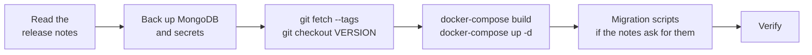

# Maintenance and upgrades

## Upgrading

DiagramaHub follows [SemVer](https://semver.org/) and publishes each version as a git tag
without a `v` prefix (for example `0.8.3`). While the project is at `0.x`, a minor version
may bring incompatible changes: always read the [release notes](../release-notes/index.md)
of every version you skip.



```bash
cd ~/diagramahub          # or wherever your installation lives

# 1. Back up (see below)

# 2. Fetch the version
git fetch --tags
git checkout 0.8.3        # the tag of the version to install
# (or `git pull` if you track the main branch)

# 3. Rebuild and start
docker-compose build
docker-compose up -d

# 4. Verify
bash verify-installation.sh
curl http://localhost:5172/   # shows the running version
```

The data in the `mongodb_data` volume (`local-full` mode) survives rebuilds, unless you
delete the volume explicitly (`docker-compose down -v`).

!!! tip "Check the example files"
    Compare your `backend/.env` with `backend/.env.example` after upgrading: new versions
    may add variables. The full reference is in [Configuration](configuration.md).

## Backups

A complete backup has **two parts**: the database and the secrets in `backend/.env`.

| What | Why |
|---|---|
| MongoDB database | Users, projects, diagrams, plans, integrations, history. |
| `AI_ENCRYPTION_KEY` | Without it, the backup's AI API keys, integrations and MFA secrets cannot be decrypted. |
| `JWT_SECRET` | If it changes, every session is signed out (no data is lost). |

### Back up

=== "local-full (MongoDB container)"

    ```bash
    docker exec diagramahub-mongodb \
      mongodump --db diagramahub --archive --gzip \
      > diagramahub-$(date +%F).archive.gz
    ```

=== "external-mongodb"

    ```bash
    mongodump --uri "<your MONGO_URI>" --db diagramahub --archive --gzip \
      > diagramahub-$(date +%F).archive.gz
    ```

    If you use a managed service (such as MongoDB Atlas), you can also rely on its
    automatic backups.

### Restore

```bash
docker-compose stop backend

docker exec -i diagramahub-mongodb \
  mongorestore --archive --gzip --drop < diagramahub-2026-10-19.archive.gz

docker-compose start backend
```

`--drop` replaces the existing collections with the backup's. Restore with the same
`AI_ENCRYPTION_KEY` the instance had when the backup was taken.

!!! note "Data that expires on its own"
    The audit log (`audit_log`) deletes its entries after 90 days through a MongoDB TTL
    index. If you need to keep them longer, back them up first.

## Maintenance scripts

The backend ships scripts in `backend/scripts/`. Run them inside the container:

```bash
docker exec -it diagramahub-backend python -m scripts.<name> [options]
```

| Script | Purpose | Options |
|---|---|---|
| `create_free_plan` | Creates the free plan (`FREE`) if it doesn't exist. Idempotent. | — |
| `migrate_users_to_subscriptions` | Gives the `FREE` plan to users without a subscription. Idempotent. | `--dry-run`, `--verbose` |
| `fix_misfiled_diagrams` | Before 0.8.1 a diagram could end up filed under another project's folder. Moves them back to their project's root. Deletes nothing. | No options: report only. `--apply`: fix. |
| `fix_webhook_index` | Drops an old `webhook_events` index that conflicts with the current unique index. Restart the backend afterwards. | — |

Example:

```bash
# See which diagrams are misfiled, without changing anything
docker exec -it diagramahub-backend python -m scripts.fix_misfiled_diagrams
# Fix them
docker exec -it diagramahub-backend python -m scripts.fix_misfiled_diagrams --apply
```

## Logs

```bash
docker-compose logs -f              # every service
docker-compose logs -f backend      # the API only
docker-compose logs -f frontend
docker-compose logs -f kroki        # PlantUML / D2 / DBML render errors
docker-compose logs -f mongodb      # local-full only
```

In production the backend writes gunicorn's access and error logs to standard output.
Unhandled exceptions are logged with their full trace, even though the API only answers
`Internal server error`.

## Monitoring with Sentry

Sentry is optional and enabled separately on the backend and the frontend:

| Side | Variables | Notes |
|---|---|---|
| Backend | `SENTRY_DSN`, `SENTRY_TRACES_SAMPLE_RATE`, `SENTRY_ENABLE_LOGS` | Reports the environment (`APP_ENV`) and the version as the *release*. |
| Frontend | `VITE_SENTRY_DSN`, `VITE_APP_ENV` | 10% trace sampling. |

Before sending an event, the backend masks the `Authorization` and `Cookie` headers and the
`api_key`, `password`, `token`, `secret` and `jwt` parameters in the body and query string.
If sanitization fails, the event is dropped instead of being sent unsanitized.

## Uninstalling

```bash
# Stop and remove containers, network and volumes (deletes the local database!)
docker-compose down -v

# Remove the images
docker images | grep diagramahub
docker rmi <image-id>
```
