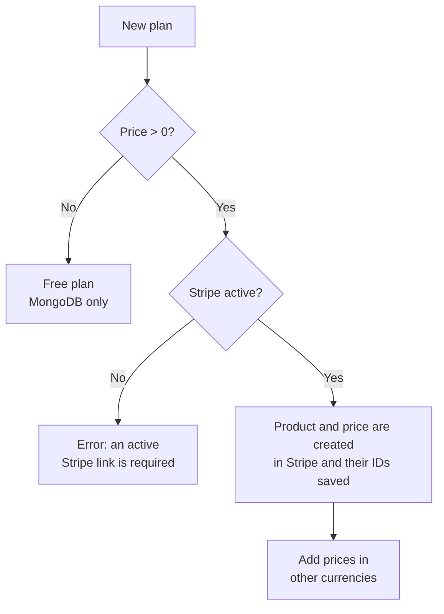
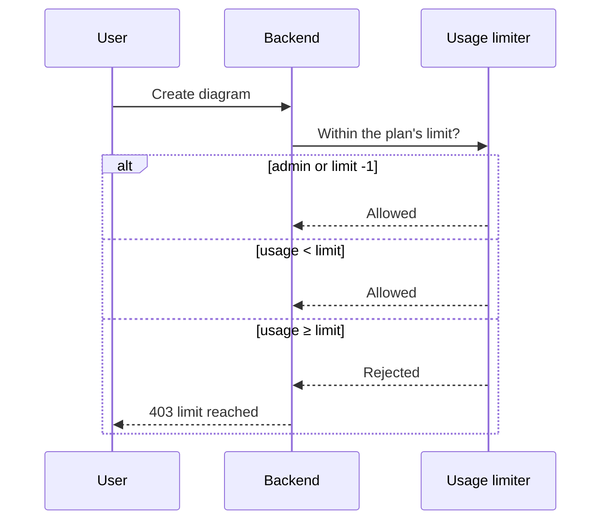

# Plans and limits

In DiagramaHub plans are **data**, not code: each operator decides which plans to offer,
how many projects and diagrams each one allows and how much it costs (or whether it costs
anything at all). No feature is exclusive to a plan: every plan has access to every
feature, only the limits change.

## The `Plan` model

Plans live in MongoDB's `plans` collection.

| Field | Type | Description |
|---|---|---|
| `name` | text (1–50) | Display name. Unique. |
| `code` | text (1–30) | Unique code in uppercase letters, digits, `_` or `-` (e.g. `TEAM`). `FREE` is reserved. |
| `description` | text (≤500) | Optional description. |
| `max_projects` | integer | Maximum projects. `-1` or empty = unlimited. |
| `max_diagrams` | integer | Maximum diagrams. `-1` or empty = unlimited. Counts only **private** ones unless `public_diagrams_count` (see [Public diagrams](#public-diagrams)). |
| `public_diagrams_count` | boolean | `true`: diagrams published in the Community also count toward `max_diagrams`. Defaults to `false`. |
| `max_public_diagrams` | integer | Maximum published diagrams. `-1` or empty = unlimited (the default). |
| `prices` | dictionary | Monthly price per currency, e.g. `{"usd": 4, "mxn": 70}`. Empty = free. |
| `is_active` | boolean | An inactive plan is no longer offered, but its subscribers keep it. |
| `gateway_config` | object | Stripe product and price IDs; filled in automatically on sync. |

Supported currencies: `usd`, `eur`, `gbp`, `mxn` and `brl`.

## The free plan (`FREE`)

- It is created automatically on the **first registration of a non-admin user**, named
  `Gratuito`, with 1 project and 10 diagrams.
- Every new user gets a `FREE` subscription, including sign-ups with Google.
- It cannot be deleted, deactivated or have its code changed. You can edit its name,
  description and limits.

If the database comes from a version without plans, create the plan and give existing
users `FREE` with the backend scripts (both are idempotent):

```bash
docker exec -it diagramahub-backend python -m scripts.create_free_plan
docker exec -it diagramahub-backend python -m scripts.migrate_users_to_subscriptions --dry-run
docker exec -it diagramahub-backend python -m scripts.migrate_users_to_subscriptions
```

## Administrators

Administrators have no limits: usage checks let them create projects and diagrams freely
and they don't get a subscription.

## Creating and editing plans

Open **Administration → Plans** (route `/admin/plans`).



Rules the server enforces:

- A paid plan needs an active Stripe gateway ([Integrations](integrations.md#payments-stripe)).
  On creation, DiagramaHub creates the product and price in Stripe.
- The USD price is the primary one. Other currencies are added afterwards, once the plan
  is synced with Stripe.
- **A plan's price cannot change while it has active subscribers.** Create a new plan and
  deactivate the old one.
- Changing a paid plan's name, description or price re-syncs it with Stripe.
- Deleting a plan **with** subscribers only deactivates it (and archives it in Stripe);
  subscribers keep it. **Without** subscribers, it is archived in Stripe and deleted.

## How limits are enforced

Limits are checked **on the server** before a project or diagram is created, including the
ones that arrive through an import. When the limit is reached, the API answers `403` and the
UI offers a plan change. The client never decides whether something is allowed.



Each user can check their usage at `GET /api/v1/subscriptions/usage`.

## Public diagrams

By default, a diagram **published in the [Community](../guide/community.md)** doesn't use a slot of the diagram limit: the limit counts only private ones. It's a way to grow without paying in exchange for sharing: someone who publishes everything can use the platform without reaching the cap, and someone who wants privacy needs a plan with more room. Each plan decides it with two fields (in **Administration → Plans**):

- **Published diagrams also count toward the diagram limit** (`public_diagrams_count`): off by default. On, every diagram counts.
- **Public diagrams** (`max_public_diagrams`): an optional cap on publications; unlimited by default.

Rules the server applies:

- Every diagram is born private: creating, duplicating, forking or importing uses a slot.
- **Publishing frees a slot**, and **unpublishing** needs room for one more private diagram. Without it the API answers `403` with `resource_type: "private_diagrams"` and the interface disables **Remove from the Community**, saying why.
- A publication **hidden by moderation** counts as private: only what others can see is exempt. If a published diagram is deleted, its publication no longer uses a slot.
- **Over the limit.** A user can end up over the limit through no action of their own: a downgrade, an expired subscription, an administrator removing or moderation hiding one of their publications, or you lowering the plan's limit. Nothing is ever deleted or locked: they can edit, delete and publish, but not create private diagrams or unpublish until they're back under the limit.
- So the Community isn't used as free storage, publishing needs a diagram that draws something (not empty and renderable), with at most 100,000 characters of code, and there's a cap on publications per user every 24 hours ([`COMMUNITY_MAX_PUBLICATIONS_PER_DAY`](configuration.md#community), 20 by default). Administrators have no such cap.

`GET /api/v1/subscriptions/usage` returns in `diagrams` the usage that counts (`current`), the limit, the visible published ones (`public`), whether they count (`public_counts`) and the public cap (`public_limit`).

## An instance without billing

If you don't connect Stripe, every user is on free plans. For an internal instance without
limits, edit `FREE` and set projects and diagrams to `-1`.
