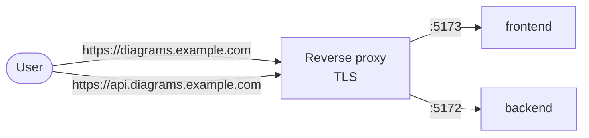

# Production

This page covers what changes when an instance stops being local and is exposed to the
internet. Install it first by following the [installation guide](../installation.md).

## Deployment modes

The root `docker-compose.yml` is a symlink to one of the two modes in `deploy/`. The
installer creates it depending on whether you choose local or external MongoDB.

| | `local-full` | `external-mongodb` |
|---|---|---|
| Meant for | Development, testing, small installs | Production |
| MongoDB | `mongo:8` container with the `mongodb_data` volume, port `27017` published | External, through `MONGO_URI` (Atlas, your own server) |
| Kroki | Internal container | Internal container |
| Backend | `APP_ENV=development`: uvicorn with hot reload, Swagger at `/docs` | `APP_ENV=production` (image default): gunicorn with `WORKERS` processes, no Swagger |
| Frontend | `development` target: Vite dev server with HMR and mounted source | `production` target: static build served by non-root Nginx |
| `VITE_API_URL` | Fixed: `http://localhost:5172` | From the environment or a `.env` next to the compose file |

```bash
# Choose a mode manually
ln -sf deploy/external-mongodb/docker-compose.yml docker-compose.yml
docker-compose up -d --build
```

!!! warning "Don't publish `local-full` as is"
    `local-full` exposes MongoDB on port `27017` without authentication and runs the
    backend in development mode (Swagger open, error traces visible). Keep it behind a
    firewall or switch to `external-mongodb`.

## Frontend production image

The frontend `Dockerfile` is multi-stage. The `production` target:

- Builds the bundle with Vite and serves it with `nginxinc/nginx-unprivileged` as the
  `nginx` user (no root), listening on port `5173`.
- Generates `/config.js` when the container starts from `VITE_API_URL`,
  `VITE_SENTRY_DSN` and `VITE_APP_ENV`, so changing the API URL only requires recreating
  the container.
- Sends `X-Content-Type-Options`, `X-Frame-Options: DENY`, `Referrer-Policy` and
  `Permissions-Policy` (`frontend/headers.conf`). HSTS is not sent here: it belongs on the
  proxy that terminates TLS.
- Never caches `index.html` or `config.js`; hashed assets are cached for a year.
- Includes a healthcheck on `http://127.0.0.1:5173/`.

```bash
docker build --target production -t diagramahub-frontend ./frontend
```

## Reverse proxy and HTTPS

Put a reverse proxy (Nginx, Traefik, Caddy) in front to terminate TLS and serve on ports
80/443. The recommended approach uses a subdomain for the API:



```nginx
# Frontend
server {
    listen 80;
    server_name diagrams.example.com;

    location / {
        proxy_pass http://localhost:5173;
        proxy_set_header Host $host;
        proxy_set_header X-Real-IP $remote_addr;
        proxy_set_header X-Forwarded-For $proxy_add_x_forwarded_for;
        proxy_set_header X-Forwarded-Proto $scheme;
    }
}

# Backend API
server {
    listen 80;
    server_name api.diagrams.example.com;

    # Project imports accept up to 20 MB (MAX_IMPORT_UPLOAD_BYTES).
    # Nginx limits the body to 1 MB by default.
    client_max_body_size 20m;

    location / {
        proxy_pass http://localhost:5172;
        proxy_set_header Host $host;
        proxy_set_header X-Real-IP $remote_addr;
        proxy_set_header X-Forwarded-For $proxy_add_x_forwarded_for;
        proxy_set_header X-Forwarded-Proto $scheme;
    }
}
```

Free certificates with Let's Encrypt:

```bash
sudo apt install certbot python3-certbot-nginx
sudo certbot --nginx -d diagrams.example.com -d api.diagrams.example.com
```

### Real client IP behind the proxy

Request limits (login, registration, MFA, shared links, rendering), account lockout and the
audit log use the client IP. Behind a proxy the backend only sees the proxy's IP unless it
trusts the proxy's `X-Forwarded-For` headers. If it doesn't, **every user shares the same
counter** and a few failed attempts lock sign-in for the whole instance.

Set `FORWARDED_ALLOW_IPS` (in `backend/.env`) to the address the proxy connects to the
backend from. Only those connections can set the client IP; any other keeps its own, so a
client cannot forge it by sending the header.

=== "Proxy on the host (example above)"

    The proxy reaches the container through the published port, so the backend sees the
    Docker network gateway:

    ```bash
    docker network inspect $(docker network ls -q --filter name=diagramahub-network) \
      --format '{{(index .IPAM.Config 0).Gateway}}'
    ```

    ```bash
    # backend/.env
    FORWARDED_ALLOW_IPS=172.18.0.1   # the IP the previous command printed
    ```

=== "Proxy in another container"

    Use the proxy container's IP or the subnet of the Docker network it shares with the
    backend:

    ```bash
    # backend/.env
    FORWARDED_ALLOW_IPS=172.18.0.0/16
    ```

Restart the backend (`docker compose up -d backend`) and check that the `ip_address` field of
the `audit_log` collection shows client IPs and not the proxy's.

!!! danger "Don't use `*`"
    `FORWARDED_ALLOW_IPS=*` accepts the header from anyone: it is only safe when the backend
    port is reachable exclusively from the proxy (firewall). Otherwise anyone can change
    their IP and evade the limits.

### Request limits and workers

Request-limit and account-lockout counters live in each process's memory. In production,
gunicorn starts `WORKERS` processes (default `2`) and each keeps its own counters, so the
effective per-IP limit can be up to `WORKERS` times the configured one (with 2 workers, up to
20 sign-in attempts per minute instead of 10). Keep this in mind before raising `WORKERS`.

## Point the instance at your domain

Before opening it to the public, set three values; otherwise the browser blocks the API
and Stripe redirects to `localhost`:

| Variable | Where | Value |
|---|---|---|
| `FRONTEND_URL` | `backend/.env` | `https://diagrams.example.com` |
| `BACKEND_CORS_ORIGINS` | `backend/.env` | `https://diagrams.example.com` (comma-separated list, no brackets). Empty = `FRONTEND_URL` only. |
| `VITE_API_URL` | frontend environment | `https://api.diagrams.example.com` |

Details for each in [Configuration](configuration.md).

## What `APP_ENV=production` does

| Effect | Detail |
|---|---|
| API docs disabled | `/docs`, `/redoc` and `/openapi.json` return 404. |
| Traces hidden | An unhandled exception answers `{"detail": "Internal server error"}`; the trace goes to the logs. |
| HSTS | `Strict-Transport-Security: max-age=63072000; includeSubDomains; preload`. |
| API CSP | `default-src 'none'; frame-ancestors 'none'` (responses are JSON). |
| Server | gunicorn with uvicorn workers (`WORKERS`, default 2), 120 s timeout. |

To browse Swagger for a production instance, run a copy with `APP_ENV=development` in a
non-public environment.

!!! note "In-memory limits"
    Request limits and account lockouts are kept in each process's memory: they reset
    when the backend restarts and each gunicorn worker keeps its own count. A deployment
    with several replicas would need a shared store.

## Frontend Content-Security-Policy

The frontend CSP is disabled by default: a policy that is too strict breaks the editor
(Mermaid injects inline styles and Monaco loads workers from jsDelivr).
`frontend/csp.conf.example` ships a tested starting point:

1. Replace `API_ORIGIN` with your API's real origin.
2. Append the `add_header` line to `frontend/headers.conf`.
3. Rebuild the image and check the editor, rendering and exports in the browser console.

## Hardening checklist

- [ ] Random 32+ character `JWT_SECRET` and a Fernet-generated `AI_ENCRYPTION_KEY`.
- [ ] Both secrets stored off the server, together with the backups.
- [ ] `APP_ENV=production` on the backend and the frontend on the `production` target.
- [ ] HTTPS on the proxy; `FRONTEND_URL`, `BACKEND_CORS_ORIGINS` and `VITE_API_URL` set
      to the public domains.
- [ ] MongoDB not exposed to the internet (no public `27017`), with a user and password.
- [ ] Ports `5172` and `5173` reachable only from the proxy (firewall).
- [ ] An active email engine, so password recovery and email MFA work
      ([Integrations](integrations.md)).
- [ ] The administrator account with MFA enabled.
- [ ] Automatic database backups ([Maintenance](maintenance.md)).
- [ ] (Optional) Frontend CSP enabled and validated.
- [ ] (Optional) Sentry configured for backend and frontend.

More context on the platform's controls in [Security](../security/index.md).
