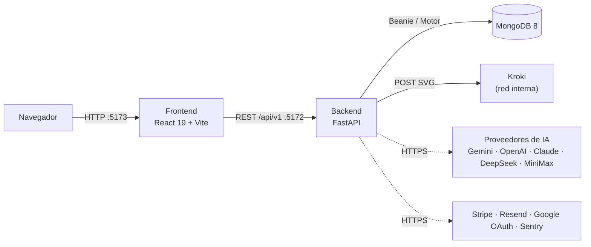
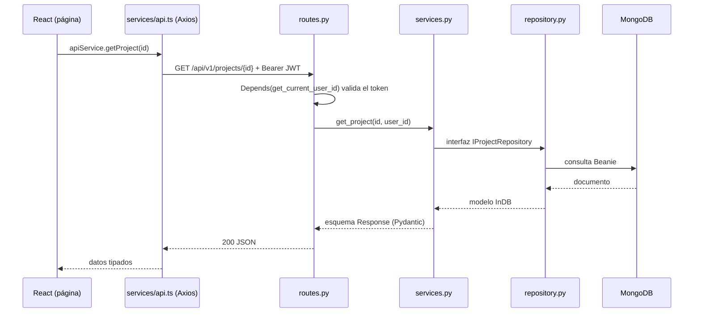
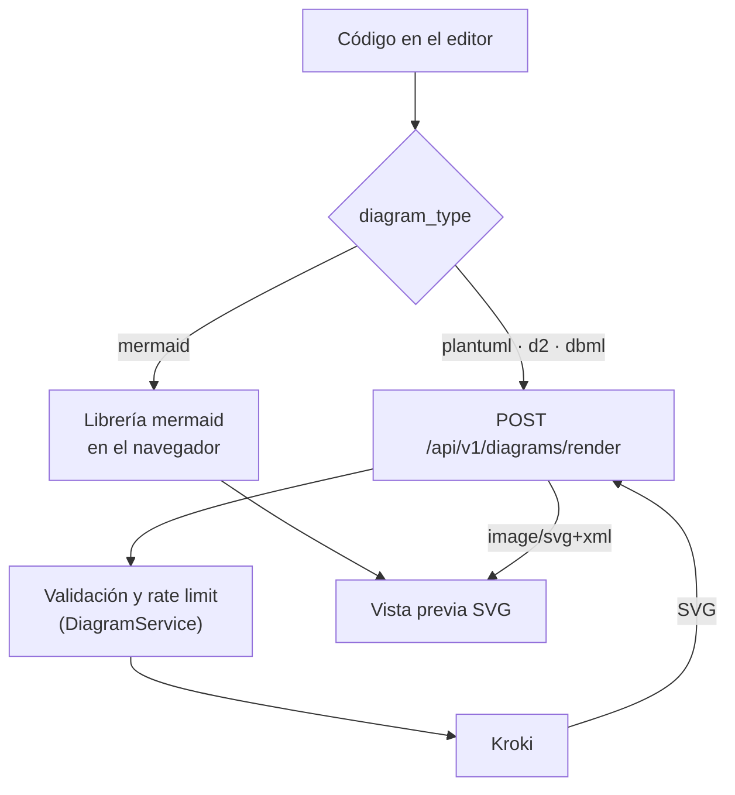
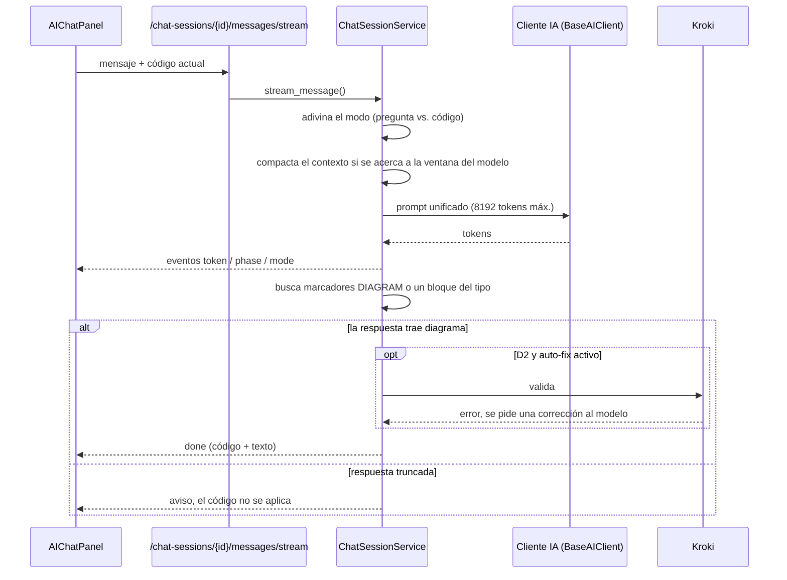

# Arquitectura

DiagramaHub es un monorepo modular con un frontend en **React 19 + Vite 7**, una API en **FastAPI + MongoDB** y **[Kroki](https://kroki.io/)** para renderizar en el servidor los lenguajes que no se dibujan en el navegador. Todo se orquesta con Docker Compose.

## Servicios



| Servicio | Tecnología | Propósito |
|---|---|---|
| Frontend | React 19 + TypeScript + Vite 7 + TailwindCSS v3 | Interfaz, editor Monaco, render de Mermaid en el cliente, pizarrón |
| Backend | FastAPI (imagen `python:3.13-alpine`) | API, lógica de negocio, proxy hacia Kroki, llamadas a la IA |
| Kroki | imagen `yuzutech/kroki` | Render en el servidor de PlantUML, D2 y DBML |
| MongoDB | MongoDB 8 (o externo en el modo `external-mongodb`) | Persistencia |

Los servicios de terceros (IA, Stripe, Resend, Google, Sentry) son opcionales: se activan con la configuración del operador o con la API key de cada usuario (BYOL).

## Flujo de una petición

El backend sigue una arquitectura por capas con inversión de dependencias: las rutas solo traducen HTTP, los servicios dependen de **interfaces** y los repositorios son la única capa que toca MongoDB.



Si la API responde `401`, el interceptor de Axios borra el token de `localStorage` y la app vuelve al login.

## Render de diagramas

Mermaid se dibuja en el navegador; PlantUML, D2 y DBML se envían al backend, que los reenvía a Kroki y devuelve un SVG. El contenido nunca sale de tu instalación: Kroki corre dentro de la red de Docker.



`/diagrams/render` es público (lo usa también la vista de enlaces compartidos), por eso tiene su propio límite de peticiones por IP (`diagrams/rate_limiter.py`).

## Flujo del chat de IA

El chat es la única entrada de la interfaz para generar o modificar diagramas con IA. La respuesta llega por streaming (Server-Sent Events, `chat_sessions/sse_events.py`).



Puntos clave:

- **Marcadores**: el modelo envuelve el código en `<<<DIAGRAM>>>` / `<<<END_DIAGRAM>>>` (o `<<<DIAGRAMA>>>` / `<<<END_DIAGRAMA>>>`). Una respuesta con marcadores siempre se trata como código, aunque el modo adivinado fuera "pregunta"; también cuenta un bloque etiquetado con el tipo de diagrama que contenga un diagrama completo (excepto en el modo Explicar).
- **Truncado**: una respuesta cortada por el límite de tokens nunca se aplica como código; la API de generación responde `422 response_truncated` y una vacía `502 empty_response`.
- **Validación**: D2 se valida con Kroki en el servidor; Mermaid con el parser real en el navegador, que pide una corrección al modelo una vez. PlantUML y DBML no se reintentan (daban falsos positivos). Todo respeta el ajuste `auto_fix_generated` del usuario.
- Las etiquetas `<think>` de los modelos de razonamiento se eliminan.

## Estructura del repositorio

```text
diagramahub/
├── backend/            # FastAPI + Beanie (Poetry)
│   ├── app/
│   │   ├── main.py     # app, lifespan, middlewares, registro de routers
│   │   ├── core/       # config, seguridad, rate limit, límites de petición
│   │   └── api/        # deps.py + v1/<módulo>/
│   └── tests/
├── frontend/           # React 19 + Vite 7 (pnpm)
│   └── src/
├── deploy/
│   ├── local-full/         # MongoDB 8 + Kroki + Backend + Frontend
│   └── external-mongodb/   # Kroki + Backend + Frontend (MongoDB externo)
├── docs/               # este sitio (MkDocs Material)
├── scripts/            # check-version.sh, ai-benchmark/, test-helpers.sh
└── docker-compose.yml  # symlink al modo de despliegue
```

Más detalle en [Backend](backend.md) y [Frontend](frontend.md).
