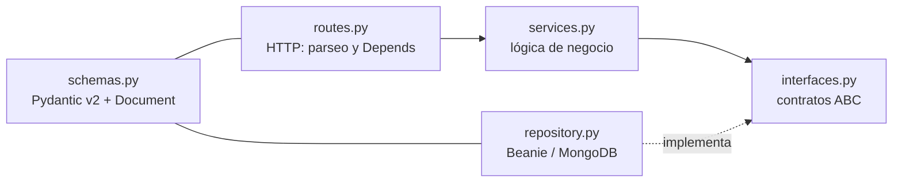

# Backend

API REST en **FastAPI** sobre **MongoDB 8** con el ODM **Beanie** (driver async Motor). Dependencias con **Poetry** (`backend/pyproject.toml`, Python `>=3.12,<3.14`; la imagen Docker usa Python 3.13).

## Estructura

```text
backend/app/
├── main.py          # FastAPI, lifespan (init_beanie), middlewares, routers, Sentry
├── core/
│   ├── config.py         # Settings (pydantic-settings, lee backend/.env)
│   ├── security.py       # JWT + BCrypt
│   ├── rate_limit.py     # limitador sliding-window en memoria compartido
│   ├── request_limits.py # middleware ASGI de tamaño máximo del cuerpo (413)
│   └── clock.py          # utcnow() sin zona horaria (como lo devuelve Motor)
└── api/
    ├── deps.py      # get_current_user_email / get_current_user / get_current_user_id
    └── v1/<módulo>/ # un módulo por entidad
```

## Patrón de un módulo

Cada entidad vive en su carpeta bajo `backend/app/api/v1/` con las mismas capas:



| Archivo | Responsabilidad |
|---|---|
| `interfaces.py` | Clases abstractas (ABC) con el contrato del repositorio |
| `repository.py` | Implementación concreta con Beanie |
| `services.py` | Lógica de negocio; depende de la **interfaz**, nunca del repositorio concreto |
| `schemas.py` | Modelos Pydantic v2: `Base`, `Create`, `Update`, `InDB` (`Document` de Beanie) y `Response` |
| `routes.py` | `APIRouter`: solo HTTP, delega al servicio |

!!! warning "Regla"
    Las rutas no contienen lógica de negocio y los servicios no importan repositorios concretos: los reciben ya construidos (inyección de dependencias con `Depends`).

## Los 12 módulos

| Módulo | Propósito | Archivos además del patrón base |
|---|---|---|
| `users/` | Registro, login, perfil, cambio y reseteo de contraseña, borrado de cuenta, estado de instalación | `audit_log.py`, `deletion_service.py`, `email_templates.py`, `rate_limiter.py` |
| `projects/` | CRUD de proyectos; exportar (ZIP / Markdown para IA) e importar (archivos, ZIP, Excalidraw) | `export_service.py`, `export_builders.py`, `import_service.py`, `import_parsers.py` |
| `diagrams/` | CRUD, mover, duplicar, corrección con IA, conversión entre tipos, validación de sintaxis y proxy de render hacia Kroki | `fix_service.py`, `fix_prompts.py`, `conversion_service.py`, `syntax_validator.py`, `config_utils.py`, `kroki_client.py`, `rate_limiter.py` |
| `folders/` | CRUD de carpetas dentro de un proyecto | — |
| `ai_providers/` | Proveedores de IA del usuario (keys cifradas), generación/mejora de diagramas y descripciones | `clients/` (`base.py`, `factory.py` y un cliente por proveedor), `prompts.py`, `model_catalog.json`, `model_catalog.py` |
| `chat_sessions/` | Sesiones y mensajes del chat de IA, streaming SSE, compactación de contexto | `sse_events.py` |
| `subscriptions/` | Planes, suscripciones, límites de uso, Stripe (checkout, portal, webhooks) | `plan_repository.py`, `plan_service.py`, `subscription_repository.py`, `subscription_service.py`, `billing_service.py`, `usage_limiter.py`, `webhook_handler.py`, `webhook_routes.py`, `stripe_catalog_service.py`, `migration_service.py`, `payment_providers/`, `constants.py`, `exceptions.py`, `logger.py` |
| `shared_links/` | Enlaces para compartir diagramas (públicos o con código), expiración, log de accesos | `public_routes.py`, `rate_limiter.py` |
| `prompt_history/` | Historial de prompts de IA del usuario | — |
| `integrations/` | Configuración (admin) de vendors de email, pago y OAuth | `email_service.py`, `email_vendors/` (Resend), `vendor_factory.py` |
| `mfa/` | MFA por TOTP y por código de email, códigos de recuperación, administración de MFA de usuarios | `totp_service.py`, `admin_service.py`, `rate_limiter.py` |
| `oauth/` | Login con OAuth 2.0 / OpenID Connect (Google; extensible con `IOAuthProvider`) | `providers/` (`google.py`, `factory.py`) |

!!! info "Dónde vive cada dato"
    Los datos de MFA se guardan en el propio documento del usuario (`UserInDB`), por eso `mfa/` no registra un `Document` propio.

## Registro en `main.py`

Un módulo nuevo no existe para la app hasta registrarlo en [`backend/app/main.py`](https://github.com/diagramahub/diagramahub/blob/main/backend/app/main.py):

1. Su `Document` en `init_beanie(document_models=[...])` dentro del `lifespan`. Hoy se registran: `UserInDB`, `ProjectInDB`, `DiagramInDB`, `FolderInDB`, `UserAISettingsInDB`, `PlanInDB`, `SubscriptionInDB`, `StripeConfigInDB`, `WebhookEventInDB`, `PromptHistoryInDB`, `ChatSessionInDB`, `ChatMessageInDB`, `SharedLinkInDB`, `AccessLogInDB`, `VendorConfigInDB`, `AuditLogEntry` y `OAuthStateToken`.
2. Su router con `app.include_router(router, prefix=settings.API_V1_PREFIX)`. Los proveedores de IA se montan bajo `/api/v1/ai`.
3. Si tiene rutas públicas o de webhooks en archivos aparte (`public_routes.py`, `webhook_routes.py`), también se registran.

Además, `main.py` configura:

- **Middlewares**: límite de tamaño del cuerpo (`MAX_REQUEST_BODY_BYTES`, con un presupuesto mayor para `POST /projects/{id}/import`), cabeceras de seguridad y CORS con lista explícita de cabeceras.
- **Producción** (`APP_ENV=production`): Swagger, ReDoc y `openapi.json` deshabilitados, HSTS y CSP en las respuestas, y un manejador que oculta los stack traces (`500 Internal server error`).
- **Sentry**: solo si `SENTRY_DSN` está definido, con sanitización de datos sensibles en `before_send`.

## Configuración

[`backend/app/core/config.py`](https://github.com/diagramahub/diagramahub/blob/main/backend/app/core/config.py) define `Settings` con `pydantic-settings`; los valores salen de variables de entorno o de `backend/.env`. Las más relevantes para desarrollar:

| Variable | Por defecto | Uso |
|---|---|---|
| `JWT_SECRET` | — (obligatoria) | Firma de los JWT |
| `MONGO_URI` / `DATABASE_NAME` | `mongodb://mongodb:27017` / `diagramahub` | Conexión a MongoDB |
| `APP_ENV` | `production` | Usa `development` en local para tener Swagger |
| `KROKI_URL` | `http://kroki:8000` | Servicio de render |
| `FRONTEND_URL` / `BACKEND_CORS_ORIGINS` | `http://localhost:5173` / vacío | CORS (si está vacío, se usa `FRONTEND_URL`) |
| `AI_ENCRYPTION_KEY` | — | Clave Fernet para cifrar API keys de IA |

La referencia completa para operadores está en [Configuración](../self-host/configuracion.md).

## Calidad de código

```bash
docker exec diagramahub-backend poetry run black app/
docker exec diagramahub-backend poetry run ruff check app/
docker exec diagramahub-backend poetry run mypy app/
```

Ruff y Black usan `line-length = 100`. Todas las funciones llevan type hints y docstring; los errores de API se lanzan con `HTTPException`.
