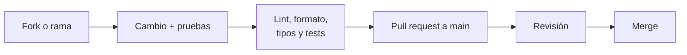

# Contribuir

DiagramaHub es open source bajo la licencia **Apache 2.0**. Toda contribución se publica bajo esa misma licencia.

## Reportar un problema

- **Bugs y propuestas**: abre un issue en [GitHub](https://github.com/diagramahub/diagramahub/issues) con los pasos para reproducirlo, lo que esperabas, lo que pasó, la versión (la ves en **Acerca de** o en `GET /`) y el tipo de diagrama si aplica.
- **Vulnerabilidades**: **no** abras un issue público. Repórtalas en privado como se explica en [Seguridad](../seguridad/index.md).

## Flujo de un cambio



1. Crea una rama desde `main` (o desde la rama `release/<V>` en curso, si el cambio va en esa versión).
2. Haz el cambio respetando la arquitectura: [Backend](backend.md) y [Frontend](frontend.md).
3. Agrega pruebas: todo endpoint nuevo lleva su test.
4. Corre las verificaciones (abajo).
5. Abre un pull request contra `main` explicando qué cambia y por qué.

## Antes de abrir el PR

=== "Backend"

    ```bash
    docker exec diagramahub-backend poetry run black app/
    docker exec diagramahub-backend poetry run ruff check app/
    docker exec diagramahub-backend poetry run mypy app/
    docker exec diagramahub-backend poetry run pytest --cov-fail-under=60
    ```

=== "Frontend"

    ```bash
    cd frontend
    pnpm lint
    pnpm test
    pnpm build
    ```

=== "Documentación"

    ```bash
    mkdocs build --strict
    ```

## Estilo

| Área | Regla |
|---|---|
| Python | Ruff + Black (`line-length = 100`), mypy; type hints y docstring en todas las funciones; `snake_case` |
| TypeScript | ESLint (`typescript-eslint`); `camelCase`; TypeScript estricto |
| Validación | Modelos Pydantic para toda entrada y salida de la API |
| Async | `async`/`await` en todo el backend |
| Textos | Nunca strings visibles hardcodeadas: `t('clave')` en `es.json` **y** `en.json` |
| UI | Según [`DESIGN.md`](https://github.com/diagramahub/diagramahub/blob/main/DESIGN.md) |
| Credenciales en pruebas | Generadas, nunca literales (ver [Pruebas](pruebas.md#credenciales-de-prueba)) |

## Commits y PRs

- Mensajes en inglés, en imperativo y descriptivos; con prefijo tipo `fix:`, `feat:`, `docs:`, `chore:` cuando ayude.
- Un PR por tema. Los releases se integran como `Release <V>: <resumen>`.
- Si el cambio es visible para el usuario, añade la entrada en `CHANGELOG.md` y en las notas de la versión en curso (ver [Versionado](versionado.md)).
