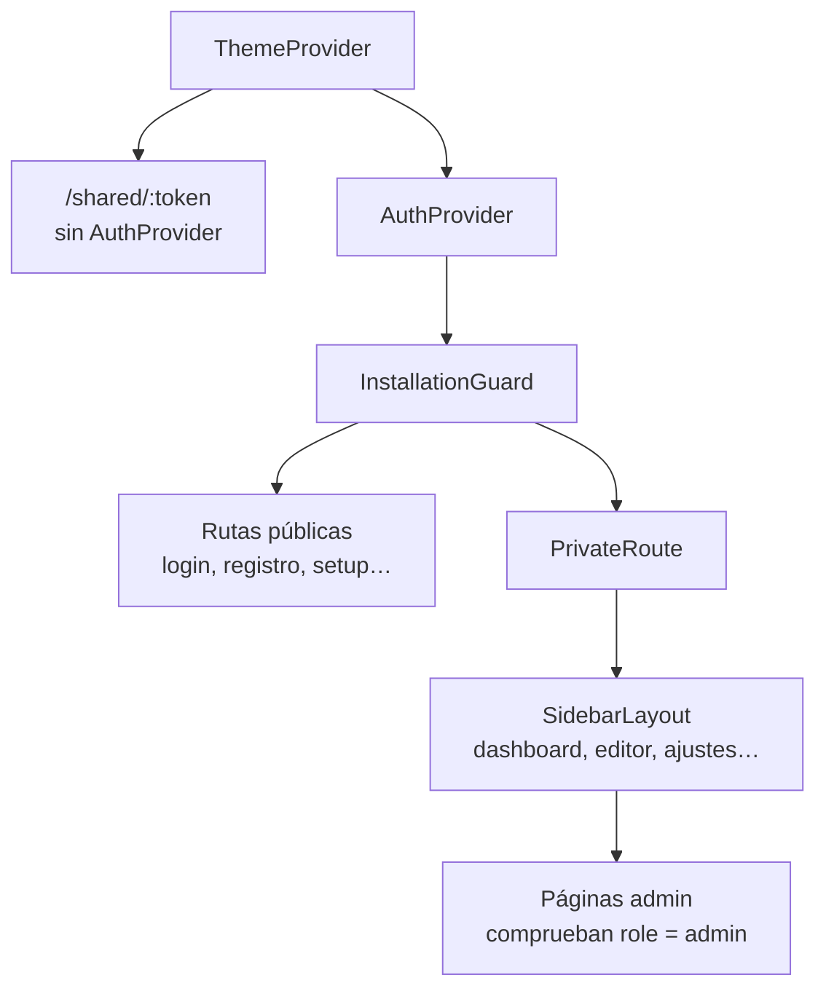

# Frontend

SPA en **React 19 + TypeScript** construida con **Vite 7**, estilos con **TailwindCSS v3** y rutas con **React Router v7**. Paquetes con **pnpm**.

```bash
cd frontend
pnpm install
pnpm dev       # Vite con HMR en :5173
pnpm build     # tsc -b && vite build
pnpm lint      # ESLint
pnpm test      # Vitest
```

## Estructura de `src/`

```text
frontend/src/
├── App.tsx          # proveedores + rutas
├── main.tsx         # punto de entrada + Sentry
├── index.css        # directivas Tailwind + @layer components
├── pages/           # una página por ruta
├── components/      # UI reutilizable (+ admin/, annotations/, mfa/, subscription/)
├── contexts/        # AuthContext, ThemeContext, PresentationContext
├── services/        # api.ts (Axios + ApiService), streamConsumer.ts (SSE del chat)
├── hooks/           # useIsMobile, useTouchZoomPan, useDialogA11y, …
├── types/           # tipos por dominio (ai, auth, chat, project, sharing, …)
├── utils/           # render, exportación, pizarrón, sketch → Mermaid, … (+ __tests__/)
└── i18n/            # config.ts + locales/es.json, en.json
```

## Rutas

Definidas en [`frontend/src/App.tsx`](https://github.com/diagramahub/diagramahub/blob/main/frontend/src/App.tsx).



| Ruta | Página | Acceso |
|---|---|---|
| `/shared/:token` | `SharedDiagramPage` | Pública, fuera de `AuthProvider` |
| `/setup` | `InstallationWizardPage` | Pública (asistente de instalación) |
| `/login`, `/register` | `LoginPage`, `RegisterPage` | Pública |
| `/forgot-password`, `/reset-password` | `ForgotPasswordPage`, `ResetPasswordPage` | Pública |
| `/mfa-verify` | `MfaVerifyPage` | Pública (segundo paso del login) |
| `/oauth/callback` | `OAuthCallbackPage` | Pública (retorno de Google) |
| `/onboarding` | `OnboardingWizardPage` | Sesión iniciada |
| `/dashboard` | `DashboardPage` | Sesión iniciada |
| `/projects-list` | `ProjectsPage` | Sesión iniciada |
| `/projects/:projectId` | `DiagramEditorPage` | Sesión iniciada |
| `/projects/:projectId/diagrams/:diagramId` | `DiagramEditorPage` | Sesión iniciada |
| `/profile`, `/settings` | `ProfilePage`, `SettingsPage` | Sesión iniciada |
| `/subscription` | `SubscriptionPage` | Sesión iniciada |
| `/about` | `AboutPage` | Sesión iniciada |
| `/admin`, `/admin/users`, `/admin/plans`, `/integrations` | `AdminPage`, `UserManagementPage`, `PlansPage`, `IntegrationsPage` | Administrador |
| `/` | redirige a `/dashboard` | — |
| `*` | `NotFoundPage` | — |

- `InstallationGuard` envía a `/setup` mientras no exista un administrador.
- `PrivateRoute` redirige a `/login` sin sesión.
- Las páginas de administración redirigen a `/dashboard` si `user.role !== 'admin'`. Es solo navegación: **la autorización real la hace el backend**.
- Las rutas del editor se envuelven además en `PresentationProvider` (modo presentación).

## Estado global

| Contexto | Qué guarda |
|---|---|
| `AuthContext` | Usuario y JWT (en `localStorage`, clave `token`); cierre de sesión automático ante un `401` |
| `ThemeContext` | Tema claro/oscuro, persistido en `localStorage` bajo `theme` |
| `PresentationContext` | Si el editor está en modo presentación |

## Capa de API

[`services/api.ts`](https://github.com/diagramahub/diagramahub/blob/main/frontend/src/services/api.ts) centraliza todas las llamadas en la clase `ApiService` (exportada como `apiService`):

- Instancia de Axios con `baseURL = API_URL`.
- Interceptor de petición: añade `Authorization: Bearer <token>` y `Accept-Language` con el idioma de la interfaz (los errores y la IA responden en ese idioma).
- Interceptor de respuesta: ante `401` borra `token` y `user` y vuelve al login.
- El streaming del chat se consume con `fetch` + SSE en `services/streamConsumer.ts`.

`API_URL`, `SENTRY_DSN` y `APP_ENV` salen de [`utils/runtimeConfig.ts`](https://github.com/diagramahub/diagramahub/blob/main/frontend/src/utils/runtimeConfig.ts) con esta precedencia: `window.__DH_CONFIG__` (inyectado en `/config.js` al arrancar la imagen de producción), luego las variables `VITE_*` de build y por último valores de localhost. Así la misma imagen sirve para cualquier dominio.

## Internacionalización

- i18next + react-i18next, configurado en `src/i18n/config.ts`. Español por defecto (`fallbackLng: 'es'`), inglés disponible; el idioma se guarda en `localStorage` bajo `language`.
- **Todo** texto visible se escribe con `t('clave')` y la clave existe en `es.json` **y** `en.json`. El test `i18nParity.test.ts` falla si los archivos no tienen exactamente las mismas claves.

## Design system (resumen)

La referencia obligatoria es [`DESIGN.md`](https://github.com/diagramahub/diagramahub/blob/main/DESIGN.md). Lo esencial:

- **Sin librerías de UI ni de íconos**: solo TailwindCSS y componentes propios; íconos SVG inline estilo Heroicons.
- **Identidad morada**: `bg-purple-600` / `hover:bg-purple-700`; botón principal `.btn-glass`. Peligro en `red-600`, éxito en `green-600`.
- **Modo oscuro en todo**: `darkMode: 'class'` y variantes `dark:` en cada color.
- **Sin colores en `style`**: solo clases de Tailwind; CSS propio únicamente en `index.css` bajo `@layer components`.
- **Accesibilidad mínima**: elementos `<button>`/`<a>` semánticos, `aria-label` en controles sin texto, foco visible `focus:ring-2 focus:ring-purple-500`, contraste AA.
- Páginas nuevas en `pages/` + ruta en `App.tsx`; UI reutilizable en `components/`.
