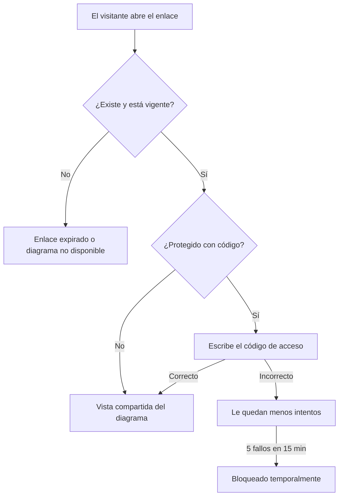

# Compartir diagramas

Puedes compartir un diagrama con cualquier persona mediante un **enlace**. Quien lo abra no necesita una cuenta de DiagramaHub: ve el diagrama en modo de solo lectura.

## Crear un enlace

1. Abre el diagrama en el editor. Si es nuevo, guárdalo primero: no se puede compartir un diagrama sin guardar.
2. Usa **Compartir diagrama**.
3. Configura el enlace:

| Opción | Valores |
|---|---|
| **Tipo de acceso** | **Público**: cualquiera con el enlace lo ve. **Protegido con código**: el visitante debe escribir un código de acceso. |
| **Código de acceso** | Solo para enlaces protegidos. Entre 4 y 20 caracteres. Escribe uno o usa **Generar**. Si lo dejas vacío, se genera uno automáticamente. |
| **Vigencia del enlace** | 5, 10 o 30 días, o **Ilimitado**. El valor predeterminado es 30 días. |
| **Permitir copiar código del diagrama** | Si lo activas, el visitante puede ver y copiar el código fuente. |

4. Pulsa **Generar enlace** y usa **Copiar enlace**.

!!! warning "Guarda el código de acceso al crearlo"
    El código se muestra **solo cuando creas el enlace**. DiagramaHub guarda únicamente una versión cifrada (hash) del código, así que después no lo puede mostrar de nuevo. Si lo pierdes, crea un enlace nuevo.

## Un enlace activo por diagrama

Cada diagrama tiene como máximo **un enlace activo**. Si generas uno nuevo, el anterior deja de funcionar. Mientras haya un enlace activo, el editor lo indica con «Este diagrama tiene un enlace compartido activo».

El enlace muestra siempre la **versión actual** del diagrama: si lo editas, el visitante verá los cambios la próxima vez que abra el enlace.

## Revocar un enlace

En **Compartir diagrama**, usa **Revocar enlace**. El enlace deja de funcionar de inmediato. Si eliminas el diagrama, su enlace también se revoca.

## Qué ve el visitante

En la **Vista compartida**, el visitante puede:

- ver el título, la descripción del diagrama y el nombre de quien lo compartió;
- acercar, alejar y usar **Ajustar a pantalla**;
- ver y copiar el código, solo si activaste **Permitir copiar código del diagrama**.

El visitante no puede editar el diagrama ni ver el resto de tu proyecto.

!!! note "Copiar código no es un mecanismo de confidencialidad"
    Desactivar **Permitir copiar código del diagrama** oculta la vista del código en la página compartida. Aun así, el navegador del visitante recibe el diagrama para dibujarlo. No compartas por enlace información que no deba ver quien tenga acceso al enlace.

## Protección contra abuso

- **Intentos de código**: después de 5 códigos incorrectos en 15 minutos desde la misma conexión, el enlace se bloquea temporalmente para esa conexión.
- **Límite de peticiones**: las páginas públicas aceptan un número limitado de peticiones por minuto por IP.
- **Registro de accesos**: cada acceso queda registrado con la IP **anonimizada** (se guarda un hash, no la dirección).
- **Tokens impredecibles**: la URL de cada enlace usa un token aleatorio criptográficamente seguro, así que no se puede adivinar.

Más detalles en [Protecciones](../seguridad/protecciones.md).
