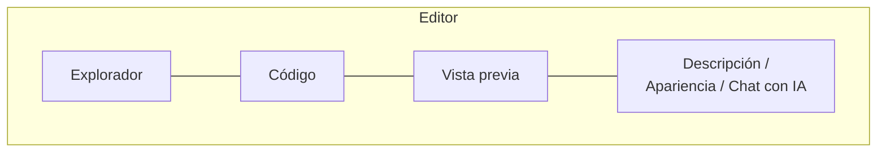

# El editor

El editor es donde escribes, ves y ajustas cada diagrama. Se divide en paneles que puedes mostrar u ocultar desde la barra superior.

## Código y vista previa

Pulsa **Código** para abrir el panel de código, basado en el editor Monaco (el mismo motor de VS Code): números de línea, resaltado de sintaxis (D2 tiene un resaltado propio), deshacer/rehacer y colores que siguen el tema claro u oscuro de la aplicación.

- La **vista previa** se actualiza mientras escribes (con una breve pausa para no renderizar en cada tecla).
- El pie del panel muestra el número de líneas y el estado de la sintaxis: **Sin errores** o **Error de sintaxis**.
- **Copiar código** copia el código al portapapeles.
- Puedes redimensionar el panel arrastrando su borde.

!!! tip "Errores de sintaxis"
    Si el diagrama tiene un error, la vista previa te muestra el mensaje y una lista de comprobaciones habituales (tipo de diagrama válido, flechas, caracteres sin escapar, comillas balanceadas). En el panel de código aparece el botón **Corregir con IA** (requiere un proveedor de IA configurado): propone una corrección con una explicación de los cambios y te muestra el **Código original** junto al **Código corregido** antes de que pulses **Aplicar corrección**. Consulta [Asistente de IA](ia.md).

## Autoguardado

No hay botón de guardar: **los cambios se guardan solos**.

- El código, el título, la descripción y la apariencia se guardan unos 1,5 segundos después de que dejas de escribir.
- La barra muestra el estado (**Guardando...**, **Guardado** y hace cuánto: «Guardado hace 2m»).
- Los guardados nunca se pisan entre sí: si uno tarda, el siguiente espera a que termine.

## Zoom y posición de la vista

| Acción | Cómo |
|---|---|
| Acercar / alejar | Botones de zoom de la barra o rueda del ratón sobre la vista previa |
| Ajustar a pantalla | Botón **Ajustar a pantalla** |
| Restablecer al 100 % | Botón **Restablecer vista (100%)** |
| Mover la vista | Arrastra la vista previa (en móvil, pellizca y arrastra) |

!!! info "La vista se recuerda por diagrama"
    El nivel de zoom y la posición se guardan con cada diagrama (aproximadamente un segundo después de que dejas de moverte), así que al volver a abrirlo lo encuentras exactamente donde lo dejaste. Mover la vista no cuenta como una edición del diagrama.

## Explorador

**Explorador** abre el árbol del proyecto con sus carpetas y diagramas. Atajo: ++ctrl+b++ (++cmd+b++ en macOS).

- **Buscar diagrama...** filtra el árbol por nombre y muestra cuántos coinciden.
- Arrastra un diagrama sobre una carpeta para moverlo, o sobre la raíz para sacarlo de la carpeta.
- El menú de cada diagrama ofrece **Renombrar**, **Duplicar**, **Mover a carpeta**, **Mover a otro proyecto** y **Eliminar**.
- Las carpetas tienen **Color**, **Nuevo diagrama aquí**, edición y eliminación.
- Puedes redimensionar el explorador; doble clic en su borde lo restablece.

Más sobre organización en [Proyectos y carpetas](organizacion.md).

## Descripción

**Descripción** abre un panel para documentar el diagrama en **Markdown** (con editor visual). Úsalo para explicar decisiones, contexto o pendientes.

- **Fijar panel** lo mantiene abierto junto a la vista previa.
- Puedes cambiar el tamaño del texto y el ancho del panel; esas preferencias se recuerdan por diagrama.
- La descripción puede incluirse al exportar a PDF o Markdown (ver [Exportar e importar](exportar-importar.md)).

## Apariencia

**Apariencia** abre las opciones visuales del diagrama. Lo que ves depende del tipo:

| Tipo | Opciones |
|---|---|
| Mermaid | Tema, layout, estilo, tipo de líneas, fuente y tamaño de fuente |
| PlantUML | Tema |
| D2 | Tema |
| DBML | Solo fondo |
| Todos | **Color de fondo** y **Patrón de fondo** (**Plano**, **Puntos**, **Cuadrícula**) |

El detalle de temas y estilos por lenguaje está en [Tipos de diagrama](tipos-de-diagrama.md). El color y patrón de fondo son del visor: no modifican el código del diagrama.

## Título, mover y clonar

- Haz clic en el título del diagrama para editarlo (++enter++ guarda, ++esc++ cancela).
- **Mover diagrama** lo lleva a otro proyecto (queda en la raíz del proyecto de destino).
- **Clonar diagrama** crea una copia en el mismo proyecto con el sufijo «-copia».

## Convertir a otro tipo

**Convertir tipo de diagrama** reescribe el diagrama en otro lenguaje (por ejemplo, de PlantUML a Mermaid) usando tu proveedor de IA:

1. Elige el formato en **Convertir a**.
2. Revisa la **Vista previa de conversión**: el original junto al convertido, en vista previa o en código, con avisos de posibles incompatibilidades.
3. Pulsa **Aplicar conversión**: el contenido y el tipo del diagrama se actualizan al formato destino.

!!! warning "La conversión puede no ser exacta"
    Cada lenguaje tiene elementos y estilos propios; revisa la vista previa antes de aplicar. Requiere un proveedor de IA configurado.

Para los pizarrones a mano alzada, el menú ofrece **Boceto → Mermaid**, una conversión sin IA descrita en [Pizarrón a mano alzada](pizarron.md#boceto-mermaid).

## Atajos del editor

| Atajo | Acción |
|---|---|
| ++ctrl+b++ / ++cmd+b++ | Mostrar u ocultar el explorador |
| ++esc++ | Salir del modo presentación |
| ++enter++ / ++esc++ | Guardar / cancelar la edición del título |

Los atajos del pizarrón están en [Pizarrón a mano alzada](pizarron.md#atajos-de-teclado).
