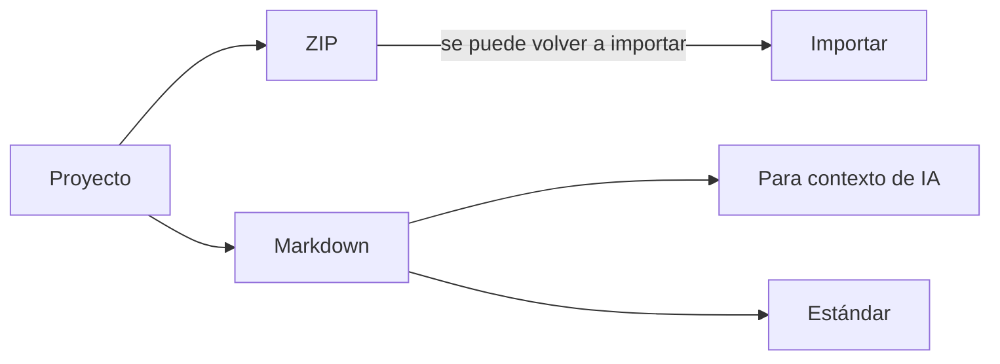

# Exportar e importar

Puedes sacar tus diagramas de DiagramaHub de dos formas: **uno por uno**, como imagen o documento, o **por proyecto o carpeta**, como archivo ZIP o Markdown. También puedes importar archivos de diagrama, archivos ZIP y dibujos de Excalidraw.

## Exportar un diagrama

En el editor, abre **Exportar Diagrama** y elige el formato:

| Formato | Para qué sirve | Opciones |
|---|---|---|
| **PNG** | Imagen rasterizada para presentaciones, chats o documentos. | **Resolución PNG**: Pantalla (1x), Estándar (2x) o Alta (3x). |
| **SVG** | Vector escalable, sin pérdida de calidad. | Se exporta como vector limpio, sin encabezado. |
| **PDF** | Documento para imprimir o adjuntar. | Descripción e información del proyecto. |
| **Markdown** | Archivo `.md` con el código del diagrama en un bloque de código. | Descripción e información del proyecto. |

Para PNG, PDF y Markdown puedes activar:

- **Incluir descripción del diagrama**
- **Incluir información del proyecto** (proyecto, carpeta, autor)

!!! info "Pizarrones a mano alzada"
    Un [pizarrón](pizarron.md) solo se exporta como **PNG**. Además, tiene la opción **Fondo transparente** para quitar el fondo del lienzo.

### Descargar el código fuente

En el mismo diálogo, **Descargar código fuente** baja el diagrama como texto, con la extensión de su tipo:

| Tipo | Extensión |
|---|---|
| Mermaid | `.mmd` |
| PlantUML | `.puml` |
| D2 | `.d2` |
| DBML | `.dbml` |
| Pizarrón | `.freehand.json` |

Esos archivos se pueden volver a [importar](#importar-diagramas).

## Exportar un proyecto o una carpeta

Usa **Exportar proyecto** o **Exportar carpeta** y elige:

1. **Alcance**: **Proyecto completo** (la raíz y todas las carpetas) o **Una carpeta**.
2. **Formato**:

    === "ZIP — carpetas y archivos individuales"

        Un archivo por diagrama con su extensión (`.mmd`, `.puml`, `.d2`, `.dbml`, `.freehand.json`) dentro de una carpeta por cada carpeta del proyecto. Si activas **Incluir descripciones**, cada diagrama lleva al lado un `.md` con su descripción.

        El ZIP incluye un `README.md` con el índice y un `manifest.json` con los datos necesarios para **volver a importarlo**: títulos, carpetas y sus colores.

    === "Markdown — un solo archivo"

        Todos los diagramas en un solo `.md`, con un bloque de código por diagrama. Tiene dos variantes:

        - **Para contexto de IA**: agrega un preámbulo que le explica el archivo al modelo, un índice con rutas y los metadatos de cada diagrama. Está pensado para pegarlo en un asistente de IA como contexto de tu proyecto.
        - **Estándar**: un documento limpio con título, secciones, descripciones y código.

        Los pizarrones no tienen código fuente de texto. En el Markdown aparecen como una nota con los textos que contienen.

Antes de descargar, el diálogo muestra un resumen de lo que vas a recibir: número de diagramas, carpetas y tamaño. En la variante para IA también muestra una estimación de **tokens**.

!!! note "Qué no viaja en la exportación"
    Se exporta el **título, tipo, código y descripción** de cada diagrama, además de las carpetas con sus colores. **No** se exportan la configuración visual guardada aparte (tema, fondo, posición y zoom de la vista) ni los enlaces compartidos.

## Importar diagramas

Usa **Importar archivos** en el proyecto o **Importar aquí** sobre una carpeta. También puedes arrastrar los archivos al explorador.

### Archivos aceptados

| Archivo | Resultado |
|---|---|
| `.mmd`, `.mermaid` | Diagrama Mermaid |
| `.puml`, `.plantuml`, `.pu`, `.iuml` | Diagrama PlantUML |
| `.d2` | Diagrama D2 |
| `.dbml` | Diagrama DBML |
| `.freehand.json` | Pizarrón de DiagramaHub |
| `.excalidraw`, `.excalidraw.json` | Dibujo de Excalidraw, convertido a pizarrón |
| `.md`, `.markdown`, `.txt` | Un diagrama, si el archivo contiene un bloque de código de diagrama |
| `.zip` | Varios diagramas, con sus carpetas |

En un archivo Markdown, el bloque de código se convierte en el diagrama. Un título `# …` al inicio se usa como título del diagrama y el resto del texto como descripción.

### Vista previa antes de importar

Antes de crear nada, DiagramaHub te muestra una **Vista previa**:

- qué diagramas y carpetas se crearán;
- qué archivos se omitirán y por qué (por ejemplo, «tipo no reconocido» o «ZIP dentro de otro ZIP»);
- cómo quedará tu cuota de diagramas («Quedarás en 12 de 30 diagramas de tu plan»).

### Cómo se importa un ZIP

- Las carpetas se toman del **primer nivel** de rutas del ZIP. Si todo el contenido está dentro de una sola carpeta raíz, se usa el nivel siguiente. Los niveles más profundos se integran en la carpeta de primer nivel.
- Un `.md` con el mismo nombre que un diagrama (`flujo.md` junto a `flujo.mmd`) se usa como su descripción.
- Si ya existe una carpeta con el mismo nombre (sin distinguir mayúsculas), se reutiliza.
- Si el ZIP es una exportación de DiagramaHub, también se recuperan los títulos originales y los colores de las carpetas.

### Importar desde Excalidraw

Los dibujos `.excalidraw` se convierten en un [pizarrón](pizarron.md). Se conservan rectángulos, rombos, elipses, flechas, líneas, textos y trazos libres. Un texto unido a una forma se convierte en su etiqueta. Las imágenes, marcos, elementos embebidos y cualquier otro elemento se omiten; la vista previa indica cuántos se omitieron y lo marca como importación **parcial**.

### Garantías y límites

!!! success "Todo o nada"
    - La cuota de tu plan se revisa **antes** de crear cualquier cosa. Si la importación la superaría, no se importa nada.
    - Si algo falla a mitad del proceso, se deshace lo que ya se había creado.

| Límite | Valor predeterminado |
|---|---|
| Tamaño total de la subida | 20 MB |
| Archivos por importación | 500 |
| Tamaño descomprimido de un ZIP | 50 MB |
| Tamaño de un archivo individual | 5 MB |

El operador de la instancia puede ajustar estos valores. También hay un límite de importaciones y exportaciones por minuto. Si lo alcanzas, el mensaje te indica cuántos segundos esperar.
