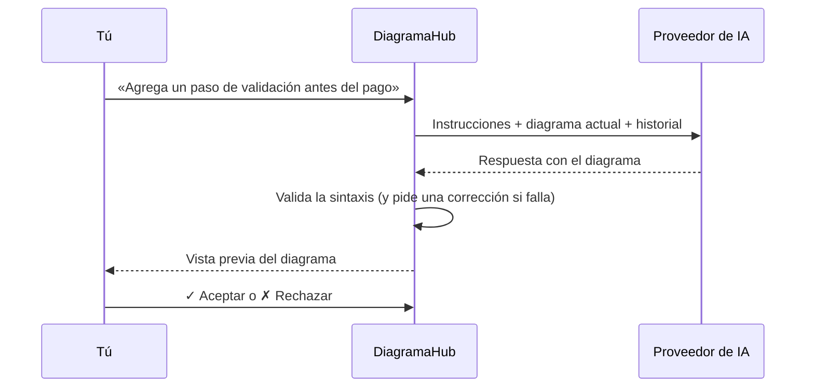

# Asistente de IA

DiagramaHub usa un modelo **BYOL** (*Bring Your Own LLM*): tú conectas **tu propia clave API** de un proveedor de IA y DiagramaHub la usa para generar, mejorar, corregir y explicar diagramas. El uso del modelo se cobra en **tu cuenta del proveedor**, no en DiagramaHub.

## Proveedores compatibles

| Proveedor | Dónde obtener la clave API |
|---|---|
| **Google Gemini** | [Google AI Studio](https://aistudio.google.com/app/apikey) |
| **OpenAI GPT** | [OpenAI Platform](https://platform.openai.com/api-keys) |
| **Anthropic Claude** | [Anthropic Console](https://console.anthropic.com/settings/keys) |
| **DeepSeek** | [DeepSeek Platform](https://platform.deepseek.com/api_keys) |
| **Minimax** | [Minimax Platform](https://platform.minimax.io/user-center/basic-information) |

## Configurar un proveedor

1. Ve a **Ajustes → Integraciones de IA**.
2. Pulsa **Agregar Proveedor** y elige el proveedor.
3. Pega tu **Clave API** y elige el **Modelo**. El modelo sugerido aparece marcado como **Recomendado**.
4. Opcionalmente, ponle un **Nombre personalizado** (por ejemplo, «Mi cuenta de Gemini»).
5. Usa **Probar Conexión** para comprobar la clave antes de guardarla.

Si la prueba falla, el mensaje te dice la causa: clave inválida o sin permisos, cuenta sin créditos, límite de peticiones del proveedor o modelo no disponible para esa clave.

Puedes conectar varios proveedores. Marca uno con **Usar como predeterminado** y desactiva temporalmente los que no quieras usar con **Activo**. El proveedor de una conexión no se puede cambiar: si quieres otro, crea una conexión nueva.

??? note "Modelos disponibles (0.8.x)"
    La lista sale del catálogo de modelos del servidor. Puede cambiar entre versiones.

    | Proveedor | Modelos | Recomendado |
    |---|---|---|
    | Google Gemini | `gemini-3.8-flash`, `gemini-3.7-flash`, `gemini-3.5-flash`, `gemini-3.5-flash-lite`, `gemini-3.1-pro-preview` | `gemini-3.8-flash` |
    | OpenAI GPT | `gpt-6-luna`, `gpt-6.1-sol`, `gpt-6-astra`, `gpt-5.5`, `gpt-5.4-mini`, `gpt-5.4-nano`, `gpt-4.1-mini` | `gpt-6-luna` |
    | Anthropic Claude | `claude-sonnet-5-5`, `claude-opus-5-5`, `claude-fable-5-1`, `claude-haiku-4-5-20251001` | `claude-sonnet-5-5` |
    | DeepSeek | `deepseek-flash`, `deepseek-v4-pro` | `deepseek-flash` |
    | Minimax | `MiniMax-M2.7`, `MiniMax-M3`, `MiniMax-M2.7-highspeed` | `MiniMax-M2.7` |

    Si un modelo que ya tenías configurado sale de la lista, se muestra como **retirado**. Sigue funcionando mientras el proveedor lo ofrezca, y puedes cambiarlo al editar la conexión.

!!! info "Tu clave está protegida"
    - La clave se guarda **cifrada** en la base de datos.
    - Nunca se devuelve completa: la interfaz solo muestra una versión enmascarada (por ejemplo, `AIza...xyz`).
    - Al editar una conexión, deja el campo vacío para conservar la clave actual.
    - El servidor de DiagramaHub es quien llama al proveedor. El código de tu diagrama y tus mensajes se envían al proveedor que elegiste, según sus propias políticas de privacidad.

## El chat con IA

En el editor, abre **Chat con IA**. El chat es la forma principal de crear y modificar diagramas con IA: describe lo que quieres en lenguaje natural y el asistente responde con el diagrama completo.

### Acciones rápidas

Bajo el cuadro de mensaje tienes cuatro atajos:

| Acción | Qué le pide al modelo |
|---|---|
| 🧠 **Explicar** | Que explique el diagrama de forma clara y breve. No cambia el diagrama. |
| 🎨 **Mejorar UI** | Que lo haga más claro, ordenado y legible. |
| ⚙️ **Mejorar Proceso** | Que mejore el proceso que representa para hacerlo más eficiente. |
| 🛠️ **Reparar** | Que corrija errores de sintaxis, estructura o renderizado y devuelva el diagrama completo. |

### Revisar los cambios

Cuando el asistente propone un diagrama, el chat muestra una **Vista previa del diagrama** (con **Ver en grande**):

- **✓ Aceptar** aplica el cambio al editor.
- **✗ Rechazar** lo descarta.
- En propuestas anteriores puedes usar **↩ Restaurar** o **↩ Utilizar** para volver a esa versión.

### Sesiones de chat

Cada diagrama tiene sus propias **sesiones** de chat. Puedes crear una **Nueva sesión**, cambiar entre sesiones, renombrarlas o eliminarlas, y elegir el **Modelo** de cada sesión.

Cuando una conversación se acerca al límite de contexto del modelo, DiagramaHub la **resume automáticamente** y continúa en una sesión nueva a partir de ese resumen. La sesión anterior queda marcada como **Sesión finalizada (solo lectura)**: puedes consultarla, pero ya no enviarle mensajes.

### Idioma

El asistente responde en el idioma de la interfaz (español o inglés), incluidas las etiquetas de los diagramas que genera.

## Corrección automática

Con **Corregir automáticamente los diagramas generados** (en **Ajustes → Integraciones de IA**, activado por defecto), si el código Mermaid o D2 que genera la IA no se puede renderizar, DiagramaHub le pide al modelo **una corrección** antes de mostrártelo:

- **Mermaid** se valida en tu navegador con el mismo motor que dibuja el diagrama.
- **D2** se valida en el servidor.
- **PlantUML y DBML** no se corrigen automáticamente: su validación daba falsos positivos.

!!! tip "Cada corrección automática usa una llamada extra de tu clave"
    Si prefieres controlar el consumo, desactiva esta opción y usa **Reparar** solo cuando lo necesites.

## Corregir con IA desde el editor

Si el diagrama tiene un error, el panel de código muestra el botón **Corregir con IA**. La propuesta se presenta junto al código original para que revises los cambios antes de aplicarlos.

## Respuestas demasiado largas

Si el diagrama que genera el modelo es tan grande que la respuesta se corta por el límite de salida, DiagramaHub **no aplica** ese código incompleto. En su lugar, el chat te avisa que la respuesta se cortó. Pide un diagrama más pequeño o constrúyelo por partes.

## Otras funciones con IA

- **Descripción con IA**: en la descripción del diagrama, **Generar con IA** propone un texto. Puedes **Refinar** con instrucciones («hazla más corta», «más detalle técnico») antes de **Aceptar**.
- **Convertir tipo de diagrama**: convierte el diagrama a otro formato (por ejemplo, de PlantUML a Mermaid). La conversión se muestra en una vista previa con advertencias de posibles incompatibilidades y solo se aplica al pulsar **Aplicar conversión**. Más en [El editor](editor.md).

## Sin proveedor configurado

Si intentas usar una función de IA sin un proveedor activo, verás **Configuración de IA Requerida** con un acceso a **Ir a Configuración**.
