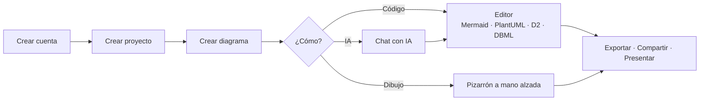

# Guía de uso

Esta guía explica cómo usar DiagramaHub día a día: crear diagramas con código o a mano alzada, organizarlos en proyectos y carpetas, exportarlos, compartirlos y apoyarte en la IA con tu propia clave (BYOL).

Si vas a instalar o administrar tu propia instancia, consulta la sección [Self-host](../self-host/index.md).

-   :material-rocket-launch: **Primeros pasos**

    ---

    Crea tu cuenta, tu primer proyecto y tu primer diagrama, y conoce la interfaz.

    [:octicons-arrow-right-24: Empezar](primeros-pasos.md)

-   :material-code-braces: **El editor**

    ---

    Código, vista previa en vivo, autoguardado, explorador, descripción y apariencia.

    [:octicons-arrow-right-24: Conocer el editor](editor.md)

-   :material-shape: **Tipos de diagrama**

    ---

    Mermaid, PlantUML, D2 y DBML: ejemplos, temas y opciones de cada uno.

    [:octicons-arrow-right-24: Ver tipos](tipos-de-diagrama.md)

-   :material-draw: **Pizarrón a mano alzada**

    ---

    Dibuja formas y flechas con estilo hecho a mano y conviértelas en Mermaid.

    [:octicons-arrow-right-24: Usar el pizarrón](pizarron.md)

-   :material-folder-multiple: **Proyectos y carpetas**

    ---

    Organiza tus diagramas, muévelos, duplícalos y búscalos.

    [:octicons-arrow-right-24: Organizar](organizacion.md)

-   :material-swap-horizontal: **Exportar e importar**

    ---

    PNG, SVG, PDF, Markdown, ZIP de proyectos y archivos de Excalidraw.

    [:octicons-arrow-right-24: Exportar e importar](exportar-importar.md)

-   :material-share-variant: **Compartir diagramas**

    ---

    Enlaces públicos o protegidos con código de acceso y expiración.

    [:octicons-arrow-right-24: Compartir](compartir.md)

-   :material-presentation: **Modo presentación**

    ---

    Muestra tu diagrama a pantalla completa, sin distracciones.

    [:octicons-arrow-right-24: Presentar](presentacion.md)

-   :material-robot: **Asistente de IA**

    ---

    Genera, mejora, corrige y convierte diagramas con tu propio proveedor de IA.

    [:octicons-arrow-right-24: Usar la IA](ia.md)

-   :material-account-lock: **Tu cuenta y seguridad**

    ---

    Perfil, contraseña, verificación en dos pasos (MFA) y eliminación de cuenta.

    [:octicons-arrow-right-24: Tu cuenta](cuenta.md)

## Recorrido típico

!!! tip "Idioma y tema"
    La interfaz está en español e inglés. Puedes cambiar el idioma y alternar entre modo claro y oscuro desde la barra lateral; ambas preferencias se recuerdan en tu navegador.
