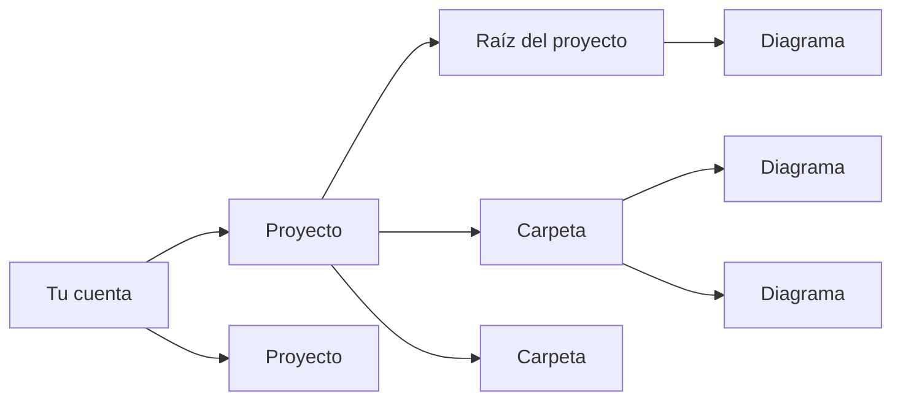

# Proyectos y carpetas

DiagramaHub organiza tu trabajo en tres niveles: **proyectos**, **carpetas** y **diagramas**.

- Un **proyecto** agrupa diagramas relacionados (un sistema, un cliente, un curso…).
- Una **carpeta** vive dentro de un proyecto y agrupa diagramas. Las carpetas tienen un solo nivel: no hay carpetas dentro de carpetas.
- Un **diagrama** pertenece siempre a un proyecto y, opcionalmente, a una carpeta. Si no está en ninguna carpeta, aparece en la **Raíz del proyecto**.

## Proyectos

### Crear un proyecto

Desde el **Panel de control** o la sección **Proyectos**, usa **Crear proyecto**. Cada proyecto tiene:

| Campo | Detalle |
|---|---|
| Nombre del proyecto | Obligatorio. |
| Descripción | Opcional. |
| Icono del proyecto | Un icono para reconocerlo en las listas. |

Para cambiar estos datos, usa **Editar proyecto**.

### Eliminar un proyecto

**Eliminar proyecto** borra el proyecto **con todos sus diagramas y carpetas**. La acción no se puede deshacer.

!!! tip "Haz un respaldo antes"
    Si tienes dudas, primero [exporta el proyecto como ZIP](exportar-importar.md#exportar-un-proyecto-o-una-carpeta). Ese archivo se puede volver a importar.

## El explorador de archivos

Dentro del editor, el explorador lateral muestra el árbol del proyecto: primero las carpetas y luego los diagramas de la raíz. Desde ahí puedes:

- **Buscar** diagramas por nombre. El contador indica cuántos coinciden («3 de 12 diagramas»).
- Crear un diagrama con **Nuevo diagrama aquí**, directamente en la raíz o en una carpeta.
- **Crear carpeta**, renombrarla y elegir su **Color**.
- Arrastrar archivos desde tu computadora para [importarlos](exportar-importar.md#importar-diagramas) en la raíz o en una carpeta.
- Cambiar el ancho del panel arrastrando su borde. Con doble clic vuelve al ancho original.

## Mover, clonar y eliminar diagramas

El menú de acciones de cada diagrama ofrece:

| Acción | Qué hace |
|---|---|
| **Renombrar** | Cambia el título del diagrama. |
| **Duplicar** | Abre **Clonar diagrama**: crea una copia en el mismo proyecto. El nombre sugerido termina en `-copia` y puedes cambiarlo. |
| **Mover a carpeta** | Lo pasa a otra carpeta del mismo proyecto, o a la raíz. |
| **Mover a otro proyecto** | Lo lleva a otro de tus proyectos. Queda en la **raíz** del proyecto de destino. |
| **Eliminar** | Borra el diagrama. Si tenía un enlace compartido activo, el enlace se revoca. |

También puedes **arrastrar** un diagrama del explorador y soltarlo sobre una carpeta. Si lo sueltas en la zona «Suelta aquí para sacarlo de la carpeta», regresa a la raíz.

!!! note "Una copia cuenta como un diagrama nuevo"
    Clonar crea un diagrama más, así que cuenta para el límite de tu plan, igual que crear uno desde cero.

## Eliminar una carpeta

Al eliminar una carpeta que contiene diagramas, DiagramaHub te deja elegir qué hacer con ellos:

=== "Conservar los diagramas"

    La carpeta desaparece y sus diagramas pasan a la **raíz del proyecto**. No se pierde nada.

=== "Eliminar también los diagramas"

    La carpeta se elimina junto con todos sus diagramas. No se puede deshacer.

## Límites de tu plan

Quien opera la instancia de DiagramaHub define los planes: cuántos **proyectos** y cuántos **diagramas** permite cada uno. Si eres el operador, consulta [Planes y límites](../self-host/planes.md).

- El límite de diagramas es para **toda tu cuenta**: se suman los de todos tus proyectos.
- Un plan puede no tener límite. En ese caso la interfaz muestra **Ilimitado**.
- Los límites se aplican en el servidor. Si llegas al límite al crear, clonar o importar, verás **Límite de plan alcanzado** con un enlace a **Ver planes disponibles**.
- Las cuentas de administrador no tienen límites.

Tu consumo actual aparece en **Suscripción → Uso de Recursos**. Más detalles en [Tu cuenta y seguridad](cuenta.md#suscripcion).
