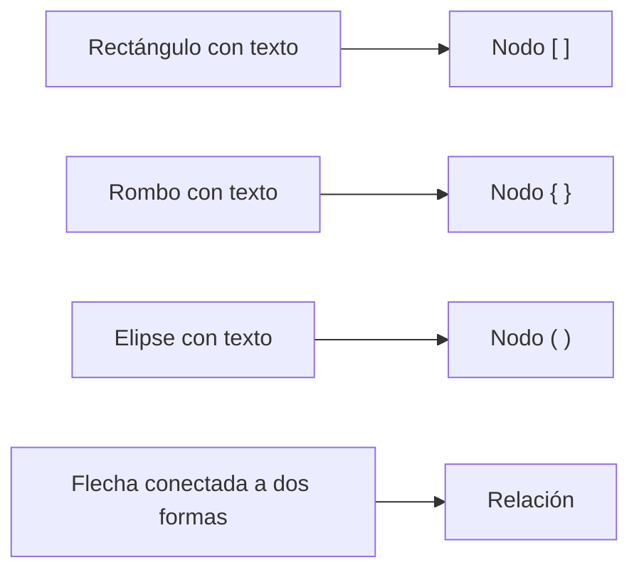

# Pizarrón a mano alzada

El tipo **Mano Alzada** es un pizarrón libre para pensar sin sintaxis: dibuja formas, flechas, texto y trazos con un aspecto hecho a mano. Cuando la idea madura, conviértela en un diagrama Mermaid con un clic.

Para crear uno, elige **Mano Alzada** como **Tipo de diagrama** al crear un diagrama. El pizarrón se guarda automáticamente, igual que cualquier otro diagrama.

## Herramientas

| Herramienta | Atajo | Uso |
|---|---|---|
| **Seleccionar** | ++v++ | Selecciona, mueve, redimensiona y rota elementos |
| **Mano** | ++h++ | Mueve el lienzo |
| **Rectángulo** | ++r++ | Caja |
| **Rombo** | ++d++ | Decisión |
| **Elipse** | ++o++ | Círculo u óvalo |
| **Flecha** | ++a++ | Flecha; si la sueltas sobre una forma, queda conectada a ella |
| **Línea** | ++l++ | Línea sin punta |
| **Texto** | ++t++ | Texto libre |
| **Mano alzada** | ++p++ | Trazo libre, sensible a la presión del lápiz |
| **Borrador** | ++e++ | Borra elementos |

!!! tip "Texto rápido"
    Haz doble clic en una forma para escribir dentro de ella, o doble clic en un espacio vacío (con **Seleccionar**) para crear un texto. ++enter++ confirma y ++esc++ cancela; ++shift+enter++ agrega un salto de línea.

Las flechas conectadas siguen a las formas cuando las mueves o rotas.

## Estilo de los elementos

Con uno o varios elementos seleccionados, el panel **Estilo del elemento** te deja ajustar:

| Opción | Valores |
|---|---|
| **Trazo** y **Relleno** | Color del borde y del interior (o **Sin relleno**) |
| **Grosor** | Ancho del trazo |
| **Estilo de trazo** | **Limpio**, **Arquitecto**, **Artista**, **Caricatura** |
| **Estilo de relleno** | **Sólido**, **Rayado**, **Cruzado** |
| **Fuente** | **Manuscrita**, **Normal**, **Código**; y **Tamaño de fuente** |
| Líneas y flechas | **Línea discontinua**, **Flecha inicial**, **Flecha final** |
| Formas | **Esquinas redondeadas** |

El aspecto «hecho a mano» se dibuja con [Rough.js](https://roughjs.com/) y es estable: un elemento no cambia de forma cada vez que se redibuja.

## Organizar elementos

- **Duplicar**, **Agrupar** / **Desagrupar**.
- Orden: **Traer al frente**, **Traer adelante**, **Enviar atrás**, **Enviar al fondo**.
- Alineación (izquierda, centro, derecha, arriba, medio, abajo) y **Distribuir horizontalmente** / **verticalmente**.
- Guías de alineación al mover elementos.
- Menú contextual con clic derecho.
- **Limpiar todo** borra el pizarrón (se puede deshacer).

## Bloquear elementos

**Bloquear** fija los elementos seleccionados para no moverlos por accidente (también con ++ctrl+shift+l++ / ++cmd+shift+l++ o desde el menú contextual). Un elemento bloqueado no se puede arrastrar, redimensionar, rotar, mover con flechas, alinear, cambiar de estilo, cortar ni borrar hasta que pulses **Desbloquear**.

## Navegar por el lienzo

| Acción | Cómo |
|---|---|
| Mover el lienzo | Rueda del ratón, herramienta **Mano**, mantener ++space++ y arrastrar, o clic central |
| Zoom | ++ctrl++ / ++cmd++ + rueda (centrado en el cursor) o los botones de zoom |
| Ajustar al contenido | ++f++ |

La posición y el zoom del pizarrón se guardan con el diagrama.

## Atajos de teclado

| Atajo | Acción |
|---|---|
| ++ctrl+z++ / ++cmd+z++ | Deshacer |
| ++ctrl+shift+z++ o ++ctrl+y++ | Rehacer |
| ++ctrl+a++ | Seleccionar todo |
| ++ctrl+c++ / ++ctrl+x++ / ++ctrl+v++ | Copiar / cortar / pegar (se pega en la posición del cursor) |
| ++ctrl+d++ | Duplicar |
| ++ctrl+g++ / ++ctrl+shift+g++ | Agrupar / desagrupar |
| ++ctrl+shift+l++ | Bloquear / desbloquear |
| ++delete++ o ++backspace++ | Borrar la selección |
| Flechas (++shift++ = 10 px) | Mover la selección |
| ++esc++ | Quitar la selección y volver a **Seleccionar** |
| ++f++ | Ajustar al contenido |

En macOS usa ++cmd++ en lugar de ++ctrl++.

## Exportar el pizarrón

Desde **Exportar Diagrama**, los pizarrones se exportan como **PNG** con resolución **Pantalla (1x)**, **Estándar (2x)** o **Alta (3x)** y la opción **Fondo transparente**. La imagen abarca todo el contenido dibujado (incluidos elementos rotados); en lienzos muy grandes la escala se reduce automáticamente para no exceder los límites del navegador, sin recortar nada.

También puedes **Descargar código fuente** como archivo `.freehand.json`, que se puede volver a importar. Los archivos de Excalidraw (`.excalidraw`) se importan como pizarrones. Consulta [Exportar e importar](exportar-importar.md).

## Boceto → Mermaid

En un pizarrón, el menú **Convertir tipo de diagrama** ofrece **Boceto → Mermaid**, que crea un **diagrama Mermaid nuevo** (el pizarrón no se modifica). La conversión es determinista y **no usa IA**:

| En el pizarrón | En Mermaid |
|---|---|
| Rectángulo / rombo / elipse con texto | Nodo `[ ]` / `{ }` / `( )` |
| Flecha conectada a dos formas | Relación `-->` (el texto de la flecha es la etiqueta) |
| Flecha discontinua | `-.->` |
| Flecha con dos puntas | `<-->` |
| Línea sin punta | `---` |
| Flecha que sale y llega a la misma forma | Relación consigo misma |

!!! note "Lo que se omite"
    Los trazos a mano alzada, los textos sueltos, las flechas sin conectar y las formas sin texto no tienen equivalente estructural: se omiten y DiagramaHub te dice cuántos de cada tipo quedaron fuera.
