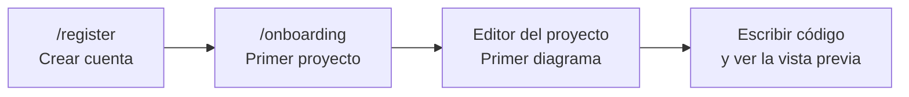

# Primeros pasos

En unos minutos tendrás una cuenta, un proyecto y tu primer diagrama.



## 1. Crea tu cuenta

Abre tu instancia de DiagramaHub (por ejemplo `http://localhost:5173` en una instalación local) y entra a **Registrarse**.

- Indica tu correo, tu nombre (opcional) y una contraseña.
- Si el administrador activó el inicio de sesión con Google, también puedes registrarte con ese botón.

!!! info "Requisitos de la contraseña"
    La contraseña debe tener **al menos 12 caracteres** e incluir una mayúscula, una minúscula, un número y un carácter especial. No puede ser igual a tu correo. Un indicador te muestra su fortaleza mientras escribes.

Toda cuenta nueva recibe automáticamente el plan gratuito de la instancia. Los límites de proyectos y diagramas de cada plan los define quien administra la instalación.

??? note "¿Es la primera vez que se abre la instancia?"
    Si nadie ha configurado aún la instalación, DiagramaHub te lleva primero al asistente de instalación (`/setup`) para crear la cuenta de administrador. Consulta [Instalación](../instalacion.md).

## 2. Crea tu primer proyecto

Después del registro llegas al asistente de bienvenida, que te pide crear tu primer proyecto:

1. Elige un icono.
2. Escribe el nombre del proyecto (obligatorio) y, si quieres, una descripción.
3. Pulsa **Crear proyecto y continuar →**.

Si cierras el asistente vuelves al **Inicio** (dashboard), donde puedes crear proyectos en cualquier momento con **Crear proyecto**.

## 3. Crea tu primer diagrama

Al abrir el proyecto aparece la ventana **¡Crea tu primer diagrama!**:

1. Dale un nombre descriptivo.
2. Elige el **Tipo de diagrama**:

    | Tipo | Para qué sirve |
    |---|---|
    | **Mermaid** | Flujo, secuencia, clases, estado, ER, Gantt |
    | **PlantUML** | UML, clases, componentes, secuencia, actividad |
    | **D2** | Lenguaje de diagramación declarativo |
    | **DBML** | Tablas, columnas y relaciones de bases de datos |
    | **Mano Alzada** | Pizarrón libre para dibujar con formas básicas |

3. Opcionalmente, elige una **Carpeta** (o déjalo en la raíz del proyecto).
4. Pulsa **Crear diagrama y empezar →**.

El diagrama se crea con un ejemplo mínimo del tipo elegido para que veas de inmediato cómo se renderiza. Por ejemplo, un diagrama Mermaid nuevo empieza así:

```text
graph TD
  A[Start] --> B[End]
```

Más detalles de cada lenguaje en [Tipos de diagrama](tipos-de-diagrama.md).

## 4. Recorrido de la interfaz

### Barra lateral

Desde la barra lateral navegas por la aplicación:

| Elemento | Qué encontrarás |
|---|---|
| **Inicio** | Resumen de tu espacio: proyectos, diagramas, última actividad, plan actual, últimos diagramas actualizados y uso de motores de IA |
| **Proyectos** | La lista de todos tus proyectos |
| **Perfil** | Tus datos, contraseña y verificación en dos pasos (MFA) |
| **Ajustes** | Tus proveedores de IA (BYOL) y la eliminación de tu cuenta |
| **Suscripción** | Tu plan y su uso |
| **Idioma** / **Cambiar tema** | Español o inglés; modo claro u oscuro |

Los administradores ven además una sección **Administración** (usuarios, planes e integraciones).

### El editor

Al abrir un diagrama entras al editor. La barra superior agrupa sus herramientas:

| Botón | Función |
|---|---|
| **Explorador** | Árbol de carpetas y diagramas del proyecto (++ctrl+b++ / ++cmd+b++) |
| **Código** | Panel con el código del diagrama |
| **Descripción** | Notas del diagrama en Markdown |
| **Apariencia** | Tema, estilo y fondo del diagrama |
| **Chat con IA** | Asistente para generar o modificar el diagrama |
| **Nuevo Diagrama** | Crea otro diagrama en el proyecto |
| **Exportar Diagrama** / **Compartir diagrama** | Descargas y enlaces públicos |
| **Convertir tipo de diagrama** | Pasa el diagrama a otro lenguaje |
| Zoom | Reducir, aumentar y ajustar a pantalla |
| **Presentar** | Modo presentación a pantalla completa |

Todo se explica en detalle en [El editor](editor.md).

!!! tip "Siguiente paso"
    Configura un proveedor de IA en **Ajustes** para generar diagramas desde una descripción en lenguaje natural. Consulta [Asistente de IA](ia.md).
