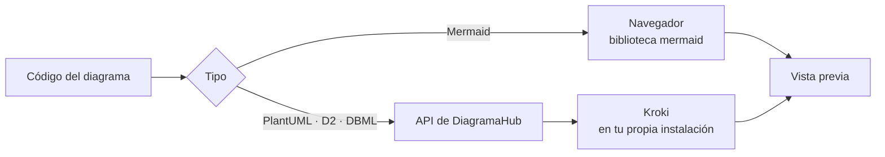

# Tipos de diagrama

DiagramaHub admite cuatro lenguajes de diagramas como texto y un pizarrón a mano alzada. Eliges el tipo al crear el diagrama y puedes cambiarlo después con **Convertir tipo de diagrama** (ver [El editor](editor.md#convertir-a-otro-tipo)).

| Tipo | Ideal para | Dónde se renderiza | Extensión al descargar |
|---|---|---|---|
| [Mermaid](#mermaid) | Flujo, secuencia, clases, estado, ER, Gantt | En tu navegador | `.mmd` |
| [PlantUML](#plantuml) | UML, clases, componentes, secuencia, actividad | En el servidor (Kroki) | `.puml` |
| [D2](#d2) | Diagramas declarativos de arquitectura y sistemas | En el servidor (Kroki) | `.d2` |
| [DBML](#dbml) | Tablas, columnas y relaciones de bases de datos | En el servidor (Kroki) | `.dbml` |
| [Mano Alzada](pizarron.md) | Bocetos libres con formas y flechas | En tu navegador | `.freehand.json` |



!!! info "Tu contenido no sale de tu instalación"
    PlantUML, D2 y DBML se renderizan con [Kroki](https://kroki.io/). En las instalaciones con Docker Compose, Kroki corre como un servicio más junto a DiagramaHub (`KROKI_URL`, ver [Configuración](../self-host/configuracion.md)), así que tus diagramas no se envían a un servicio público.

## Mermaid

[Mermaid](https://mermaid.js.org/) es el tipo más versátil: diagramas de flujo, secuencia, clases, estados, entidad-relación, Gantt, entre otros. Se renderiza en tu navegador, así que la vista previa es instantánea.

=== "Código"

    ```text
    graph TD
      A[Start] --> B[End]
    ```

=== "Resultado"

    ```mermaid
    graph TD
      A[Start] --> B[End]
    ```

### Opciones de apariencia

En **Apariencia** puedes ajustar:

| Opción | Valores |
|---|---|
| **Tema** | Default, Base (personalizable), Dark, Forest, Neutral |
| **Layout** | Dagre, ELK |
| **Estilo** | Classic, Neo, Hand Drawn (aspecto de boceto) |
| Tipo de líneas | Basis (suaves), Linear (rectas), Step, Step Before, Step After |
| Fuente | Por defecto, Arial, Helvetica, Verdana, Trebuchet MS, Georgia, Courier New, Times New Roman |
| Tamaño de fuente | 12, 14, 16, 18 o 20 px |

Estas opciones se guardan dentro del propio código del diagrama como un bloque de inicialización de Mermaid (`%%{init: ...}%%`), así que viajan con el código cuando lo copias o exportas.

!!! tip
    Los diagramas Mermaid nuevos usan fondo con **Cuadrícula** por defecto; el resto, fondo **Plano**. Puedes cambiarlo en **Apariencia**.

## PlantUML

[PlantUML](https://plantuml.com/) es el estándar para UML: clases, componentes, secuencia, actividad, casos de uso y más. El código va entre `@startuml` y `@enduml`.

```text
@startuml
Alice -> Bob: Hello
Bob -> Alice: Hi!
@enduml
```

### Temas

En **Apariencia** eliges un **Tema** de PlantUML. DiagramaHub inserta la directiva `!theme <nombre>` justo después de `@startuml`:

| Grupo | Temas |
|---|---|
| Estilos modernos | sketchy, sketchy-outline, blueprint, minty, spacelab |
| Color | bluegray, cerulean, cerulean-outline, materia, materia-outline, lightgray, plain |
| Oscuros | cyborg, cyborg-outline, superhero, superhero-outline, black-knight, hacker |
| Retro | amiga, crt-amber, crt-green, metal |
| Otros | resume-light, unitide |

También puedes escribir directivas `skinparam` directamente en el código.

## D2

[D2](https://d2lang.com/) es un lenguaje declarativo pensado para diagramas de arquitectura y sistemas: describes las conexiones y D2 se encarga del acomodo. El editor incluye resaltado de sintaxis propio para D2.

```text
x -> y: hello world
```

### Temas

El **Tema** de D2 se guarda en el código como un bloque `vars`:

```text
vars: {
  d2-config: {
    theme-id: 200
  }
}
x -> y: hello world
```

| Grupo | Temas (id) |
|---|---|
| Claros | Default (0), Neutral Grey (1), Flagship Terrastruct (3), Cool Classics (4), Mixed Berry Blue (5), Grape Soda (6), Aubergine (7), Colorblind Clear (8), Vanilla Nitro Cola (100), Orange Creamsicle (101), Shirley Temple (102), Earth Tones (103), Everglade Green (104), Buttered Toast (105) |
| Oscuros | Dark Mauve (200), Dark Flagship Terrastruct (201) |
| Especiales | Terminal (300), Terminal Grayscale (301), Origami (302) |

## DBML

[DBML](https://dbml.dbdiagram.io/) (*Database Markup Language*) define tablas, columnas y relaciones de una base de datos. Es ideal para documentar esquemas.

```text
Table users {
  id integer [primary key]
  username varchar
  email varchar
  created_at timestamp
}

Table posts {
  id integer [primary key]
  title varchar
  body text
  user_id integer
  created_at timestamp
}

Ref: posts.user_id > users.id
```

DBML no tiene temas: en **Apariencia** solo ajustas el color y el patrón de fondo.

## Validación de sintaxis

Mientras escribes, el editor revisa la sintaxis y muestra **Sin errores** o **Error de sintaxis** en el panel de código. Con un proveedor de IA configurado puedes usar **Corregir con IA** (ver [Asistente de IA](ia.md)).

## ¿Cuál elijo?

| Si quieres… | Usa |
|---|---|
| Un flujo, una secuencia o un Gantt rápido, con vista previa instantánea | Mermaid |
| UML formal y detallado | PlantUML |
| Arquitectura de sistemas con acomodo automático y temas cuidados | D2 |
| Documentar un esquema de base de datos | DBML |
| Pensar en voz alta, sin sintaxis | [Mano Alzada](pizarron.md) |
