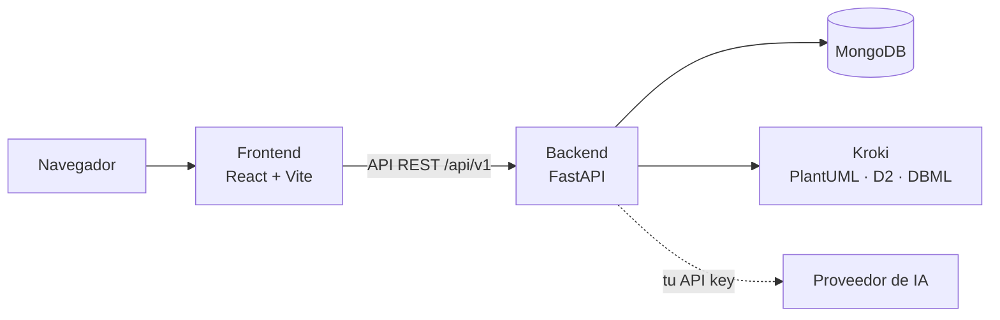

# Bienvenido a DiagramaHub

**DiagramaHub** es una plataforma open-source (Apache 2.0) para crear, organizar y exportar
diagramas escritos como texto: **Mermaid**, **PlantUML**, **D2** y **DBML**, más un
**pizarrón a mano alzada** para bocetar. Incluye un asistente de IA con modelo **BYOL**
(*Bring Your Own LLM*): tú pones la API key de tu proveedor y DiagramaHub la usa para
generar, mejorar, corregir y explicar diagramas por chat.

Se instala en tu propia infraestructura con Docker Compose.

!!! warning "Software en beta (v0.x)"
    Las APIs y las estructuras de datos pueden cambiar entre versiones. Revisa las
    [notas de versión](release-notes/index.md) antes de actualizar.

## ¿Por dónde empiezo?

<div class="grid cards" markdown>

-   :material-pencil-ruler: **Quiero usar DiagramaHub**

    ---

    Crea tu primer proyecto, aprende el editor y los cuatro lenguajes de diagrama.

    [:octicons-arrow-right-24: Guía de uso](guia/index.md)

-   :material-server: **Quiero instalarlo en mi servidor**

    ---

    Instalación, variables de entorno, producción, integraciones y respaldos.

    [:octicons-arrow-right-24: Self-host](self-host/index.md)

-   :material-code-braces: **Quiero desarrollar o contribuir**

    ---

    Arquitectura, módulos del backend, frontend, API, pruebas y cómo extenderlo.

    [:octicons-arrow-right-24: Desarrollo](desarrollo/index.md)

-   :material-shield-lock: **Quiero revisar la seguridad**

    ---

    Autenticación, MFA, protecciones, registro de auditoría y cómo reportar fallas.

    [:octicons-arrow-right-24: Seguridad](seguridad/index.md)

</div>

## Funcionalidades

### Diagramas como código

- **Cuatro lenguajes**: Mermaid (renderizado en el navegador), PlantUML, D2 y DBML (renderizados
  en el servidor con [Kroki](https://kroki.io/), dentro de tu propia instalación).
- **Editor Monaco** con resaltado de sintaxis y vista previa en tiempo real.
- **Estilo por diagrama**: temas, motores de layout, estilo clásico o a mano y tipos de curva en
  Mermaid; temas y `skinparam` en PlantUML; temas en D2; color y patrón de fondo en todos.
- **Conversión entre lenguajes** con IA, con vista previa lado a lado.
- **Modo presentación** a pantalla completa.

### Pizarrón a mano alzada

- Lienzo tipo pizarrón con formas, flechas, texto y trazo libre, dibujados con estilo a mano.
- Bloqueo de elementos, deshacer/rehacer y exportación a PNG.
- **Boceto → Mermaid**: convierte un boceto en un diagrama Mermaid editable.

### Organización

- **Proyectos y carpetas** con un explorador de archivos: renombrar, duplicar, mover entre
  carpetas y entre proyectos.
- **Exportar** un diagrama a PNG, SVG, PDF o Markdown.
- **Exportar un proyecto o una carpeta** como ZIP o como Markdown pensado como contexto para IA.
- **Importar** archivos de diagrama, ZIP y dibujos de Excalidraw.

### Asistente de IA (BYOL)

- Cinco proveedores: **Google Gemini**, **OpenAI**, **Anthropic Claude**, **DeepSeek** y
  **MiniMax**. Tu API key se guarda cifrada y nunca se devuelve completa.
- Chat por diagrama para generar, mejorar, reparar o explicar, con validación del código
  generado y corrección automática opcional.

### Compartir

- Enlaces **públicos** o **protegidos** con código de acceso, con expiración de 5, 10 o 30 días
  o sin expiración, y la opción de mostrar u ocultar el código fuente.

### Cuentas, seguridad y administración

- Registro con contraseña robusta, **MFA** (app TOTP y códigos por email, con códigos de
  recuperación) e inicio de sesión con **Google**.
- **Planes y límites** definidos por el operador, con pagos opcionales vía **Stripe**.
- **Panel de administración**: usuarios, planes e integraciones (email, pagos, OAuth).
- **Registro de auditoría** de eventos de seguridad.
- Interfaz en **español e inglés**, con modo claro y oscuro.

## Cómo está construido



Cuatro servicios en Docker Compose: frontend, backend, Kroki y MongoDB (este último puede ser
externo). Los detalles están en [Arquitectura](desarrollo/arquitectura.md).

## Enlaces

- [Repositorio en GitHub](https://github.com/diagramahub/diagramahub)
- [Notas de versión](release-notes/index.md) ·
  [CHANGELOG](https://github.com/diagramahub/diagramahub/blob/main/CHANGELOG.md)
- [Preguntas frecuentes](faq.md)
- Licencia [Apache 2.0](https://github.com/diagramahub/diagramahub/blob/main/LICENSE)

---

*Para servir esta documentación localmente:*

```bash
pip install -r docs/requirements.txt
mkdocs serve
```
