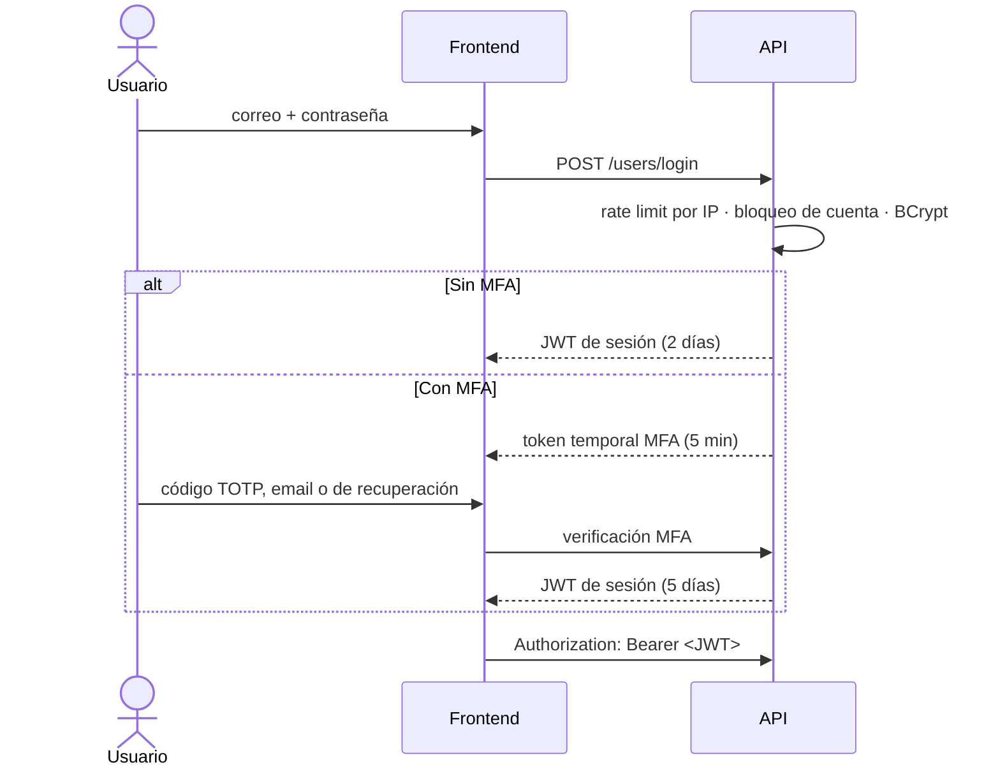

# Autenticación

DiagramaHub autentica con **tokens JWT** firmados por el backend. Los usuarios pueden iniciar sesión con correo y contraseña (con o sin segundo factor) o con **Google OAuth**.

## Flujo de inicio de sesión

## Sesiones (JWT)

| Aspecto | Valor |
|---|---|
| Algoritmo | HS256, firmado con `JWT_SECRET` |
| Sesión sin MFA | 2 días |
| Sesión con MFA | 5 días |
| Sesión vía OAuth | 5 días |
| Token temporal de verificación MFA | 5 minutos, solo sirve para completar el segundo factor y es de un solo uso: tras un inicio de sesión exitoso deja de aceptarse |
| Almacenamiento en el navegador | `localStorage`; el frontend cierra la sesión automáticamente ante un `401` |

### Invalidación al cambiar la contraseña

Cada token incluye el claim `pca` (*password changed at*). Cuando el usuario cambia o restablece su contraseña, el backend registra la nueva marca de tiempo y **rechaza cualquier token emitido antes de ese momento** con `401 Session invalidated`. Así, cambiar la contraseña cierra todas las sesiones abiertas en otros dispositivos.

!!! tip "Rotar `JWT_SECRET`"
    Cambiar `JWT_SECRET` invalida todas las sesiones de la instancia a la vez. Úsalo si sospechas que el secreto se filtró.

## Política de contraseñas

Se valida en el servidor al registrarse, cambiar y restablecer la contraseña:

- Entre **12 y 128** caracteres.
- Al menos una **mayúscula**, una **minúscula**, un **dígito** y un **carácter especial** (`!@#$%^&*()_+-=[]{}|;:',.<>?/~`).
- No puede ser igual al correo del usuario.

Las contraseñas se guardan con **BCrypt** (sal aleatoria por contraseña); nunca en texto plano.

## Protección contra fuerza bruta

| Control | Límite |
|---|---|
| Intentos de login | 10 por IP por minuto (respuesta `429` con `Retry-After`) |
| Bloqueo de cuenta | Tras **5 fallos consecutivos** la cuenta queda bloqueada **15 minutos** |
| Registro | 20 cuentas por IP por hora |
| Solicitudes de restablecimiento de contraseña | 10 por IP por hora |
| Verificación MFA | 10 intentos por IP cada 5 minutos |
| Códigos MFA por inicio de sesión | **5 intentos** (TOTP, email o recuperación) por token temporal, también con peticiones simultáneas; después hay que volver a iniciar sesión |
| Callback de OAuth | 10 por IP por minuto |

Un inicio de sesión exitoso reinicia el contador de fallos. Los fallos y bloqueos quedan en el [registro de auditoría](auditoria.md).

!!! note "Contadores en memoria"
    Los contadores viven en la memoria del proceso del backend y se reinician al reiniciarlo. Con varios procesos o réplicas, cada uno lleva sus propios contadores.

## Autenticación multifactor (MFA)

Cada usuario puede activar uno o ambos métodos desde su perfil (ver [Tu cuenta y seguridad](../guia/cuenta.md)):

| Método | Cómo funciona |
|---|---|
| **TOTP** | App autenticadora (Google Authenticator, Authy, 1Password…). El secreto se guarda cifrado con Fernet. |
| **Código por email** | Código numérico de un solo uso enviado por correo; vence a los **10 minutos**. Permite hasta 3 reenvíos, con 60 segundos de espera entre ellos. Requiere un proveedor de email configurado por el administrador. |

- Con ambos métodos activos, el usuario elige cuál es el **predeterminado** y puede usar el otro al iniciar sesión.
- Al activar MFA se generan **8 códigos de recuperación** de un solo uso (10 caracteres). Se muestran una sola vez y se guardan hasheados. Al usar el último, la app avisa para generar nuevos.
- Desactivar un método requiere confirmar la contraseña.
- Un administrador puede **restablecer el MFA** de un usuario que perdió acceso a sus factores; la acción queda auditada como `admin_mfa_reset`.

## Inicio de sesión con Google (OAuth 2.0 / OpenID Connect)

El administrador activa Google como proveedor desde **Integraciones** (ver [Integraciones](../self-host/integraciones.md)). El flujo aplica estos controles:

- **Protección CSRF**: cada intento genera un `state` aleatorio guardado en el servidor, válido **10 minutos** y de un solo uso.
- **Validación del ID token**: firma, emisor (`issuer`), audiencia (`client_id`) y expiración.
- **Solo correos verificados**: si Google no marca el correo como verificado, el acceso se rechaza y se audita.
- **Vinculación automática por correo**: si ya existe una cuenta con ese correo, se vincula a Google (evento `oauth_account_linked`); si no existe, se crea con el plan gratuito.
- La sesión OAuth dura 5 días y **no pide el segundo factor de DiagramaHub**: la verificación queda a cargo de Google.

## Roles

| Rol | Permisos |
|---|---|
| `user` | Rol por defecto. Gestiona sus propios proyectos, diagramas, proveedores de IA y enlaces. |
| `admin` | Además, gestiona usuarios, planes e integraciones (email, pagos, OAuth). |

La **primera cuenta** que se registra en una instalación nueva se crea como `admin` (asistente de instalación). Los permisos se verifican en el servidor en cada endpoint de administración.
