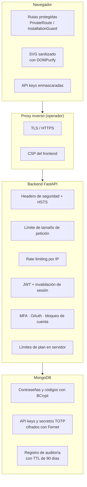

# Seguridad

DiagramaHub trata la seguridad como un requisito de diseño: cada capa del stack, desde la base de datos hasta el navegador, tiene controles propios que se superponen. Esta sección describe qué protege el software, cómo lo hace y qué parte queda en manos de quien lo opera.

!!! warning "Software en beta"
    DiagramaHub está en beta (v0.x). Las APIs y estructuras de datos pueden cambiar entre versiones. Úsalo en producción bajo tu propio criterio y mantén tu instancia actualizada.

## Modelo de seguridad por capas

| Capa | Qué la protege | Más detalle |
|---|---|---|
| Identidad | JWT, política de contraseñas, bloqueo de cuenta, MFA (TOTP + email), OAuth con Google | [Autenticación](autenticacion.md) |
| API y datos | Headers de seguridad, cifrado de secretos, rate limiting, límites de plan, aislamiento por proyecto, sanitización de errores | [Protecciones](protecciones.md) |
| Trazabilidad | Registro inmutable de eventos de seguridad con retención de 90 días | [Registro de auditoría](auditoria.md) |

## Responsabilidad compartida

El software trae los controles de aplicación. Quien opera una instancia self-host es responsable del resto:

- [x] Servir el frontend y la API **solo por HTTPS**, detrás de un proxy inverso.
- [x] Definir `APP_ENV=production` (desactiva Swagger, oculta trazas y activa HSTS y CSP en la API).
- [x] Generar un `JWT_SECRET` largo y aleatorio, y un `AI_ENCRYPTION_KEY` válido de Fernet; guardarlos fuera del repositorio.
- [x] Restringir `BACKEND_CORS_ORIGINS` al dominio real del frontend.
- [x] No exponer MongoDB a Internet y respaldarlo con regularidad.
- [x] Mantener DiagramaHub y sus imágenes Docker actualizados.

Los pasos concretos están en [Producción](../self-host/produccion.md) y [Configuración](../self-host/configuracion.md).

## Análisis continuo de dependencias

El proyecto participa en el programa **Secure Developer Program for Open Source** de [Snyk](https://snyk.io/), que analiza de forma continua las dependencias de npm y Python, el código (SAST) y las imágenes de contenedor.

## Reportar una vulnerabilidad

!!! danger "No abras un issue público"
    Si encuentras una vulnerabilidad, repórtala **en privado** mediante [GitHub Security Advisories](https://github.com/diagramahub/diagramahub/security/advisories/new). Un issue público expone a todas las instalaciones antes de que exista una corrección.

Incluye en el reporte:

1. La versión de DiagramaHub afectada (visible en **Acerca de** o en `GET /` de la API).
2. Los pasos para reproducir el problema y el impacto que observaste.
3. Si lo sabes, el componente afectado (frontend, backend, despliegue).

El equipo revisa todos los reportes y responde lo antes posible. Las correcciones de seguridad se publican en las [notas de versión](../release-notes/index.md).
