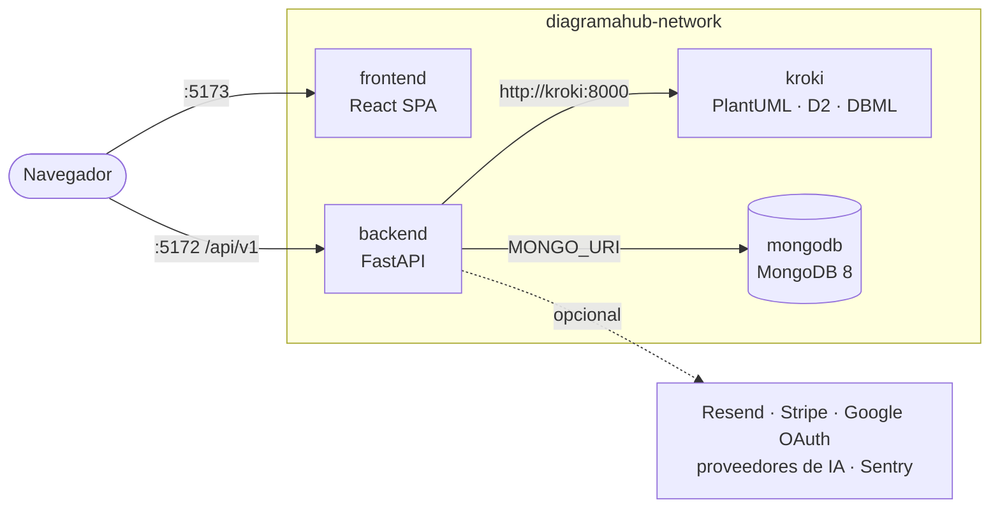

# Self-host

DiagramaHub es open source (Apache 2.0) y se instala en tu propia infraestructura con
Docker Compose. Esta sección es para quien **opera** una instancia: instalarla, configurarla,
exponerla a internet, conectar servicios externos y mantenerla al día.

!!! warning "Software en beta"
    DiagramaHub está en versión `0.x`. Las APIs y estructuras de datos pueden cambiar entre
    versiones: lee las [notas de versión](../release-notes/index.md) antes de actualizar y
    respalda la base de datos.

## Requisitos

| Requisito | Detalle |
|---|---|
| Docker + Docker Compose | Todo corre en contenedores; no necesitas Python ni Node en el host. |
| Git | Para clonar el repositorio y actualizar. |
| MongoDB 8 | Incluido como contenedor en el modo `local-full`, o externo (Atlas, servidor propio) en el modo `external-mongodb`. |
| Puertos libres | `5173` (frontend), `5172` (API) y `27017` (MongoDB, solo modo `local-full`). |
| Sistema operativo | El instalador `install.sh` detecta macOS, Ubuntu/Debian, CentOS/RHEL y Fedora. |

## Servicios

Una instalación tiene cuatro servicios en la red Docker `diagramahub-network`. Kroki no
publica ningún puerto: solo el backend habla con él.

| Servicio | Contenedor | Puerto | Función |
|---|---|---|---|
| Frontend | `diagramahub-frontend` | 5173 | Interfaz web. Mermaid se renderiza en el navegador. |
| Backend | `diagramahub-backend` | 5172 | API REST, lógica de negocio, proxy hacia Kroki. |
| Kroki | `diagramahub-kroki` | interno | Render en servidor de PlantUML, D2 y DBML. Tu contenido no sale de tu red. |
| MongoDB | `diagramahub-mongodb` | 27017 | Base de datos (solo en modo `local-full`). |

## En esta sección

-   :material-download: **[Instalación](../instalacion.md)**

    ---

    Instalador de una línea (`install.sh`) o instalación manual paso a paso.

-   :material-cog: **[Configuración](configuracion.md)**

    ---

    Referencia completa de variables de entorno del backend y del frontend.

-   :material-server-network: **[Producción](produccion.md)**

    ---

    Modos de despliegue, reverse proxy, HTTPS, CORS y checklist de endurecimiento.

-   :material-puzzle: **[Integraciones](integraciones.md)**

    ---

    Email (Resend), pagos (Stripe) e inicio de sesión con Google desde el panel de admin.

-   :material-card-account-details: **[Planes y límites](planes.md)**

    ---

    Define tus propios planes, límites de proyectos/diagramas y precios.

-   :material-backup-restore: **[Mantenimiento](mantenimiento.md)**

    ---

    Actualizar de versión, respaldos de MongoDB, scripts de reparación, logs y Sentry.

-   :material-lifebuoy: **[Solución de problemas](problemas.md)**

    ---

    Errores comunes y cómo diagnosticarlos.

## Ruta rápida

1. [Instala](../instalacion.md) con `install.sh` o manualmente.
2. Genera y configura `AI_ENCRYPTION_KEY` (ver [Configuración](configuracion.md#seguridad)):
   sin ella no se pueden guardar proveedores de IA, integraciones ni MFA por app.
3. Abre `http://localhost:5173`: el asistente `/setup` crea la cuenta de **administrador**
   (el primer usuario registrado siempre es admin).
4. Conecta un motor de email en **Integraciones** para habilitar recuperación de contraseña
   y códigos MFA por correo.
5. Antes de exponerla a internet, sigue la guía de [Producción](produccion.md).
