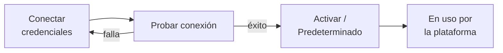

# Integraciones

Los servicios externos se conectan desde la interfaz, sin tocar archivos: inicia sesión
como administrador y abre **Integraciones** en la barra lateral (ruta `/integrations`).
Hay tres categorías:

| Categoría | Proveedor disponible | Para qué sirve |
|---|---|---|
| Email | Resend | Recuperación de contraseña, códigos MFA por correo y notificaciones. |
| Pasarela de pagos | Stripe | Cobro de planes de pago con suscripción mensual. |
| OAuth / Login social | Google | Botón "Continuar con Google" en el inicio de sesión. |

## Cómo funciona



- Las credenciales se guardan **cifradas** con `AI_ENCRYPTION_KEY`
  (ver [Configuración](configuracion.md#seguridad)). Al editarlas, la interfaz muestra los
  secretos enmascarados; deja un campo vacío para conservar el valor actual.
- Una integración solo se puede activar después de pasar la **prueba de conexión**. Si la
  prueba falla, la API responde `400` al intentar activarla.
- Solo hay **un proveedor activo por tipo**: un motor de email predeterminado, una pasarela
  de pagos activa y un proveedor OAuth activo por proveedor (Google).
- Todos los campos marcados como obligatorios se validan al guardar (`422` si falta alguno).

## Email (Resend)

| Campo | Ejemplo |
|---|---|
| Clave API | `re_...` |
| Email remitente | `noreply@tudominio.com` (de un dominio verificado en Resend) |

La prueba de conexión envía un correo real desde el remitente configurado a la dirección
de prueba de Resend (`delivered@resend.dev`), así que funciona aunque la clave solo tenga
permiso de envío.

!!! warning "Sin motor de email no hay correos"
    Mientras no haya un motor de email **predeterminado**, la recuperación de contraseña y
    los códigos MFA por correo no funcionan. La página de Integraciones muestra un aviso.

## Pagos (Stripe)

| Campo | Ejemplo |
|---|---|
| Clave secreta | `sk_test_...` / `sk_live_...` |
| Clave pública | `pk_test_...` / `pk_live_...` |
| Webhook secret | `whsec_...` |

La prueba de conexión valida la clave secreta contra la API de Stripe. Si no hay una
pasarela activa en el panel, el backend usa como alternativa las variables
`STRIPE_SECRET_KEY`, `STRIPE_WEBHOOK_SECRET` y `STRIPE_PUBLISHABLE_KEY`.

### Webhook

Stripe notifica los cambios de suscripción a este endpoint:

```text
POST https://<tu-api>/api/v1/webhooks/stripe
```

En el dashboard de Stripe (**Developers → Webhooks → Add endpoint**) suscribe estos
eventos, que son los que procesa el backend:

- `checkout.session.completed`
- `customer.subscription.updated`
- `customer.subscription.deleted`
- `invoice.payment_failed`

Cada petición se valida con el secreto de firma del webhook (`whsec_...`) configurado en la
integración de Stripe; una firma inválida se rechaza. Cada evento se aplica **una sola vez**: si
Stripe vuelve a entregar un evento ya procesado, se responde como duplicado sin reaplicarlo, y si
el procesamiento falla se responde con error para que Stripe lo reintente.

=== "Desarrollo local (Stripe CLI)"

    ```bash
    stripe login
    stripe listen --forward-to localhost:5172/api/v1/webhooks/stripe
    ```

    El CLI imprime un secreto `whsec_...` temporal: úsalo como *webhook secret*.

=== "Producción"

    Registra el endpoint público con HTTPS en el dashboard de Stripe y copia su
    *signing secret*.

Al pagar, Stripe redirige al usuario a `FRONTEND_URL`; configúrala con tu dominio público.
En modo de prueba usa la tarjeta `4242 4242 4242 4242` con cualquier fecha futura y CVC.

Con Stripe conectado ya puedes crear planes de pago: ver [Planes y límites](planes.md).

## Inicio de sesión con Google (OAuth)

1. En Google Cloud Console crea un **OAuth client ID** de tipo *Web application*.
2. Agrega como **Authorized redirect URI** la ruta `/oauth/callback` de tu frontend:
   `https://diagramas.ejemplo.com/oauth/callback`.
3. En DiagramaHub, conecta Google con:

| Campo | Valor |
|---|---|
| Client ID | El de Google Cloud |
| Client Secret | El de Google Cloud |
| URI de redirección | Exactamente la misma URI registrada en Google |

4. Prueba la conexión y actívala. El botón de Google aparece en el login.

!!! note "Qué valida la prueba"
    La prueba de Google confirma que el servidor alcanza el *discovery document* de Google;
    no valida el Client ID ni el secreto. Haz un inicio de sesión real para confirmarlos.

Comportamiento del login con Google:

- Si ya existe una cuenta con el mismo email, se vincula automáticamente.
- Las cuentas nuevas reciben el plan gratuito, igual que un registro normal.
- La sesión dura 5 días y no pide MFA (Google ya autenticó al usuario).

## Estado de las integraciones

El endpoint de administración `GET /api/v1/admin/integrations/status` resume qué motor de email y
qué pasarela de pagos están activos.
