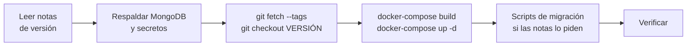

# Mantenimiento y actualización

## Actualizar de versión

DiagramaHub sigue [SemVer](https://semver.org/) y publica cada versión como un tag de git
sin prefijo `v` (por ejemplo `0.8.3`). Mientras el proyecto esté en `0.x`, una versión menor
puede traer cambios incompatibles: lee siempre las [notas de versión](../release-notes/index.md)
de cada versión que saltes.



```bash
cd ~/diagramahub          # o donde esté tu instalación

# 1. Respaldo (ver abajo)

# 2. Traer la versión
git fetch --tags
git checkout 0.8.3        # el tag de la versión a instalar
# (o `git pull` si sigues la rama main)

# 3. Reconstruir y levantar
docker-compose build
docker-compose up -d

# 4. Verificar
bash verify-installation.sh
curl http://localhost:5172/   # muestra la versión en ejecución
```

Los datos del volumen `mongodb_data` (modo `local-full`) se conservan al reconstruir, a
menos que borres el volumen explícitamente (`docker-compose down -v`).

!!! tip "Revisa los archivos de ejemplo"
    Compara tu `backend/.env` con `backend/.env.example` después de actualizar: las versiones
    nuevas pueden agregar variables. La referencia completa está en
    [Configuración](configuracion.md).

## Respaldos

Un respaldo completo tiene **dos partes**: la base de datos y los secretos de `backend/.env`.

| Qué | Por qué |
|---|---|
| Base de datos MongoDB | Usuarios, proyectos, diagramas, planes, integraciones, historial. |
| `AI_ENCRYPTION_KEY` | Sin ella, las API keys de IA, las integraciones y los secretos MFA del respaldo no se pueden descifrar. |
| `JWT_SECRET` | Si cambia, todas las sesiones se cierran (no se pierden datos). |

### Respaldar

=== "local-full (contenedor MongoDB)"

    ```bash
    docker exec diagramahub-mongodb \
      mongodump --db diagramahub --archive --gzip \
      > diagramahub-$(date +%F).archive.gz
    ```

=== "external-mongodb"

    ```bash
    mongodump --uri "<tu MONGO_URI>" --db diagramahub --archive --gzip \
      > diagramahub-$(date +%F).archive.gz
    ```

    Si usas un servicio administrado (como MongoDB Atlas), también puedes usar sus
    respaldos automáticos.

### Restaurar

```bash
docker-compose stop backend

docker exec -i diagramahub-mongodb \
  mongorestore --archive --gzip --drop < diagramahub-2026-10-19.archive.gz

docker-compose start backend
```

`--drop` reemplaza las colecciones existentes por las del respaldo. Restaura con el mismo
`AI_ENCRYPTION_KEY` que tenía la instancia cuando se hizo el respaldo.

!!! note "Datos que caducan solos"
    El registro de auditoría (`audit_log`) borra sus entradas a los 90 días con un índice TTL
    de MongoDB. Si necesitas conservarlas más tiempo, respáldalas antes.

## Scripts de mantenimiento

El backend incluye scripts en `backend/scripts/`. Ejecútalos dentro del contenedor:

```bash
docker exec -it diagramahub-backend python -m scripts.<nombre> [opciones]
```

| Script | Para qué | Opciones |
|---|---|---|
| `create_free_plan` | Crea el plan gratuito (`FREE`) si no existe. Idempotente. | — |
| `migrate_users_to_subscriptions` | Asigna el plan `FREE` a los usuarios que no tienen suscripción. Idempotente. | `--dry-run`, `--verbose` |
| `fix_misfiled_diagrams` | Antes de 0.8.1 un diagrama podía quedar asignado a una carpeta de otro proyecto. Los devuelve a la raíz de su proyecto. No borra nada. | Sin opciones: solo reporta. `--apply`: corrige. |
| `fix_webhook_index` | Elimina un índice antiguo de `webhook_events` que choca con el índice único actual. Reinicia el backend después. | — |

Ejemplo:

```bash
# Ver qué diagramas están mal archivados, sin cambiar nada
docker exec -it diagramahub-backend python -m scripts.fix_misfiled_diagrams
# Corregirlos
docker exec -it diagramahub-backend python -m scripts.fix_misfiled_diagrams --apply
```

## Logs

```bash
docker-compose logs -f              # todos los servicios
docker-compose logs -f backend      # solo la API
docker-compose logs -f frontend
docker-compose logs -f kroki        # errores de render de PlantUML / D2 / DBML
docker-compose logs -f mongodb      # solo en local-full
```

En producción el backend escribe a la salida estándar el log de acceso y el de errores de
gunicorn. Las excepciones no controladas se registran con su traza completa, aunque la API
responda solo `Internal server error`.

## Monitoreo con Sentry

Sentry es opcional y se activa por separado en el backend y en el frontend:

| Lado | Variables | Notas |
|---|---|---|
| Backend | `SENTRY_DSN`, `SENTRY_TRACES_SAMPLE_RATE`, `SENTRY_ENABLE_LOGS` | Reporta el entorno (`APP_ENV`) y la versión como *release*. |
| Frontend | `VITE_SENTRY_DSN`, `VITE_APP_ENV` | Muestreo de trazas del 10 %. |

Antes de enviar un evento, el backend enmascara las cabeceras `Authorization` y `Cookie` y
los parámetros `api_key`, `password`, `token`, `secret` y `jwt` del cuerpo y de la query
string. Si la sanitización falla, el evento se descarta en lugar de enviarse sin limpiar.

## Desinstalar

```bash
# Detener y borrar contenedores, red y volúmenes (¡borra la base de datos local!)
docker-compose down -v

# Borrar las imágenes
docker images | grep diagramahub
docker rmi <id-de-imagen>
```
