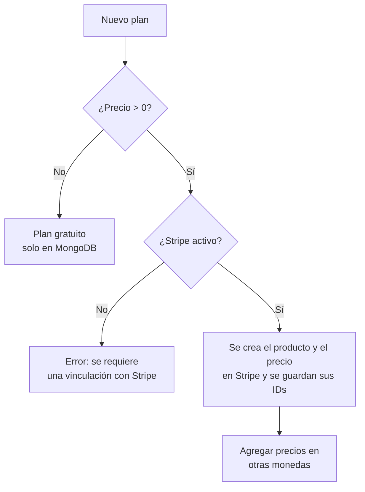
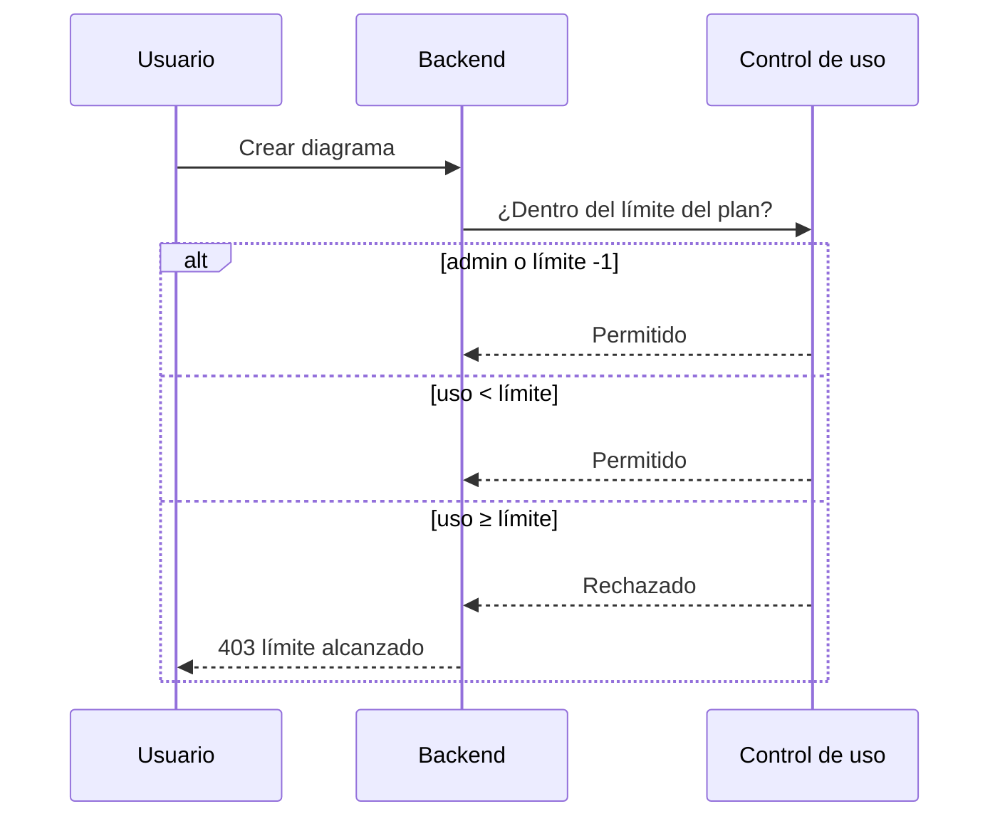

# Planes y límites

En DiagramaHub los planes son **datos**, no código: cada operador decide qué planes ofrece,
cuántos proyectos y diagramas permite cada uno y cuánto cobra (o si no cobra nada). No hay
funciones exclusivas de un plan: todos los planes dan acceso a todas las funciones y solo
cambian los límites.

## El modelo `Plan`

Los planes viven en la colección `plans` de MongoDB.

| Campo | Tipo | Descripción |
|---|---|---|
| `name` | texto (1–50) | Nombre visible. Único. |
| `code` | texto (1–30) | Código único en mayúsculas, dígitos, `_` o `-` (p. ej. `TEAM`). `FREE` está reservado. |
| `description` | texto (≤500) | Descripción opcional. |
| `max_projects` | entero | Máximo de proyectos. `-1` o vacío = ilimitado. |
| `max_diagrams` | entero | Máximo de diagramas. `-1` o vacío = ilimitado. |
| `prices` | diccionario | Precio mensual por moneda, p. ej. `{"usd": 4, "mxn": 70}`. Vacío = gratis. |
| `is_active` | booleano | Un plan inactivo deja de ofrecerse, pero sus suscriptores lo conservan. |
| `gateway_config` | objeto | IDs de producto y precio en Stripe; se llena solo al sincronizar. |

Monedas admitidas: `usd`, `eur`, `gbp`, `mxn` y `brl`.

## El plan gratuito (`FREE`)

- Se crea automáticamente con el **primer registro de un usuario no administrador**, con
  nombre `Gratuito`, 1 proyecto y 10 diagramas.
- Todo usuario nuevo recibe una suscripción a `FREE`, también al registrarse con Google.
- No se puede eliminar, desactivar ni cambiar su código. Sí puedes editar su nombre,
  descripción y límites.

Si la base de datos viene de una versión sin planes, crea el plan y asigna `FREE` a los
usuarios existentes con los scripts del backend (ambos son idempotentes):

```bash
docker exec -it diagramahub-backend python -m scripts.create_free_plan
docker exec -it diagramahub-backend python -m scripts.migrate_users_to_subscriptions --dry-run
docker exec -it diagramahub-backend python -m scripts.migrate_users_to_subscriptions
```

## Administradores

Los administradores no tienen límites: el control de uso los deja crear proyectos y
diagramas sin restricción y no reciben una suscripción.

## Crear y editar planes

Abre **Administración → Planes** (ruta `/admin/plans`).



Reglas que aplica el servidor:

- Un plan de pago necesita una pasarela Stripe activa ([Integraciones](integraciones.md#pagos-stripe)).
  Al crearlo, DiagramaHub crea el producto y el precio en Stripe.
- El precio en USD es el principal. Las demás monedas se agregan después, una vez que el
  plan está sincronizado con Stripe.
- **No se puede cambiar el precio de un plan con suscriptores activos.** Crea un plan nuevo
  y desactiva el anterior.
- Cambiar nombre, descripción o precio de un plan de pago lo vuelve a sincronizar con Stripe.
- Al eliminar un plan **con** suscriptores, solo se desactiva (y se archiva en Stripe); los
  suscriptores lo conservan. **Sin** suscriptores, se archiva en Stripe y se borra.

## Cómo se aplican los límites

Los límites se comprueban **en el servidor** antes de crear un proyecto o un diagrama,
incluidos los que llegan por importación. Al alcanzar el límite, la API responde `403` y la
interfaz ofrece cambiar de plan. El cliente nunca decide si algo está permitido.



Cada usuario consulta su uso en `GET /api/v1/subscriptions/usage`.

## Instancia sin cobros

Si no conectas Stripe, todos los usuarios usan planes gratuitos. Para una instancia interna
sin límites, edita `FREE` y pon `-1` en proyectos y diagramas.
