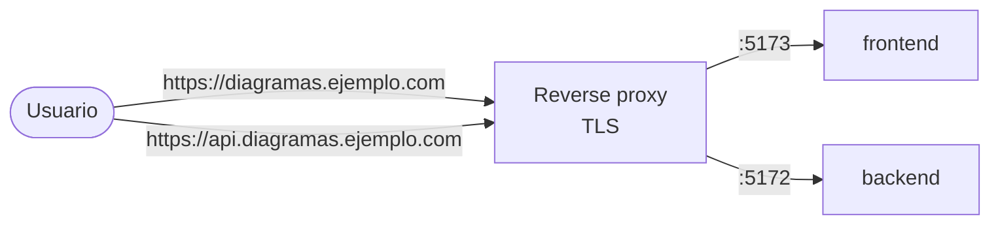

# Producción

Esta página cubre lo que cambia cuando una instancia deja de ser local y se expone a
internet. Primero instala siguiendo la [guía de instalación](../instalacion.md).

## Modos de despliegue

El `docker-compose.yml` de la raíz es un enlace simbólico a uno de los dos modos de
`deploy/`. El instalador lo crea según elijas MongoDB local o externo.

| | `local-full` | `external-mongodb` |
|---|---|---|
| Pensado para | Desarrollo, pruebas, instalaciones pequeñas | Producción |
| MongoDB | Contenedor `mongo:8` con volumen `mongodb_data`, puerto `27017` publicado | Externo, vía `MONGO_URI` (Atlas, servidor propio) |
| Kroki | Contenedor interno | Contenedor interno |
| Backend | `APP_ENV=development`: uvicorn con recarga en caliente, Swagger en `/docs` | `APP_ENV=production` (por defecto de la imagen): gunicorn con `WORKERS` procesos, sin Swagger |
| Frontend | *Target* `development`: servidor de Vite con HMR y código montado | *Target* `production`: build estático servido por Nginx sin root |
| `VITE_API_URL` | Fijo: `http://localhost:5172` | Desde el entorno o un `.env` junto al compose |

```bash
# Elegir modo manualmente
ln -sf deploy/external-mongodb/docker-compose.yml docker-compose.yml
docker-compose up -d --build
```

!!! warning "No publiques `local-full` tal cual"
    `local-full` expone MongoDB en el puerto `27017` sin autenticación y corre el backend
    en modo desarrollo (Swagger abierto, trazas de error visibles). Úsalo detrás de un
    firewall o cambia a `external-mongodb`.

## Imagen de producción del frontend

El `Dockerfile` del frontend es multi-etapa. El *target* `production`:

- Construye el bundle con Vite y lo sirve con `nginxinc/nginx-unprivileged` como usuario
  `nginx` (sin root), escuchando en el puerto `5173`.
- Genera `/config.js` al arrancar el contenedor a partir de `VITE_API_URL`,
  `VITE_SENTRY_DSN` y `VITE_APP_ENV`, así que cambiar la URL de la API solo requiere
  recrear el contenedor.
- Envía `X-Content-Type-Options`, `X-Frame-Options: DENY`, `Referrer-Policy` y
  `Permissions-Policy` (`frontend/headers.conf`). HSTS no se envía aquí: va en el proxy que
  termina TLS.
- Nunca guarda en caché `index.html` ni `config.js`; los assets con hash se cachean un año.
- Incluye un *healthcheck* sobre `http://127.0.0.1:5173/`.

```bash
docker build --target production -t diagramahub-frontend ./frontend
```

## Reverse proxy y HTTPS

Pon un reverse proxy (Nginx, Traefik, Caddy) delante para terminar TLS y servir en los
puertos 80/443. El enfoque recomendado usa un subdominio para la API:



```nginx
# Frontend
server {
    listen 80;
    server_name diagramas.ejemplo.com;

    location / {
        proxy_pass http://localhost:5173;
        proxy_set_header Host $host;
        proxy_set_header X-Real-IP $remote_addr;
        proxy_set_header X-Forwarded-For $proxy_add_x_forwarded_for;
        proxy_set_header X-Forwarded-Proto $scheme;
    }
}

# Backend API
server {
    listen 80;
    server_name api.diagramas.ejemplo.com;

    # Las importaciones de proyecto aceptan hasta 20 MB (MAX_IMPORT_UPLOAD_BYTES).
    # Nginx limita el cuerpo a 1 MB por defecto.
    client_max_body_size 20m;

    location / {
        proxy_pass http://localhost:5172;
        proxy_set_header Host $host;
        proxy_set_header X-Real-IP $remote_addr;
        proxy_set_header X-Forwarded-For $proxy_add_x_forwarded_for;
        proxy_set_header X-Forwarded-Proto $scheme;
    }
}
```

Certificados gratuitos con Let's Encrypt:

```bash
sudo apt install certbot python3-certbot-nginx
sudo certbot --nginx -d diagramas.ejemplo.com -d api.diagramas.ejemplo.com
```

### IP real del cliente detrás del proxy

Los límites de peticiones (login, registro, MFA, enlaces compartidos, render), el bloqueo de
cuentas y el registro de auditoría usan la IP del cliente. Detrás de un proxy, el backend solo
ve la IP del proxy, salvo que confíe en sus encabezados `X-Forwarded-For`. Si no lo hace,
**todos los usuarios comparten el mismo contador** y unos pocos intentos fallidos bloquean el
login de toda la instancia.

Indica en `FORWARDED_ALLOW_IPS` (en `backend/.env`) la dirección desde la que el proxy se
conecta al backend. Solo esas conexiones pueden fijar la IP del cliente; cualquier otra
conserva la suya, así que un cliente no puede falsificarla enviando el encabezado.

=== "Proxy en el host (ejemplo de arriba)"

    El proxy llega al contenedor a través del puerto publicado, así que el backend ve la
    puerta de enlace de la red de Docker:

    ```bash
    docker network inspect $(docker network ls -q --filter name=diagramahub-network) \
      --format '{{(index .IPAM.Config 0).Gateway}}'
    ```

    ```bash
    # backend/.env
    FORWARDED_ALLOW_IPS=172.18.0.1   # la IP que devolvió el comando anterior
    ```

=== "Proxy en otro contenedor"

    Usa la IP del contenedor del proxy o la subred de la red de Docker que comparte con el
    backend:

    ```bash
    # backend/.env
    FORWARDED_ALLOW_IPS=172.18.0.0/16
    ```

Reinicia el backend (`docker compose up -d backend`) y verifica que el campo `ip_address` de
la colección `audit_log` muestre las IPs de los clientes y no la del proxy.

!!! danger "No uses `*`"
    `FORWARDED_ALLOW_IPS=*` acepta el encabezado de cualquiera: solo es seguro si el puerto
    del backend es accesible únicamente desde el proxy (firewall). Si no, cualquiera puede
    cambiar su IP y evadir los límites.

### Límites de peticiones y workers

Los contadores de los límites de peticiones y del bloqueo de cuentas viven en la memoria de
cada proceso. En producción, gunicorn arranca `WORKERS` procesos (por defecto `2`) y cada uno
lleva sus propios contadores, así que el límite efectivo por IP puede ser hasta `WORKERS`
veces el configurado (con 2 workers, hasta 20 intentos de login por minuto en lugar de 10).
Ten esto en cuenta antes de subir `WORKERS`.

## Apuntar la instancia a tu dominio

Antes de abrirla al público, ajusta tres valores; si no, el navegador bloquea la API y
Stripe redirige a `localhost`:

| Variable | Dónde | Valor |
|---|---|---|
| `FRONTEND_URL` | `backend/.env` | `https://diagramas.ejemplo.com` |
| `BACKEND_CORS_ORIGINS` | `backend/.env` | `https://diagramas.ejemplo.com` (lista separada por comas, sin corchetes). Vacío = solo `FRONTEND_URL`. |
| `VITE_API_URL` | entorno del frontend | `https://api.diagramas.ejemplo.com` |

Detalle de cada una en [Configuración](configuracion.md).

## Qué hace `APP_ENV=production`

| Efecto | Detalle |
|---|---|
| Documentación de la API desactivada | `/docs`, `/redoc` y `/openapi.json` devuelven 404. |
| Trazas ocultas | Una excepción no controlada responde `{"detail": "Internal server error"}`; la traza queda en los logs. |
| HSTS | `Strict-Transport-Security: max-age=63072000; includeSubDomains; preload`. |
| CSP de la API | `default-src 'none'; frame-ancestors 'none'` (las respuestas son JSON). |
| Servidor | gunicorn con workers de uvicorn (`WORKERS`, por defecto 2), timeout de 120 s. |

Para consultar Swagger en una instancia de producción, levanta una copia con
`APP_ENV=development` en un entorno no público.

!!! note "Límites en memoria"
    Los límites de peticiones y el bloqueo de cuentas se guardan en la memoria de cada
    proceso: se reinician al reiniciar el backend y cada worker de gunicorn lleva su propia
    cuenta. Un despliegue con varias réplicas necesitaría un almacén compartido.

## Content-Security-Policy del frontend

La CSP del frontend está desactivada por defecto: una política demasiado estricta rompe el
editor (Mermaid inyecta estilos en línea y Monaco carga *workers* desde jsDelivr).
`frontend/csp.conf.example` trae una política probada como punto de partida:

1. Reemplaza `API_ORIGIN` por el origen real de tu API.
2. Agrega la línea `add_header` a `frontend/headers.conf`.
3. Reconstruye la imagen y verifica en la consola del navegador el editor, el render y las
   exportaciones.

## Checklist de endurecimiento

- [ ] `JWT_SECRET` aleatorio de 32+ caracteres y `AI_ENCRYPTION_KEY` generada con Fernet.
- [ ] Ambos secretos guardados fuera del servidor, junto con los respaldos.
- [ ] `APP_ENV=production` en el backend y frontend con el *target* `production`.
- [ ] HTTPS en el proxy; `FRONTEND_URL`, `BACKEND_CORS_ORIGINS` y `VITE_API_URL` con los
      dominios públicos.
- [ ] MongoDB no expuesto a internet (sin `27017` público), con usuario y contraseña.
- [ ] Los puertos `5172` y `5173` accesibles solo desde el proxy (firewall).
- [ ] Un motor de email activo, para que funcionen la recuperación de contraseña y el MFA
      por correo ([Integraciones](integraciones.md)).
- [ ] La cuenta de administrador con MFA activado.
- [ ] Respaldos automáticos de la base de datos ([Mantenimiento](mantenimiento.md)).
- [ ] (Opcional) CSP del frontend habilitada y validada.
- [ ] (Opcional) Sentry configurado para backend y frontend.

Más contexto sobre los controles de la plataforma en [Seguridad](../seguridad/index.md).
